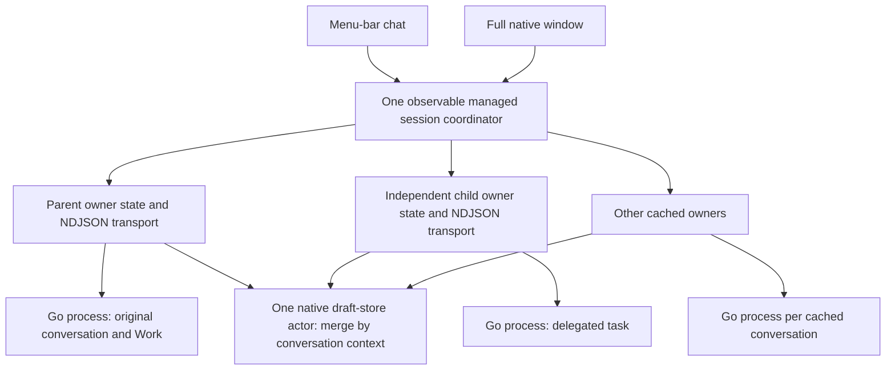

# Tranche 02: managed sessions and conversation during work

Implemented against the current local native frontend and the existing Go/JS session contracts. Changes are confined to `macos/`. No Go, JS host, terminal, README, dependency, signing or distribution changes were needed. No commits were created by this implementation. The separate backend goal remains paused.

## Result and ownership

Both SwiftUI scenes share one observable `ManagedSessionCoordinator`. The existing `GatorApplicationState` now represents one process owner's state. Selection never moves a running task, stream, approval or submission into another state object.



Transitions, dispatches and capacity-changing admissions are serialized. A submission transition waits for admission resolution, rather than releasing capacity on a nonce acknowledgement. Queued submission callbacks also verify their captured owner generation and draft revision. Ordinary native messages never set `queue_only`.

The compatibility limits remain three working tasks and four cached process owners. Dialogue routing itself is not counted as a working task, matching the existing host. A disconnected owner last known to be running conservatively reserves a task slot until recovered. Retirement requires an idle nonselected owner without retained queues, approvals, external steps, pending submissions, operations or unconfirmed host actions. Retiring a cache preserves drafts, durable history and unread result attention.

## Exact file inventory

| File under `macos/` | Change and responsibility |
| --- | --- |
| `Sources/GatorCore/ManagedSessionCoordinator.swift` | New: owner map, serialized transitions/admissions, foreground focus, capacity, host projection/dispatch, unread results, independent recovery and all-owner Quit guard. |
| `Sources/GatorCore/ManagedSessionProtocol.swift` | New: typed host-private session, dispatch, control and outbound frame contracts. |
| `Sources/GatorCore/GatorApplicationState.swift` | Existing per-owner state retained; managed readiness, scoped persistence, authoritative navigation/result waits and turn-specific submission outcomes added. |
| `Sources/GatorCore/GoBridgeConnection.swift` | Opt-in managed launch settings; `focus_session` awaits projected state rather than a nonexistent nonce acknowledgement. Framing and subprocess supervision retained. |
| `Sources/GatorCore/BridgeProtocol.swift` | Typed host command adapter and retained task context suitable for native navigation. |
| `Sources/GatorCore/NativeDraftStore.swift` | Shared actor merges owner-scoped drafts and pending admissions; reads legacy archives and writes managed archive version 2. |
| `Sources/GatorMac/GatorApp.swift` | Both scenes receive the same coordinator. |
| `Sources/GatorMac/AppDelegate.swift` | Quit inspects and closes every owner. |
| `Sources/GatorMac/ConversationView.swift` | Bounded expandable chat/task list, stable ID navigation, contextual original-task/parent actions, background attention and dialogue status. |
| `Sources/GatorMac/ComposerView.swift` | Submissions enter the shared coordinator with the intended owner captured. |
| `Sources/GatorMac/ApprovalReviewView.swift` | Captures the exact owner for decisions and disables controls during a transition. |
| `Tests/GatorCoreTests/ManagedSessionTests.swift` | New: twelve controlled owner/coordinator tests covering the multi-owner boundaries below. |
| `Tests/GatorCoreTests/ManagedGoIntegrationTests.swift` | New: real Go managed dialogue, child bootstrap, exact guide/stop, independent completion and restart. |
| `Tests/GatorCoreTests/Fixtures/managed-provider.mjs` | New: local controlled Chat Completions provider; file-gated work, deterministic Go routing decisions and no connected services. |
| `TRANCHE02-VERIFICATION.md` | This implementation/evidence record. |

The existing, previously untracked `VERIFICATION.md` was preserved as the Tranche 01 record. Package and packaging-script conventions remain unchanged.

## Session and dialogue contract coverage

| Contract | Native handling and evidence |
| --- | --- |
| `GATOR_UI_SESSION_HOST` | Enabled only by the coordinator's owner configuration. The low-level Tranche 01 single-owner configuration remains unmanaged. |
| `GATOR_UI_BOOT_MODE`, `GATOR_UI_START_SOURCE` | New chat mode and Go-validated source used on creation. Reconnect restores the actual conversation with new-chat boot mode cleared. |
| `GATOR_UI_VIEW_ORIGIN` | Transport supports the field, but terminal-page/view and goal navigation are explicitly unsupported in this tranche; the original chat remains selected and receives an explanation. |
| `focus_session` | Waits for exact `foreground` and cleared `session_request`. Go deliberately emits no `action_applied` for focus. Failure restores the prior selection/focus without cancelling its work. |
| `session_request` | Only the current owner's projected request is consumed; monotonic per-owner sequence deduplication and generation checks prevent stale redirection. Recent IDs still go through Go's list identity validation. |
| `dialogue_host` | Projects task capacity, other active work and exact child peers. Go revalidates each peer against durable task origin. Preference changes refresh cached owners through the existing Go command. |
| `dialogue_dispatch: task` | Creates or reuses a background owner. No focus transfer. Sends the exact parent/turn bootstrap and waits for matching child/turn result. |
| `dialogue_bootstrap` | Actual Go integration validates the retained admission, task origin and independent execution. Timeout/failure is reported; there is no automatic retry. |
| `dialogue_dispatch: guide / stop` | Sends the original parent, admission turn, request ID and target run to the existing child. Real Go integration exercises both; stale controls are rejected. |
| `dialogue_dispatch: revise_plan / revise_action` | Typed routing preserves local `owner_task`, original child origin, request ID and exact target control epoch. Matching result flags/errors are returned to the parent. Covered by native controlled tests and existing Go tests; dedicated native editors and a physical correction journey are deferred. |
| `dialogue_result` | Exactly one attempt per dispatch sequence. Includes authoritative cancellation/revision flags or a truthful error. Never turns a timeout into a claim that nothing executed. |
| `upload_submit`, `upload_result` | Original durable request/context/revision stays with its owner. Ack alone never clears drafts. Dialogue outcomes are mapped from their own retained turn, not an unrelated Work's running flag. |
| Approval / foreground Stop | Existing token checks and `/cancel` remain per owner. Background review navigates to that owner; no automatic approval or cross-owner cancellation. |
| Reconnect | Reaps the selected owner's transport before replacement; other owners remain intact. No submission, approval, bootstrap or control replay. |

## Commands and results

Successful commands, from the repository root unless indicated:

```sh
go build -o /tmp/gator-native-runtime ./cmd/gator

go test ./cmd/gator ./internal/workapp -count=1

node --test app-host/tests/backend.test.mjs app-host/tests/sessions.test.mjs app-host/tests/drafts.test.mjs app-host/tests/uploads.test.mjs app-host/tests/policy.test.mjs

swift build --package-path macos --scratch-path /tmp/gator-native-build

swift test --package-path macos --scratch-path /tmp/gator-native-build

GATOR_NATIVE_APP_PATH=/tmp/Gator-Native-Tranche02-Ready.app bash macos/scripts/build-dev-app.sh

# From ui/:
GATOR_TEST_BINARY=/tmp/gator-native-runtime bun test --preload ./scripts/preload.ts tests/client.test.ts tests/approvals.test.tsx tests/recovery.test.tsx tests/conversation-during-work.test.tsx
```

| Check | Result |
| --- | --- |
| Go build | Passed. |
| Full `cmd/gator` and `internal/workapp` tests | Both passed (182.829 s and 53.230 s). |
| Host regressions, including Sessions | 63 passed, 0 failed. |
| Terminal regressions, including conversation during work | 17 passed, 0 failed; 255 assertions. |
| Swift build | Passed on Swift 6.1.2 / macOS 15.5 SDK. |
| Swift core and integration tests | 34 passed, including all 21 Tranche 01 tests; final run 6.564 s. |
| Development package | Passed; native executable and real Go runtime bundled and executable; `plutil -lint` passed. |
| Actual native journey | Passed on the final Ready bundle, using disposable profiles and a local controlled provider. |

Logs: `/tmp/gator-native-tranche02-{build,tests,go,host,tui,package,journey}.log`. Full repository tests outside the listed suites were not run.

## Required case coverage

| Cases | Evidence |
| --- | --- |
| 1–3: shared coordinator, retained process/work, reuse | `managedSurfacesShareCoordinatorAndSwitchingReusesOriginalOwnerWithDrafts`, real Go integration and native PID/draft checks. |
| 4–5: serialized transitions, failure restoration | `transitionsAreSerializedAndFailedFocusRestoresOriginalExecution`; `failedOwnerStartupAndBootstrapCreationDoNotCancelOriginalOrReplay`. |
| 6–7: sequence deduplication | `hostSequencesAreDeduplicatedAndStaleNavigationCannotStealFocus`; `dispatchBootstrapsExactChildOnceAndRoutesAllControlsWithoutMovingFocus`. |
| 8–9: exact bootstrap / no uncertain replay | Real Go managed integration; `uncertainBootstrapIsReportedAndNeverReplayedOrEvicted`; startup-failure test. |
| 10–11: original control owner / stale epochs | All-control dispatch test, local-revision/foreground-Stop test, stale-control test, real Go guide/stop and existing Go task-control regressions. |
| 12–13: independent completion and retained results | Real Go integration, background-completion test and physical native journey. |
| 14–15: capacity / protected retirement | `capacityNeverEvictsBusyOrReviewOwnersAndWorkingLimitIsAuthoritative`, including retained unread attention after cache retirement. |
| 16: approval isolation | `backgroundCompletionAndApprovalAttentionNeverStealSelectionOrTokens` and retained Tranche 01 exact-review tests. |
| 17–18: per-chat drafts / late acceptance | Shared-surface, late-admission and multi-pending-restart tests; real Go restart and native switching. |
| 19–20: independent disconnect / no reconnect replay | `lateAdmissionStaysWithOriginalDraftAndDisconnectDoesNotAffectOthers`, multi-pending restart and retained real subprocess failure/reconnect tests. |
| 21: all-owner Quit | Core guard tests and actual native Quit warning while the visible completed child had a still-working parent. |
| 22: Tranche 01 behavior | Original 21 native tests remain passing, alongside existing host/Go/terminal suites. |

## Physical native journey

Actual AppKit/SwiftUI windows were driven through Accessibility and targeted keyboard events. The provider supplied deterministic decisions to Go; Swift did not classify text. The final journey used root:

`/var/folders/pq/lllswlg16q396qgx147zv_mm0000gn/T/gator-native-tranche02-verified-ui-2odr8sdx`

Its `journey.json` records IDs, process ownership and successful checkpoints. The run opened both native surfaces, held the original venue comparison, received an ordinary conversational reply before release, started a separate brief task, opened that exact child, returned to the same parent, and exercised a stable activity-list row. Different parent/child drafts were restored, and both native surfaces showed the same selected draft. Closing both presentations left the same two Go PIDs alive.

Releasing only the child produced background completion attention without changing selection. Its retained “jade heron” result and draft were inspected. Quit from this completed child warned about the original working owner; Keep Gator Open preserved both processes. Releasing the original Work retained its result in the background without stealing focus. Returning to it restored its result and original draft. Final idle Quit reaped both Go processes.

Screenshots `background-completion.png` and `retained-results.png` in that root were inspected. This is controlled-provider native evidence, not a real account/model-service verification. Early diagnostic journey attempts and fixture-readiness failures were corrected; only the final complete run above is the acceptance evidence.

## Launch and acceptance boundaries

```sh
open /tmp/Gator-Native-Tranche02-Ready.app --args --open-window
```

Omit `--args --open-window` for menu-bar-first launch. The old `/tmp/Gator-Native-Verified.app` is preserved. Packaging refuses an existing destination; choose a fresh `GATOR_NATIVE_APP_PATH` for rebuilds.

Managed draft archives use version 2. Existing version 1 native drafts are read and preserved; terminal drafts are never opened. The older Tranche 01 bundle rejects version 2 rather than silently dropping per-conversation uncertain request IDs. Compare builds with isolated profiles. Native draft files are not synchronized between separately forced application instances; normal LaunchServices launch should use one application instance per profile.

| Status | Scope |
| --- | --- |
| PASS | One coordinator across both scenes; bounded owners; Go-routed dialogue during work; exact child bootstrap/control; owner-preserving navigation; isolated drafts; capacity protection; background attention; per-owner recovery; all-owner guarded shutdown; relevant regressions. |
| FAIL | No known failing required check remains. |
| NOT TESTED | Physical IME composition, VoiceOver, exhaustive contrast/light-mode/long-history checks, real connected accounts/providers; manual multi-owner disconnect and advanced correction journeys. Core controlled tests cover failure/ownership boundaries independently. |
| DEFERRED | Dedicated plan/action correction editors, goal/terminal-page navigation, broad queue UI, Following, voice, attachments, general file editing/export, provider setup, memory inspection and distribution signing. |

Unconfirmed host bootstrap/control outcomes deliberately retain their owner and consume cache capacity, even if a later idle snapshot arrives. There is no “assume failed” dismissal that could hide an external effect. Inspect/reconnect retained state explicitly; restarting the app restores durable history without recreating old dispatches. This conservative retention can require a restart after inspection to release a cache slot. Request/approval replay is never automatic.

Recommended next tranche: a bounded native task-review/correction flow using the existing exact review and control contracts, with focused native accessibility testing. No Tranche 03 implementation was started.
