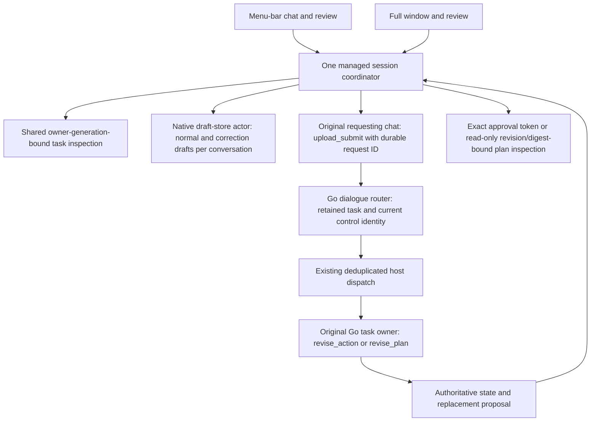

# Tranche 03: native task review, corrections and accessibility

Implementation uses the current local Tranche 02 coordinator and existing Go bridge. Application changes are confined to `macos/`; Go, JavaScript host, CLI/TUI, README files and dependencies are unchanged. No commits were created by this implementation. The separately paused backend goal was not resumed. Tranche 04 was not started.

## Ownership and control flow



Opening a correction only opens an editable draft. It neither submits nor approves anything. For a delegated task, the coordinator selects its already-retained original requesting chat; it does not create a replacement owner. The native contextual message identifies the original conversation/task and asks for a correction, without embedding executable tokens. The user's explicit submission uses ordinary durable `upload_submit`. Go chooses the routing decision and current review/preparation control epoch. The existing host dispatcher forwards that exact authority to the original owner.

Corrections retain the target owner generation, original turn, action review token or plan revision/digest locally for freshness checks. These are guards, not execution grants. A changed or disconnected target prevents submission. A late UI callback cannot redirect a newer foreground selection. A withdrawn proposal, replacement-ready state and actual execution are presented separately. No uncertain admission or control is automatically replayed.

## File inventory

Paths are relative to `macos/`. Some implementation files were incorporated by external repository commits during this session; the inventory describes the whole tranche, not just the final uncommitted diff.

| File | Responsibility |
| --- | --- |
| `Sources/GatorCore/NativeTaskReview.swift` | New: stable task/plan identity, correction context, public task summaries, literal public review fields, finite work modes and testable interaction semantics. |
| `Sources/GatorCore/GatorApplicationState.swift` | Exact review retirement/freshness guards; read-only plan results matched by request ID and revision/digest; correction draft lifecycle; Plan First and authoritative work-mode readback; composer focus requests. |
| `Sources/GatorCore/ManagedSessionCoordinator.swift` | Shared inspector contexts; original-parent correction drafts; freshness checks at preparation/submission; owner-bound exact decisions; distinction between correction admission and actual replacement availability. Existing host dispatch/capacity remains authoritative. |
| `Sources/GatorCore/BridgeProtocol.swift` | Existing `upload_submit.plan_first`, read-only `task_plan.inspect`, finite existing `/mode` adapter; no new protocol or arbitrary visual frame construction. |
| `Sources/GatorCore/NativeDraftStore.swift` | Separate correction draft and target identity, suspended ordinary draft and Plan First preference; version 3 archive with backward reads. |
| `Sources/GatorMac/TaskInspectorView.swift` | New: contextual compact/full task inspector, public activity, owner navigation, exact pending proposal and revision-bound plan inspection/request. Stable task rows survive plan revision. |
| `Sources/GatorMac/ExactReviewContent.swift` | New: literal selectable wrapping account/destination/content, full exact-data disclosure and meaningful accessibility fields. Decodes only Go's known encoded public preview envelope. |
| `Sources/GatorMac/ExactDecisionButton.swift` | New: owner-bound native decision button; Return/keypad Enter cannot decide; explicit click, accessibility press or unmodified nonrepeating Space. |
| `Sources/GatorMac/NativeAccessibilityStatus.swift` | New: polite meaningful status announcements only in the active presentation; no streaming narration or focus movement. |
| `Sources/GatorMac/ApprovalReviewView.swift` | Full scrollable exact review, stale state/current-proposal recovery, explicit correction, decision safety and owner context. |
| `Sources/GatorMac/ComposerView.swift` | Native correction banner/cancel/target inspection, Plan First, preferred native font and IME-aware send. Focus requests wait for window attachment/activation and do not follow background updates. |
| `Sources/GatorMac/ConversationView.swift` | Shared contextual inspection, work mode menu, correction progress, accessible task controls, reduced-motion treatment and existing visual system. |
| `Sources/GatorMac/GatorApp.swift` | Command-L composer, Command-I task inspection, Command-Shift-R pending review. Both scenes retain the same coordinator. |
| `Tests/GatorCoreTests/NativeTaskReviewTests.swift` | New: fourteen focused identity, draft, stale-review, plan-result, accessibility-semantics, no-replay and native work-mode tests. |
| `Tests/GatorCoreTests/NativeReviewIntegrationTests.swift` | New: two actual Go/coordinator correction/revision journeys, original-owner/fresh-review checks and controlled effect evidence. |
| `Tests/GatorCoreTests/Fixtures/review-provider.mjs` | New: isolated local provider, file-gated work/revision and fake Gmail sink. No external account credentials or services. |
| `Tests/GatorCoreTests/ManagedSessionTests.swift` | Submission fixture supports Plan First; explicit test admission timeout supports meaningful revision/result waits under load. |
| `TRANCHE03-VERIFICATION.md` | This verification and acceptance record. |

## Contract coverage

| Surface | Contract and safety boundary |
| --- | --- |
| Task inspection | Existing `dialogue_task`, task plans, public retained prose/tool names/states and errors. Stable conversation/task identity. No raw tool payload or model reasoning. Background inspection never transfers execution or selection. |
| Exact approval | Original conversation/context, process generation, interaction ID, message index, token and exact current result must match. Missing message, changed preview, disconnect or retired token disables both decisions. Tokens retire on withdrawal/replacement and immediately on submission; older retained snapshots cannot restore authority. |
| Action correction | Explicit ordinary admitted dialogue; Go emits `revise_action` with current review control. Existing coordinator dispatches to original task owner. Correction acceptance withdraws the old proposal only when Go confirms; a replacement requires a different exact review. |
| Plan inspection | `task_plan` action `inspect`, actual conversation/task/revision/digest and unique request ID. Only the matching `task_plan_result` can populate a current read. Transport acknowledgement is insufficient. |
| Plan revision | Explicit ordinary dialogue; Go emits `revise_plan` with preparation/control identity. Native progress distinguishes revision requested/preparing from the actual new revision/digest. Old reads remain visibly stale until refreshed. |
| Multi-owner navigation | Existing coordinator owner map, serialized transitions, deduplication and limits retained. Inspection/correction does not spawn a second owner for an owned task. Background completion does not steal focus. |
| Recovery | Drafts and uncertain request identities persist; reconnect creates the existing replacement owner and restores authoritative state. No automatic submission, approval or control replay. Restarted correction targets require fresh inspection. |
| Plan First / work mode | Existing Go contracts, not local permissions. The user may explicitly choose Automatic / Read and Inspect / Prepare Drafts / Propose Actions. Native selection waits for authoritative `work_details.mode`, not nonce acknowledgement. Propose Actions still requires exact action approval. Go resets mode on restart; the frontend reflects that reset. |

Plan approve/start, manual plan editing and broad queue controls are deliberately absent. The inspector explicitly directs these supported advanced workflows to the terminal app. Read-only inspection does not grant execution authority.

## Reproducible build and regression commands

Run from the repository root unless marked otherwise:

```sh
go build -o /tmp/gator-native-runtime ./cmd/gator
go test ./cmd/gator ./internal/workapp -count=1

node --test app-host/tests/backend.test.mjs app-host/tests/sessions.test.mjs app-host/tests/drafts.test.mjs app-host/tests/uploads.test.mjs app-host/tests/policy.test.mjs

swift build --package-path macos --scratch-path /tmp/gator-native-build
swift test --package-path macos --scratch-path /tmp/gator-native-build

GATOR_NATIVE_APP_PATH=/tmp/Gator-Native-Tranche03-Ready.app bash macos/scripts/build-dev-app.sh

# Run from ui/:
GATOR_TEST_BINARY=/tmp/gator-native-runtime bun test --preload ./scripts/preload.ts tests/client.test.ts tests/approvals.test.tsx tests/approval-review.test.tsx tests/conversation-during-work.test.tsx tests/action-corrections.test.ts tests/plan-corrections.test.tsx tests/running-plan-correction.test.ts tests/repeated-plan-owners.test.ts tests/recovery.test.tsx
```

Packaging refuses an existing destination. For another build, choose a fresh `GATOR_NATIVE_APP_PATH`; do not overwrite a running app or the preserved Tranche 01/02 bundles.

| Check | Result |
| --- | --- |
| Go build | PASS. |
| Full Go bridge/workapp package tests | PASS: `cmd/gator` 253.606 s; `internal/workapp` 70.235 s. |
| JS host/session/draft/upload/policy regressions | PASS: 63 tests, zero failed/skipped. |
| Targeted TUI/client/dialogue/approval/plan/recovery regressions | PASS: 52 tests across 9 files, 979 assertions, zero failed; 214.11 s. |
| Swift build | PASS: installed Swift 6.1.2, macOS 15.5 SDK; macOS 15 minimum. |
| Swift tests | PASS: 50 tests, including all 34 Tranche 01/02 cases, fourteen new native review cases and two real Go correction/revision cases; final run 11.556 s. |
| Development package | PASS: `Info.plist` lint and bundled executable native app plus real Go runtime. No runtime dependency on an absolute repository path. |

Logs: `/tmp/gator-native-t03-{go,host,tui,build,tests,package}.log`. Full repository suites beyond those listed were not run. No live account or outbound model-provider verification was performed.

## Real Go integration evidence

`realGoActionCorrectionKeepsChildOwnerAndRequiresFreshExactApproval` runs a held parent and delegated action child through actual Go subprocesses and the managed coordinator. It observes the original pending action, requests the changed subject through ordinary dialogue, checks the same child and a new review token, and confirms zero effects before fresh approval. Wrong-owner and stale-token decisions produce no effect. Exactly one local fake sink effect occurs after fresh approval; decoded MIME verifies `Project Update`, the original recipient and original body including its final line. There is no real email delivery.

`realGoPlanRevisionDistinguishesAdmissionFromReplacementAndRejectsOldReview` uses the real Plan First admission and exact plan read. A file gate holds revision preparation, proving that admission is not a completed replacement. Release produces a new revision/digest on the same task and owner. The old read cannot be reused; a new exact read contains the changed objective/step. No plan or external action is executed.

Profiles/config/state are temporary, environment variables are whitelisted, the provider and fake connector listen locally, and no real account tokens are inherited. Fixture setup uses an existing Go connector scope command; native product views never receive arbitrary bridge access.

## Required scenario coverage

| Requested scenarios | Evidence |
| --- | --- |
| 1–5: task identity, background inspection/completion, stale details, navigation | Native task-review ownership/navigation/reconnect tests; retained managed-session tests; launched journeys below. |
| 6–12: action correction, fresh review, stale epoch, absent owner, deduplication, uncertainty | Actual Go action correction integration; existing real Go/terminal correction regressions; native stale-target, stale UI event and uncertain-admission/restart tests; retained dispatcher deduplication tests. |
| 13–18: exact plan read/revision, original owner, epoch/digest, admission versus completion | Actual Go revision integration with a held preparation phase; native exact-result request matching and old-digest rejection; existing Go/terminal plan-correction suites. No plan execution approval is implemented. |
| 19–22: approval isolation and exact decisions across presentations | Native exact-review/owner/token/missing-message tests, actual Go stale/wrong-owner decisions and new token; launched compact/full review and keyboard checks. |
| 23–27: accessibility | Semantic unit tests, AppKit/SwiftUI code inspection and launched AX/keyboard checks. Speech, physical IME, exhaustive keyboard traversal and OS preference variants are not claimed verified. |
| 28–34: earlier tranches | All 34 earlier native tests retained, including actual Go conversation-during-work, recovery, isolated drafts, late results, bounded owners, protected eviction, all-owner Quit, streaming and model-selection handling; listed Go/host/terminal regressions. |

## Accessibility and interaction boundaries

Implemented: native preferred text, selectable literal review/message content, wrapping long fields, scrollable compact/full review, meaningful task/control labels, status text and symbols independent of color, grouped exact-content accessibility, active-window-only low-priority state announcements, explicit keyboard shortcuts, Escape return, IME-aware composer and Reduce Motion with no animated task transition/spinner when enabled.

Actual launched-app keyboard/Accessibility evidence is recorded below separately from core semantic tests. Full VoiceOver speech/navigation, physical IME composition, exhaustive Tab traversal under Full Keyboard Access, alternate display scaling/contrast/color settings and toggling the system Reduce Motion preference remain NOT TESTED. AX label/content inspection is not a claim of VoiceOver acceptance.

## Actual launched native journeys

Both final journeys launched `/tmp/Gator-Native-Tranche03-Ready.app/Contents/MacOS/GatorMac --open-window`, using its bundled real Go runtime, a disposable profile and the local controlled provider. Native windows and controls were exercised through macOS Accessibility and targeted keyboard events, not Swift state mocks or screenshots alone.

Machine-local acceptance drivers, retained for reproduction on this Mac:

```sh
swiftc /tmp/gator-native-ax.swift -o /tmp/gator-native-ax
python3 /tmp/gator-native-tranche03-journeys.py action
python3 /tmp/gator-native-tranche03-journeys.py plan
```

The Python driver references the repository's controlled provider fixture; run from the repository root. Accessibility/event-posting permission is required and was available here. These `/tmp/` driver sources and evidence are local artifacts, not installed application dependencies. The persistent, account-free Go/coordinator reproduction is also covered by `NativeReviewIntegrationTests.swift` in the normal Swift test command.

### Journey A: action correction — PASS

Final evidence root:

`/var/folders/pq/lllswlg16q396qgx147zv_mm0000gn/T/gator-native-tranche03-ui-0jf71w_p`

`journey.json` records the parent/child identities, original owner PIDs, zero effects and every completed checkpoint. The final driver exited zero; log `/tmp/gator-native-t03-native-action.log`.

The app explicitly selected Go's Propose Actions mode, started held unrelated Work, and delegated the controlled proposed message to another Go owner. Inspecting that background proposal did not change foreground selection. Exact native review exposed the original subject and entire long body through its accessibility content, including `FINAL REVIEW LINE`.

The approval button was actually focused: targeted Return did not approve. Command-L returned to the composer with its unrelated draft and actual text-area focus; Command-Shift-R reopened the same exact review. Request Correction selected the already-owned requesting parent and opened an editable correction. Compact/full surfaces showed the same draft; opening task details and Expand preserved both owner PIDs and the original proposal. Explicit Send produced Go's withdrawal confirmation and a new exact review, with no effect. The replacement had `Project Update`, unchanged recipient/body and a new backend token. Focused Space on Decline completed the child with zero fake sends. The original parent's draft and work remained intact.

### Journey B: plan revision — PASS

Final evidence root:

`/var/folders/pq/lllswlg16q396qgx147zv_mm0000gn/T/gator-native-tranche03-ui-rb5uyvjd`

`journey.json` records the unchanged task/owner, revision 1 to 3, changed exact digest, zero effects and completed checkpoints. The driver exited zero; log `/tmp/gator-native-t03-native-plan.log`.

Native Plan First produced a real proposed plan. Command-I opened task details; Inspect Current Plan loaded its objective/steps. Request Plan Revision opened a draft without execution. While a fixture gate held preparation, the UI reported revision requested, not completed. Releasing it produced the actual changed objective/step and a new revision/digest. The old read was visibly stale; a fresh inspect loaded the replacement. No Approve/Start plan buttons or execution were present. Escape restored the ordinary draft and actual composer focus. Guarded Quit retained the queued plan and reaped its owner.

### Journey C: shared presentation and lifecycle — PASS

Performed in Journey A on the final bundle. Correction draft, task inspector and exact original owner survived compact-to-full expansion and navigation. After declining the replacement, both native presentations were dismissed. The driver counted actual normal and menu-bar panel window layers, verified both original Go PIDs remained alive, and checked the authoritative request journal still reported the held parent's request as running. It then released that Work while both presentations were closed. Reopening showed the retained completed result and original draft. Final Quit reaped both Go owners. No background completion redirected the selected conversation.

The final original-review and revised-plan screenshots were inspected. A fully rendered replacement-review screenshot from the preceding check of the same final bundle was also inspected at `/var/folders/pq/lllswlg16q396qgx147zv_mm0000gn/T/gator-native-tranche03-ui-myek9847/replacement-review.png`. They show the existing native typography/materials, literal scrollable review and proposed-versus-completed hierarchy. The last driver's replacement capture was partial while the full window was inactive and is not visual acceptance evidence; its complete replacement text and identity were verified through the actual AX tree and Go state. Physical human scroll/VoiceOver traversal is not inferred from screenshots.

Diagnostic acceptance attempts exposed two driver issues: repeated traversal of both complete accessibility trees could outlast Go's five-minute held-provider timeout, and active Work was incorrectly checked in finish-only activity files. The final driver avoids redundant traversal, explicitly dismisses compact after verifying shared inspection, counts the menu-bar panel's actual window layer, and checks the actual Go request journal. No backend timeout, permission, execution or approval restriction was relaxed. Diagnostic timeout/error screenshots are not happy-path evidence; the final complete runs above are. Performance with exhaustive simultaneous accessibility-tree traversal still merits physical VoiceOver follow-up.

## Acceptance matrix

| Status | Scope |
| --- | --- |
| PASS | Real task inspection; original-owner correction requests; fresh exact replacement action review; revision/digest-bound plan inspection and complete revision request; admission/completion distinction; stale/missing/disconnected identity guards; multi-owner navigation/drafts; no uncertain replay; bounded owners and all-owner Quit; final launched journeys A/B/C; listed regressions and packaging. |
| PARTIAL | Accessibility: native semantics, selected keyboard interactions, AX content and reduced-motion code are verified; complete manual accessibility acceptance is outstanding. |
| FAIL | No known failing product check remains in the required executed suites. Diagnostic harness failures and corrections are recorded above. |
| NOT TESTED | VoiceOver speech/navigation, physical IME, exhaustive Tab/Full Keyboard Access, OS contrast/text-scale/Reduce Motion variants, live accounts/providers and broader native performance benchmarking. |
| DEFERRED | Native plan approve/start and manual editor; general queue UI; Following, voice, attachment import, provider setup, file editing/export and signing/notarization. |

## Persistence and remaining restrictions

Native archive version 3 preserves normal and correction drafts separately. Versions 1/2 are read without migrating terminal drafts; the archive never downgrades after version 3 semantics are used. Older app bundles reject version 3 instead of silently dropping correction target identity. Compare builds with isolated profiles. Separately forced application instances do not synchronize native draft writes.

After restart/reconnect, a retained correction draft has a stale owner generation and cannot be submitted unchanged as authority. Its text is kept; cancel the correction to restore the normal draft, inspect the current proposal and open a fresh request. Unconfirmed controls conservatively retain their owner/capacity. No UI shortcut assumes an uncertain external effect failed.

No Following, voice, attachment import, provider setup/login, file editing/export, general queue UI, new networking or signing/notarization is included.

## Launch and manual inspection

```sh
open /tmp/Gator-Native-Tranche03-Ready.app --args --open-window
```

Omit `--args --open-window` for menu-bar-first launch. The development bundle contains both executable Mach-O files at `Contents/MacOS/GatorMac` and `Contents/Resources/gator-runtime`; `plutil -lint` passed. Tranche 01 `/tmp/Gator-Native-Verified.app` and Tranche 02 `/tmp/Gator-Native-Tranche02-Ready.app` remain preserved.

Open the menu-bar icon, then Expand to the full window. Command-L focuses the shared composer; Command-I opens current task details; Command-Shift-R opens a pending exact action. Escape returns to the conversation. The activity disclosure exposes owner-bound task inspection/navigation. A correction opens an editable composer and requires explicit Send. Plan First requests a proposal; Inspect Current Plan loads its exact review. Proposed plans have no native Approve/Start control in this tranche.

The app uses the existing configured Go profile for normal launch. The acceptance journeys below instead use disposable profiles and a local provider/fake connector. Neither represents a live account or provider connectivity test.

Recommended Tranche 04: exact revision/digest-bound native plan approval/start with complete access/budget review, plus physical VoiceOver validation of the review flow. This is a recommendation only; no Tranche 04 work is included.

