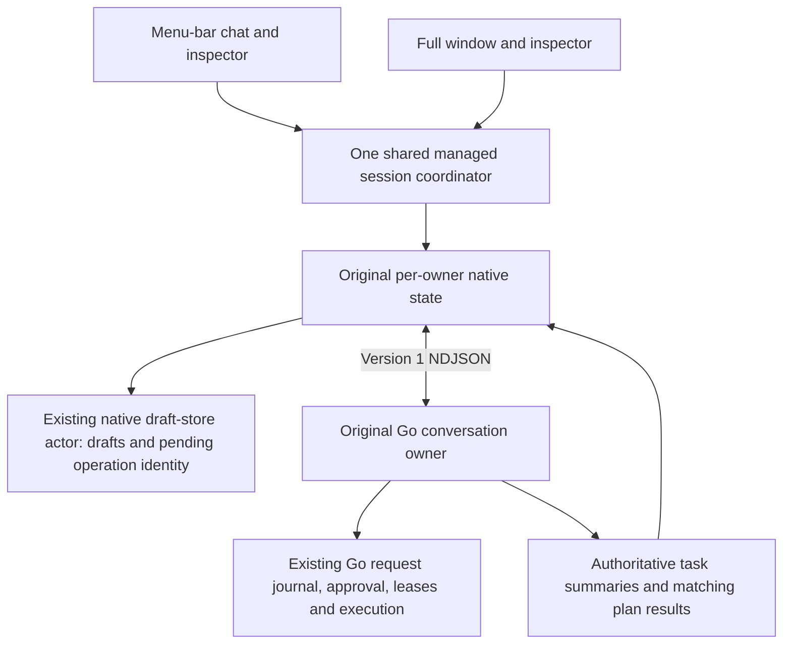

# Tranche 04 — exact plan approval, execution and accessibility

Implemented against the current local Tranche 03 application and actual Go plan/session implementations. Changes are confined to `macos/`. Go application code, JavaScript host, terminal behavior, Go stores, README files and the separately paused backend goal are unchanged. No commits were created. Tranche 05 was not started.

## Reviewed-plan lifecycle and authority

Plan First already existed and remains optional, conversation-specific and captured in the durable `upload_submit.plan_first` submission. It is not forced on ordinary conversation.

1. **Review:** `task_plan.inspect` supplies the actual owner/task/revision/digest/request ID. Only its matching `task_plan_result.review` populates a native exact read. The native read captures owner generation, focus epoch, complete task summary and projected scope/recovery context.
2. **Explicit authorization:** Approve & Start sends `action: approve`; Go can immediately dispatch. It is never labeled approval-only. Start Approved Plan sends `action: start` only after a fresh Go read reports `state: queued`, `phase: approved`. Go's validated approved phase represents the retained revision/digest-bound approval; no imaginary approval token/boolean was added.
3. **Dispatch:** the existing shared coordinator serializes authorization with session transitions/admissions. It checks the selected original owner, no competing controls and the three-working/four-cached limits. Pending native metadata is persisted before a send. State and capacity are checked again after that storage await.
4. **Execution:** transport acknowledgement only projects acknowledged. Matching result ID projects Go acceptance/rejection; the exact task summary's running/dispatching state projects execution. Completion/failure/stopping comes from that same task, not another run or the presence of plan steps. Plan approval does not approve tool actions; existing exact action tokens remain required. Plan-preparation admission is labeled separately: Go also uses its running flag during preparation, which must not be mistaken for reviewed execution.
5. **Recovery:** startup restores state and never sends approve/start. Unconfirmed native IDs survive restart. A replacement owner plus a fresh exact inspection can reconcile retained uncertainty without replay. A queued approved plan needs a new explicit Start. A dispatched/completed/cancelled/unapproved plan cannot use Start.



Native operation identity includes conversation/task/revision/digest, original process generation, nonce and request ID. Repeated queued clicks cannot become a second operation. The same accepted authorization is not sent again. A local admission failure is labeled **Not submitted**, a Go rejection **Go rejected**, and a timeout/disconnect **Outcome uncertain**. A successful result is not labeled completed work.

The inspector displays objective, outcome, ordered proposed steps, declared effects, selected and proposal sources, retained inputs, input additions/removals, access/connection changes, original/remaining budget, prior measured attempts, state/phase/revision, correction and actual errors/recovery requirements. Effects, access changes, requirements and budgets are expanded before authorization. Exact digest/full data remain inspectable. No step completion is inferred from the plan.

## Exact files and responsibilities

| File under `macos/` | Responsibility |
| --- | --- |
| `Sources/GatorCore/NativePlanExecution.swift` | New: finite approve/start intents; durable native operation phases/identity; complete-review and public plan-state presentation. |
| `Sources/GatorCore/BridgeProtocol.swift` | Typed existing `task_plan` approve/start envelopes; updated plan availability explanation. No raw frame-writing exposed to views. |
| `Sources/GatorCore/GatorApplicationState.swift` | Exact read freshness, generation/focus/scope guards, durable per-owner operation lifecycle, request/nonce matching, authoritative task execution projection and no-replay recovery. |
| `Sources/GatorCore/ManagedSessionCoordinator.swift` | Selected-owner authorization, serialized result waits, pre/post-storage capacity gates and protected uncertain-owner retirement. Existing owner coordinator retained. |
| `Sources/GatorCore/NativeDraftStore.swift` | Optional owner-context plan receipts in the existing native archive; version 4 when needed, backward reads of versions 1–3; no terminal draft access. |
| `Sources/GatorCore/NativeTaskReview.swift` | Exact reads capture summary/scope/focus epoch in addition to existing task identity and generation. |
| `Sources/GatorMac/PlanReviewContent.swift` | New: full material review, accurate approve/start explanations, explicit controls, operation/error state and retained recovery context. |
| `Sources/GatorMac/TaskInspectorView.swift` | Existing contextual inspector embeds the completed review; stale reads stay visibly stale; inspection/revision/back navigation opts into native keyboard focus. |
| `Sources/GatorMac/ExactDecisionButton.swift` | Shared exact-decision control: named SwiftUI focus/accessibility element over the guarded native button; explicit Space/click/accessibility press; Return/keypad Enter guard; Tab exit and focus scrolling. |
| `Sources/GatorMac/ConversationView.swift` | Concise original-owner plan operation status and inspectable uncertain request identity; existing conversation surface retained. |
| `Tests/GatorCoreTests/NativePlanAuthorizationTests.swift` | New: thirteen focused protocol/result/ownership/freshness/capacity/persistence/duplicate-input tests. |
| `Tests/GatorCoreTests/NativePlanIntegrationTests.swift` | New: four real Go/coordinator integration journeys, including independent Go rejection of invalid identities and foreground misuse. |
| `Tests/GatorCoreTests/Fixtures/plan-provider.mjs` | New: disposable local provider, actual Go plan preparation/revision/routing and file-held execution; no connected services or tool writes. |
| `Tests/GatorCoreTests/Fixtures/retained-plan/main.go` | New test setup only: calls Go's actual `Store.ApproveTaskPlan` after the owner exits, retaining approval without dispatch. It does not hand-edit authorization JSON or change application Go behavior. |
| `TRANCHE04-VERIFICATION.md` | This evidence and operator checklist. |

## Protocol coverage

All production frames retain the existing version 1 NDJSON protocol over the original owner's stdin/stdout:

```json
{"version":1,"type":"task_plan","nonce":"<native nonce>","task_plan":{"conversation_id":"<Go owner>","task_id":"<Go task>","revision":1,"digest":"<Go digest>","action":"approve","request_id":"<native operation ID>"}}
```

Use `inspect` for a read and `start` for an already-approved undispatched plan; the other identity fields have the same shape. `action_applied` matches only the transport nonce. `state.task_plan_result.request_id` identifies the actual plan result; `error` is surfaced literally. `state.task_plans` supplies the exact task's state/phase/work ID. `state.foreground`, existing host focus confirmations and generation/focus epoch guard original ownership. Existing managed dialogue continues to handle ordinary conversation and `revise_plan`; Swift does not classify text or manufacture correction controls.

Go still independently enforces identity, current plan, phase, scope, execution leases, request journal, permission/effect and remaining-budget restrictions. Neither native controls nor the fixture adds authorization to Go.

## Verification commands and results

From the repository root unless otherwise indicated:

```sh
go build -o /tmp/gator-native-runtime ./cmd/gator
go test ./cmd/gator ./internal/workapp -count=1

node --test app-host/tests/backend.test.mjs app-host/tests/sessions.test.mjs app-host/tests/drafts.test.mjs app-host/tests/uploads.test.mjs app-host/tests/policy.test.mjs

swift build --package-path macos --scratch-path /tmp/gator-native-build
swift test --package-path macos --scratch-path /tmp/gator-native-build

GATOR_NATIVE_APP_PATH=/tmp/Gator-Native-Tranche04-Ready.app bash macos/scripts/build-dev-app.sh

# Controlled retained-approval fixture, not an application dependency:
go build -o /tmp/gator-native-retained-plan-fixture ./macos/Tests/GatorCoreTests/Fixtures/retained-plan

# From ui/:
GATOR_TEST_BINARY=/tmp/gator-native-runtime bun test --preload ./scripts/preload.ts tests/client.test.ts tests/approvals.test.tsx tests/approval-review.test.tsx tests/conversation-during-work.test.tsx tests/action-corrections.test.ts tests/plan-corrections.test.tsx tests/running-plan-correction.test.ts tests/repeated-plan-owners.test.ts tests/recovery.test.tsx
GATOR_TEST_BINARY=/tmp/gator-native-runtime bun test --preload ./scripts/preload.ts tests/product-port.test.tsx tests/request-recovery-controls.test.tsx
```

| Check | Observed result |
| --- | --- |
| Go build | PASS. |
| Full requested Go package tests | PASS: `cmd/gator` 157.251 s; `internal/workapp` 42.243 s. |
| Host/session/draft/upload/policy tests | PASS: 63, zero failed/skipped. |
| Swift build | PASS: Swift 6.1.2 / macOS 15.5 SDK, minimum macOS 15.0. |
| Full Swift suite | PASS: 67 tests, 15.240 s; all 50 earlier tests retained, thirteen new authorization tests and four new real Go tests. |
| Main targeted TUI regressions | PASS: 52 tests / 979 assertions / 9 files, 116.21 s. |
| Additional TUI exact plan controls and request recovery | PASS: 7 tests / 71 assertions / 2 files, 18.60 s. Includes actual Go approve/start and stale-review rejection. |
| Development package | PASS: native executable and real Go runtime bundled; `Info.plist` lint passed. |

Logs: `/tmp/gator-native-t04-{go,host,build,tests,package,tui,tui-plan}.log`. No live model endpoint, real account or email action was used. Full repository suites beyond those listed were not run. Packaging refuses existing destinations; rebuild to a fresh path rather than overwrite a running app or a preserved earlier tranche.

One early uncertainty unit fixture used an 80 ms timeout for both read and control. Under concurrent tests that expired the read before its controlled result. The fixture now establishes the read with a normal bound and then disconnects after acknowledgement to exercise actual uncertain admission. The separate timeout/late-result case still exercises timeout without replay. Response fixtures also wait for an actual frame acknowledgement before injecting a matching result, rather than treating creation of a local pending record as a sent frame. No production deadline was relaxed and no test was skipped.

## Real Go integration evidence

- `realGoExactPlanApprovalExecutesOnceAndConversationContinues`: actual Plan First preparation/read, native coordinator approval, matching Go result and held execution, ordinary independent dialogue while running, retained result/draft and exactly one model execution.
- `realGoRevisedPlanRequiresFreshInspectionBeforeSingleExecution`: the old read cannot authorize; same task produces a changed revision/digest; only a freshly inspected replacement executes, once.
- `realGoRestoredApprovedPlanDoesNotAutoStartAndExplicitStartExecutesOnce`: closes the original owner, retains approval through Go's Store API, restores the same conversation with no execution, reads the approved plan and explicitly Starts once.
- `realGoRejectsWrongPlanIdentitiesAndUnapprovedStartIndependentlyOfNativeGuards`: test-only typed transport access to the same managed Go process deliberately bypasses native presentation guards. Go rejects wrong conversation/task/revision/digest, Start on an unapproved plan and approval without foreground ownership. Fresh correct approval through the coordinator then executes once.

Each fixture uses isolated configuration/state/native drafts, a whitelisted environment and a local controlled provider. There are no external credentials, connected accounts, emails or destructive tools. Setup uses Go's actual stores/contracts; production code never executes the setup helper.

## Actual launched native journeys

All final journeys used `/tmp/Gator-Native-Tranche04-Ready.app` and its bundled Go executable with disposable state/configuration and local controlled providers. The native drivers used macOS Accessibility and targeted keyboard events; these are real AppKit/SwiftUI interactions, not mock Swift state. No human VoiceOver speech test is implied.

Machine-local sources and reproducible commands are retained on this Mac:

```sh
swiftc /tmp/gator-native-t04-ax.swift -o /tmp/gator-native-t04-ax
python3 /tmp/gator-native-tranche04-journeys.py new
python3 /tmp/gator-native-tranche04-journeys.py revised
python3 /tmp/gator-native-tranche04-journeys.py restored
python3 /tmp/gator-native-t04-action-regression.py action
```

Run from the repository root; the retained-approval helper above and Accessibility/event-posting permission are prerequisites. The last regression driver reuses the existing `/tmp/gator-native-ax` helper for its keyboard/AX operations. These temporary drivers are verification artifacts, not application dependencies. Persistent Go/coordinator reproduction is in the Swift integration tests.

| Journey | Final result and evidence root |
| --- | --- |
| A — new reviewed plan | PASS, exit 0: `/var/folders/pq/lllswlg16q396qgx147zv_mm0000gn/T/gator-native-tranche04-ui-xvru8ijw` |
| B — revised plan | PASS, exit 0: `/var/folders/pq/lllswlg16q396qgx147zv_mm0000gn/T/gator-native-tranche04-ui-d0fl1izl` |
| C — restored approval | PASS, exit 0: `/var/folders/pq/lllswlg16q396qgx147zv_mm0000gn/T/gator-native-tranche04-ui-9zuu6l1d` |
| D — automated native accessibility/keyboard | PASS for the enumerated controls below in A/B/C; physical human acceptance remains partial. |
| Earlier action-correction/native-button regression | PASS, exit 0: `/var/folders/pq/lllswlg16q396qgx147zv_mm0000gn/T/gator-native-tranche03-ui-dw32ke5y` |

Each root retains `journey.json`, controlled provider traces, native draft/operation records and images. Logs: `/tmp/gator-native-t04-native-{new,revised,restored,action-regression}.log`.

**A:** native Plan First preparation produced the real proposal. Full inspection exposed objective/steps/effects/budget. Tab reached the named Approve & Start control; Shift-Tab returned to Back to Conversation. Return while actually keyboard-focused produced zero execution. Compact/full presentations shared the same owner/read. Explicit native activation produced a matching result and actual running request, with exactly one provider execution. An ordinary conversation in another owner responded while that work remained running. Quit warned about the background owner; Keep Gator Open preserved it. Dismissing both normal and menu-bar panel windows left both original Go PIDs alive and the original request journal running. Completion while dismissed did not change selection. Returning retained the result and both conversation-specific drafts. Final Quit reaped all owners.

**B:** the original exact read could request a correction but did not authorize it. Go retained a changed revision/digest (revision 1 to 3) on the same task. The old visible control was actually AX-disabled. Fresh inspection enabled approval of the replacement; execution count was exactly one. Completion and the unrelated draft remained available.

**C:** the native app exited before fixture setup called Go's actual Store approval API. Reopening the same conversation showed an approved queued plan with zero execution and no automatic start. Fresh inspection offered only Start Approved Plan. Keyboard-focused Return did not start it; explicit Space did. The retained approval executed exactly once, then completion and guarded subprocess cleanup were observed.

**D:** actual Enter/Shift-Enter, Tab/Shift-Tab, named control focus, Return safety, explicit Space, Command-I, Command-L/Escape, draft restoration, stale disabled state and native review scrolling were exercised. Current Full Keyboard Access was false throughout: the repair is app-local, not a global preference change. A successful direct AX set-focused response was not treated as keyboard-focus evidence; the driver uses actual Tab and checks the focused element's name.

The additional action regression exercised the shared button after its accessibility changes: actual Tab reached Approve Exact Action, Return did not approve; Go-managed correction retained its child owner; replacement required a new exact token; actual keyboard Space declined it with zero fake sends. Original work/drafts survived, background completion was retained and both Go owners were reaped.

The fully rendered revised-plan and restored-approval screenshots were visually inspected, including readable budgets and distinct authorization explanations. One new-plan capture after presentation switching was partial and is excluded from visual acceptance evidence; its full content, focus and controls were verified through the actual native AX tree and Go journal. Manual visual inspection across presentation switches remains an operator check. Compilation and partial captures are not offered as visual proof.

## Requested scenario ledger

| Cases | Evidence |
| --- | --- |
| 1–6: inspected approval, exact tuple, execution and duplicates | Native complete-read/result/duplicate tests; real Go new-plan journey; actual native journey A below. |
| 7–13: invalid identities, changes, generation and disconnect | Direct real Go boundary test; native stale revision/digest/state/scope/preparation tests; restart/no-replay and focus-epoch tests. |
| 14–20: acknowledgement, matching result, execution, dismissal, focus, capacity, cancellation | Native ack/result/task-state tests; final admission gate and three-working-owner test; cancelled/invalid Start test; real Go/native execution and background journeys; existing Go plan cancellation regressions. |
| 21–27: retained approval, no auto-start, explicit Start, no repeat/replay | Real Go restoration test and native journey C; native invalid-phase Start test and uncertain restart/late-result cases. |
| 28–32: owner-bound controls, isolation, shared surfaces and guarded Quit | Native selected-owner/focus test, late result A/B isolation, capacity/eviction and retained all-owner lifecycle tests; launched shared-review/quit checks. |
| 33–37: accessibility | Named native control, actual keyboard traversal/Return/Space/multiline/focus checks below; native selection/wrapping/scroll code and reduced-motion semantics. Physical speech/IME/preference variants remain unverified. |
| 38–44: earlier tranches | All 50 prior Swift cases, including real Go action correction, plan revision, conversation during work, draft isolation, token-bound action decisions, recovery, streaming and model controls; listed Go/host/TUI regressions. |

## Accessibility: verification boundaries and operator checklist

Read-only preference inspection reported Reduce Motion **false**, Increase Contrast **false**, Full Keyboard Access **false**, preferred body font **13 pt**. VoiceOver was not running. No system setting or input source was changed.

The focused native pass found and repaired an actual Tab trap in the AppKit decision control and a missing accessible name on its SwiftUI keyboard focus target. Final native testing also caught a custom disabled accessibility proxy which still reported enabled, despite the native authority guard rejecting its action. Disabled decisions now use a standard disabled native Button with no decision callback, exposing the actual unavailable state. Review controls opt into app-local keyboard focus, Tab exits the native control, the semantic focus element has the decision's name/action, and intentional focus scrolls the native button into view. Return stays non-authorizing in both keyboard and native button handling. No global keyboard preference was altered.

| Evidence category | Scope |
| --- | --- |
| Automated native AX/keyboard | Actual launched windows, named controls, Tab/Shift-Tab focus destinations, Return safety, explicit Space, Escape/Command-L restoration, Enter/Shift-Enter, draft preservation and scrollable full review. Details below. |
| Code and core tests | Generation/scope/revision freshness, modified/repeated Space policy, IME marked-text guard, native selectable literal text, semantic colors, text/symbol status and Reduce Motion transaction/static status support. |
| Actual manual human verification | No physical human VoiceOver or IME acceptance was performed. Screenshots were visually inspected separately from AX checks. |
| NOT TESTED | VoiceOver speech/VO navigation, physical IME composition, toggled Reduce Motion, increased system text size/contrast variants and exhaustive keyboard traversal across every application surface. |

Operator checklist, without assuming these checks passed:

1. With your chosen VoiceOver setup, navigate chat → task inspector → plan review; read objective, ordered steps, effects, access changes, budget and error; distinguish Approve & Start from Start Approved Plan.
2. Use Tab/Shift-Tab, Space and Escape; confirm Return cannot authorize and focus/draft return to the conversation. Repeat in compact chat and the full window.
3. Use your existing IME: compose marked text, Return to confirm composition, then explicitly send; verify unfinished composition never submits. Check Shift-Return multiline input.
4. If you choose to change accessibility preferences, test Reduce Motion, larger text and contrast; read the full long review, select/copy text and inspect the final lines. No setting was changed by this implementation.

The native driver uses real keyboard Tab to reach SwiftUI's focus target; a successful AX `set focused` response alone is not considered proof of keyboard focus.

## UI review scope

Full scoped review of native plan review/authorization and shared exact-decision interaction, using the existing SwiftUI semantic fonts/colors/materials and AppKit button. No new styling system or decorative motion.

| Category | Inspected result |
| --- | --- |
| Typography | Native body/caption hierarchy, literal selectable wrapping, distinct task/outcome/steps, numeric budget alignment. OS size variants not manually tested. |
| Surfaces | Existing contextual inspector/scroll view retained; material execution context expanded; long-form controls remain within the review. |
| Animations | No custom animation added. Existing Reduce Motion support retained; no new animation requiring slow-motion review. OS preference toggle not tested. |
| Icons | System symbols with explicit status labels; authorization/error meaning does not depend on color. |
| Performance | Stable task rows and existing snapshot replacement retained. No broad long-history benchmark or exhaustive simultaneous AX-tree benchmark claimed. |

| Severity | Location | Before | After | Why |
| --- | --- | --- | --- | --- |
| HIGH | `Sources/GatorMac/ExactDecisionButton.swift` | Native button could trap Tab; SwiftUI focus target could be unnamed; a disabled custom proxy could report enabled. | Named app-local focus target, explicit Tab exit, guarded Return/Space and a standard unavailable control with correct AX state. | Keyboard and assistive-control access must remain usable without accidental authorization. |
| HIGH | `Sources/GatorMac/PlanReviewContent.swift` | Material budget/access context was inside a technical disclosure and there were no native authorization controls. | Material context expanded before exact approve/start; distinct lifecycle labels. | Authorization requires readable scope and consequences. |

Considered but rejected: switching to a custom panel was unnecessary for these control/focus fixes; changing global keyboard/accessibility preferences was prohibited and app-local focus suffices; using a generic default Return button would weaken exact authorization safety.

## Acceptance matrix and remaining boundaries

| Status | Scope |
| --- | --- |
| PASS | Complete native plan preparation → exact read → approve/dispatch/execute; revision with fresh review; explicit retained-approved Start; owner/revision/digest binding; no duplicate execution; acknowledgement/result separation; independent conversation; retained completion; native draft isolation; bounds and guarded shutdown; listed unit/real-Go/native/host/TUI checks. |
| PARTIAL | Accessibility and two-surface visual acceptance: selected native AX/keyboard/scroll checks and rendered captures passed; human speech/IME/preference checks and an exhaustive visual pass remain outstanding. |
| FAIL | No known failing product check remains in the final executed suites/journeys. The native Tab/name/disabled-state defects and deterministic fixture corrections are recorded above. |
| NOT TESTED | Physical VoiceOver speech/VO navigation, physical IME, larger-text/contrast/Reduce Motion setting variants, exhaustive every-control traversal, live account/provider verification and broad long-history/performance benchmarks. |
| DEFERRED | Manual plan editing, broad queue management, native attachments, Following, voice, provider installation/login, general file editing/export and distribution signing/notarization. |

Some implementation files were incorporated by external repository commits during the session. The inventory records the entire tranche, rather than only its final uncommitted diff; this agent created no commits.

## Persistence, safety limits and launch

Native archive version 4 retains pending plan operation identity in the **existing native draft store**. Completed receipt caches are bounded, while unconfirmed identities are never evicted to make room; Go history is unaffected. Versions 1–3 remain readable; older app bundles reject version 4 rather than discard pending authorizations. Compare older builds with isolated profiles. Terminal drafts and Go schemas are untouched. Forced parallel native application instances do not synchronize draft writes; normal single-instance launch remains the supported use of a profile.

An unconfirmed operation conservatively retains its owner/capacity. There is no Retry Approve/Start button. Reconnect or guarded restart and fresh exact inspection reconcile canonical state; no action is re-sent. If the original task has already dispatched, it is inspected rather than restarted. Go errors about scope, permission, budget or leases are not bypassed by making another task.

```sh
open /tmp/Gator-Native-Tranche04-Ready.app --args --open-window
```

Quit an older running Gator build before launching this bundle; do not force concurrent instances on the same profile. Omit `--args --open-window` for menu-bar-first launch. The bundle contains `Contents/MacOS/GatorMac` and `Contents/Resources/gator-runtime`. Tranche 01, 02 and 03 app bundles are preserved. Command-I opens task inspection, Inspect Current Plan loads the exact read, Command-L/Escape returns to the composer. Approve & Start may execute immediately; Start Approved Plan uses retained approval. Both require explicit Space/click/assistive press, and both remain Go-owned.

Recommended Tranche 05: bounded native recovery inspection for interrupted work and uncertain effects, using existing Go receipts and recovery contracts, plus the remaining human accessibility acceptance. No Tranche 05 implementation is included.
