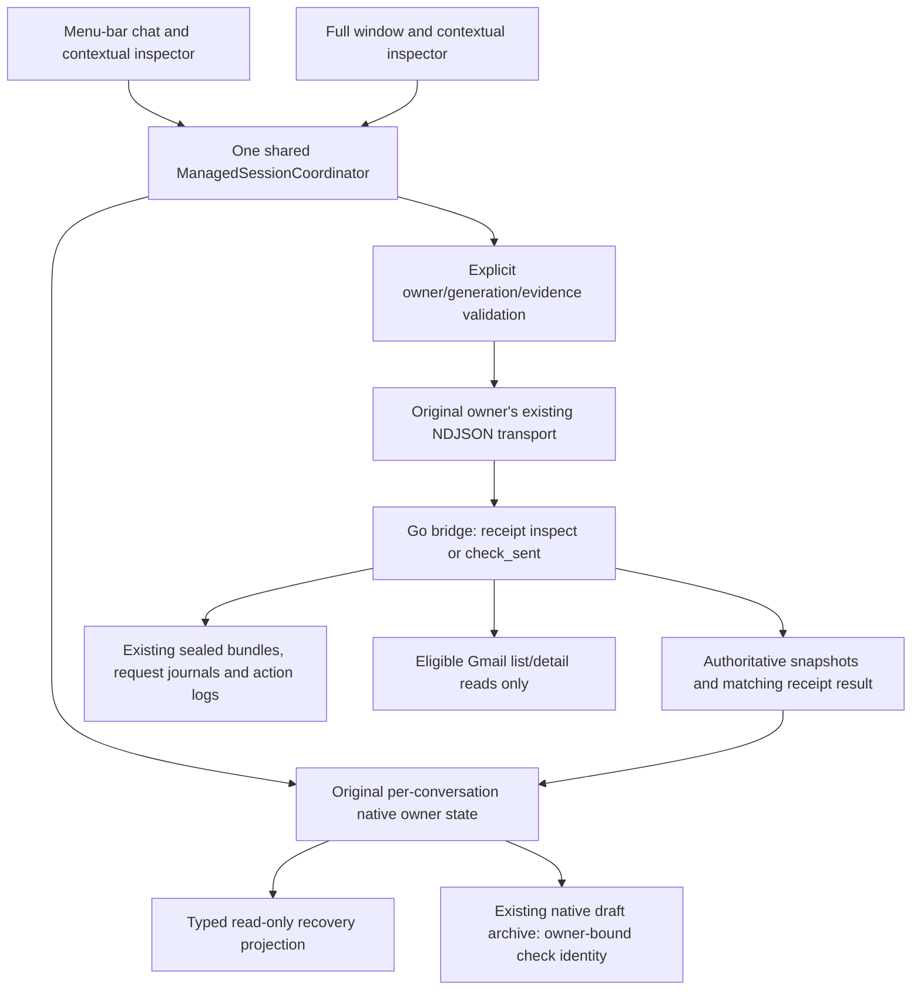

# Tranche 05 — interrupted work and uncertain action inspection

Native application changes are confined to `macos/`. Go application code, JavaScript host, CLI/TUI, Go stores, README files and dependencies are unchanged. No commits were created. The separately paused backend goal was not resumed. Tranche 06 is not implemented. The already-modified Tranche 04 ledger was preserved.

## Implemented behavior and authority

The existing task inspector now presents recovery evidence from authoritative conversation-scoped snapshots. There is no recovery engine, new process manager or database. Opening the inspector never resumes work, grants access, prepares a retry, discards a record or repeats an external action.

- Failed-request guidance uses `request_recoveries`: original objective, task ID, state, provider/model, recovery kind, repair guidance, required accounts/operations, scope/processing constraints and preparation boundary. Conditional `retry_safe` is explicitly described as eligibility, not permission. None of `review_access`, `prepare_access`, `prepare_retry` or `discard` is sent.
- Interrupted work also uses retained queue entries, interrupted/failed plan summaries, public activity and delegated task state. It does not depend on a failed-request recovery entry. The real interrupted-plan integration asserts there is no `request_recoveries` entry and still finds the task by its original ID.
- Exact request/plan task IDs combine their recovery fields into one retained task record. Similar text never joins records. Queue hashes, conversation/message indexes, bundle run/manifest tuples and action-journal entry IDs stay separate. Go already removes sealed receipts from `action_recoveries`; Swift does not reconstruct those receipts from transcript text.
- Public result bundles expose retained status, run/manifest identity and projected artifact names/previews. Partial output is never described as completed execution. Proposed plan steps do not prove completion. Failed, interrupted, stopped, waiting for review, completed evidence and uncertain effects have distinct text labels.
- Journal action attempts expose Go's bounded public metadata: connector, operation, recorded status, timestamp/live flag, recipient/subject when projected, provider receipt/resource ID, error and batch-step outcomes. No private preview, credential, body, connector arguments or raw tool diagnostics are read into recovery presentation. Issue and truncation projections are visible.

Only a unique, valid `unknown` `gmail_send` in an exact retained sealed bundle has receipt controls. The identity includes original conversation, run, action, correlation ID and manifest SHA-256. Missing, malformed, duplicate or conflicting identities have no check affordance. Ordinary action-journal rows cannot authorize checks.

**Inspect Saved Check** sends `receipt.action = inspect`, which reads Go's retained reconciliation without a mailbox query. **Check Sent Read-only** explicitly sends `check_sent`; Go validates the owned sealed manifest, original connector target and allowed read permissions before using its existing Gmail list/detail reads. It cannot resend. Neither control runs on opening a conversation or inspector.

Nonce acknowledgement projects only acknowledgement. Only the originating owner's matching `receipt_result.request_id` confirms a check result. Results distinguish `not_checked`, `found`, `ambiguous`, `unconfirmed` and errors. A matching Sent record does not establish delivery or reading; unconfirmed does not establish non-execution. The original action remains unknown and its sealed evidence is unchanged.

## Data flow



Checks retain request ID, nonce, owner generation, exact receipt identity and action in the existing native draft archive. Archive version 5 reads versions 1–4; earlier app bundles reject version 5 rather than silently discarding pending identities. Compare older bundles with separate disposable profiles. Terminal drafts and Go schemas are unchanged.

Timeout/disconnect/shutdown marks a pending check uncertain. Restart preserves its identity and never sends it. Wrong request IDs and other owners' snapshots cannot complete it. A late matching result can complete the original live owner's operation even while another chat is selected. An owner-generation change invalidates visual eligibility.

Unresolved work, unknown action evidence and unconfirmed controls prevent unsafe cached-owner eviction. Existing three-working/four-cached limits remain. The inspector explains retained slots and how to return to the original owner. No active owner is terminated to make inspection possible.

## Files and responsibilities

| File under `macos/` | Purpose |
| --- | --- |
| `Sources/GatorCore/NativeRecovery.swift` | Typed recovery/receipt identities, sanitized public presentation, stable deduplication and outcome language. |
| `Sources/GatorCore/BridgeProtocol.swift` | Finite internal `receipt` command, never exposed as raw view frame-writing. |
| `Sources/GatorCore/GatorApplicationState.swift` | Per-owner check lifecycle, request/result matching, timeout/disconnect handling and persisted uncertain identity. |
| `Sources/GatorCore/ManagedSessionCoordinator.swift` | Serialized explicit receipt dispatch to selected original owner, retained-slot explanation and safe eviction guards. |
| `Sources/GatorCore/NativeDraftStore.swift` | Version 5 optional per-context receipt metadata, owner-scoped merging and bounded completed history without dropping uncertainty. |
| `Sources/GatorMac/RecoveryInspectorContent.swift` | Contextual public evidence, explicit read-only controls, accessible selectable/scrollable literal text. |
| `Sources/GatorMac/TaskInspectorView.swift` | Embeds recovery within the shared task inspector. |
| `Sources/GatorMac/ConversationView.swift` | Contextual recovery entry, keyboard-accessible with existing Command-I; no duplicate shortcut inside inspection. |
| `Sources/GatorMac/ComposerView.swift` | Requests focus after newly inserted composer presentation; ordinary streamed snapshots do not restart the appearance task. |
| `Tests/GatorCoreTests/NativeRecoveryTests.swift` | Projection, privacy, identities, deduplication, result/ACK distinction, uncertainty, owner/draft isolation and eviction coverage. |
| `Tests/GatorCoreTests/NativeRecoveryIntegrationTests.swift` | Actual Go SIGKILL/reconnect recovery, exact receipt checks, foreign-identity rejection and no external writes. |
| `Tests/GatorCoreTests/Fixtures/recovery-seed/main.go` | Test setup using official Go workspace/artifact/conversation stores to seal an unknown-send fixture, without executing a send. |
| `Tests/GatorCoreTests/Fixtures/receipt-provider.mjs` | Loopback fake Gmail: only GET allowed, exact correlation read, found/unconfirmed outcomes and request trace. |
| `Tests/GatorCoreTests/NativePlanIntegrationTests.swift` | Optional transport factory for exact fault injection; prior journeys retained. |
| `Tests/GatorCoreTests/ManagedSessionTests.swift` | Shared test navigation allowance increased from 150 ms to 2 s for the larger concurrent integration suite; explicit 50 ms timeout cases retained. |
| `TRANCHE05-VERIFICATION.md` | This evidence ledger and operator checks. |

## Protocol coverage

| Surface | Contract and boundary |
| --- | --- |
| Interrupted execution | `queue[].interrupted`, exact task-plan IDs/state/phase/issue, dialogue task and retained messages/activity/bundles. No synthetic recovery tokens or automatic resume. |
| Failed request recovery | Read-only `request_recoveries` and `requests_issue`. No request-recovery mutation contract is implemented. `request_recovery_result` is not associated with a task by guessed identity. |
| Action recovery | `action_recoveries`, `action_recovery_issue`, `action_recovery_truncated`; journal-only rows have no check authority. |
| Receipt inspection | `receipt` with exact `conversation_id`, `run_id`, `action_id`, `correlation_id`, `manifest_sha256`, finite action and request ID; matching `receipt_result`, `receipt_busy`. |
| Multi-owner navigation | Existing managed focus/session authority and owner cache; per-owner check state, no recovery-specific subprocess manager. |
| Disconnect | Draft and operation identity retained, no replay, explicit existing reconnect creates replacement Go owner under execution-lease restrictions. It is not live process reattachment. |

The authoritative implementation remains `internal/workapp/request_recovery.go`, `action_recovery.go`, `receipts.go`, `requests.go` and `cmd/gator/work_receipts.go`. A receipt check's native transport ACK is distinct from both its Go check result and the original external action's uncertain outcome.

## Verification commands and results

Commands executed from the repository root unless noted. Output logs are under `/tmp/gator-native-t05-*`.

```sh
go build -o /tmp/gator-native-runtime ./cmd/gator
go test ./cmd/gator ./internal/workapp -count=1
swift build --package-path macos --scratch-path /tmp/gator-native-build
swift test --package-path macos --scratch-path /tmp/gator-native-build
node --test app-host/tests/sessions.test.mjs app-host/tests/backend.test.mjs app-host/tests/application.test.mjs app-host/tests/policy.test.mjs
node --test app-host/tests/native.test.mjs
```

- Go build passed; Go regression packages passed: `cmd/gator` 266.969 s, `internal/workapp` 51.689 s. These include request recovery, preparation recovery, receipts, execution ownership/leases, task plans, approvals and bridge regressions.
- Native build passed with Swift 6.1.2, macOS target 15.0 and the installed command-line SDK. Latest explicit build log: `/tmp/gator-native-t05-build-delivery.log`.
- Final Swift suite: **82 tests passed**, including all 67 earlier tests, new public-projection/ownership checks and three new actual-Go recovery/receipt tests. Final ledger run: `/tmp/gator-native-t05-tests-final-ledger.log`, 16.219 s.
- Host/session/backend/application/policy: **47 passed**, no failures. Native helper/lifecycle regression file: **9 passed**, no failures.

From `ui/`:

```sh
bun test --preload ./scripts/preload.ts \
  tests/conversation-during-work.test.tsx tests/request-recovery-controls.test.tsx \
  tests/request-recovery.test.ts tests/approval-review.test.tsx tests/recovery.test.tsx \
  tests/approvals.test.tsx tests/interaction-recovery.test.tsx tests/receipts.test.tsx \
  tests/plan-corrections.test.tsx tests/repeated-plan-owners.test.ts \
  tests/running-plan-correction.test.ts
bun test --preload ./scripts/preload.ts tests/plan-corrections.test.tsx
```

The combined TUI run had **55 pass, 1 timeout** (56 tests, 1,270 assertions). The timeout was the initial-correction failure/retry case at 80×24. Its complete file then passed independently: **24 pass, 0 fail, 437 assertions**, 102.40 s, including that case and all four terminal sizes. This is recorded as a timeout plus successful complete-file rerun, not as an initially clean suite. No terminal code or assertion was removed.

Earlier native test attempts exposed fixture problems: an incorrect Go workspace-path argument; fault injection attempted to identify a conversation from process launch arguments even though the initial owner starts with an empty ID; and a synchronous Go fixture build blocked the main actor. Setup now uses the actual workspace path, exact injected transport PID and detached test setup. Test-only provider processes from failed setup were cleaned up. A later 150 ms fixture navigation flake led to the shared 2 s allowance above; product timeouts and explicit uncertainty tests were not relaxed.

## Controlled integration fixtures

1. **Interrupted plan:** existing loopback plan provider holds authorized execution. The test injects the actual Go transport, kills only that disposable owner's PID with SIGKILL, reconnects the same coordinator, and asserts the same task is interrupted, not running and not replayed. The original request has no failed-request recovery entry. Draft retained; another owner remains usable.
2. **Unknown sealed send:** test setup calls Go's real connector preparation and artifact sealing APIs and adds a retained conversation revision. It executes no send. The fake Google service is unauthenticated loopback-only and rejects every non-GET. `inspect` returns `not_checked` with zero provider calls; `check_sent` returns `found` after list/detail GETs, then `unconfirmed` when the controlled listing becomes empty. The sealed action remains `unknown`.
3. **Independent Go boundary:** direct test-only bridge commands with wrong conversation, run, manifest and correlation are rejected by the actual Go bridge before any provider call. Native view guards are not the only protection.

No real accounts, Gmail credentials, outbound models or external actions are used. Saved fixtures are not represented as real interrupted Gmail delivery.

## Accessibility and native interaction

New recovery controls have meaningful native labels, public status text and symbols, selectable literal evidence, expandable sections and the existing inspector scroll container. No critical receipt/error text has a line limit. Recovery does not add motion. Existing Reduce Motion behavior and exact authorization Return guards remain. Repeated snapshot projection does not issue new recovery announcements or move focus.

Actual native testing found focus could remain outside the reinserted composer after returning from inspection. The contextual recovery shortcut no longer creates an extra focus target, and a newly mounted composer requests focus after SwiftUI's focus hierarchy settles. The appearance task does not restart on ordinary streaming snapshots. This is a native interaction fix, not a simulated state assertion.

Read-only inspection on this machine: AX trusted **true**, Reduce Motion **false**, Increase Contrast **false**, Full Keyboard Access **false**, preferred body font **13 pt**. VoiceOver was not running. No OS preference or input source was changed.

**Not manually tested:** spoken VoiceOver/VO navigation, physical IME marked-text input, toggled Reduce Motion, larger-system-text and high-contrast variants. AX labels and programmatic keyboard events are not claimed as spoken VoiceOver acceptance.

Operator checklist:

1. With your chosen VoiceOver setup, read chat → task details → recovery → receipt; distinguish recorded failure, interrupted work and uncertain external effect. Read the exact correlation/resource/error text and the found/unconfirmed explanation.
2. Tab/Shift-Tab through Back, Inspect Saved Check and Check Sent Read-only. Expand evidence, select/copy long text, scroll to its final line, use Command-L/Escape and confirm the same draft receives focus. Repeat in compact and full presentations.
3. With your existing IME, confirm unfinished composition never sends; test Enter and Shift-Enter. No input source was changed here.
4. If you choose to change accessibility preferences, inspect recovery with larger text, contrast and Reduce Motion. No such setting was changed by this task.

## Acceptance and remaining limits

| Status | Scope |
| --- | --- |
| PASS | Actual Go interruption and original-task restoration without replay; native recovery projections; distinct statuses and partial evidence; exact sealed receipt inspect/check; wrong-identity rejection; ACK/result separation; no external writes; owner/draft isolation; safe cache bounds and guarded shutdown; prior tranche unit/integration regressions. |
| PARTIAL | Accessibility: actual native AX/keyboard and rendered-content checks, with speech/physical input/preference variants still outstanding. |
| NOT TESTED | Real Gmail/accounts or external providers; physical VoiceOver/IME; exhaustive accessibility variants and every possible malformed on-disk recovery record. |
| DEFERRED | Access repair, reviewed retry preparation, discard, automatic recovery/resume, general action retry, broad queue controls and other excluded product tranches. |

A timeout or disconnect during receipt checking preserves the unconfirmed request identity and blocks further checks, including in a replacement owner. It is not auto-retried or treated as proof of a failed send. A late matching result from the same original live generation may resolve the native check; otherwise evidence stays uncertain. There is no native mutation/reset workflow for that pending identity in this tranche. Unknown external effects can conservatively retain cached-owner slots; the UI explains this rather than evicting work or manufacturing completion. Guarded restart preserves durable evidence and never replays it.

Unavailable/truncated projections cannot establish whether missing attempts completed. Request and receipt inspection are bounded by what Go projects. Partial history, public previews and a provider receipt are not a complete delivery audit.

Recommended Tranche 06: a separately reviewed failed-request access/retry-preparation flow using existing exact task/scope/admission contracts, plus operator-led VoiceOver/IME acceptance. Do not add automatic re-execution. No Tranche 06 work is included.

## Native application packaging and actual journeys

Final packaging used the existing script with a fresh staging destination, then moved that completed bundle into the requested path after quitting the previous test build:

```sh
GATOR_NATIVE_APP_PATH=/tmp/Gator-Native-Tranche05-Delivery.app \
  bash macos/scripts/build-dev-app.sh
mv /tmp/Gator-Native-Tranche05-Ready.app /tmp/Gator-Native-Tranche05-PreLedger.app
mv /tmp/Gator-Native-Tranche05-Delivery.app /tmp/Gator-Native-Tranche05-Ready.app
```

Packaging passed, including Info.plist validation. `Contents/MacOS/GatorMac` and executable `Contents/Resources/gator-runtime` are present. Runtime startup is relative to the app bundle, not an absolute repository path. The minimum macOS version is 15.0. Earlier Tranche 01–04 verified bundles are preserved. This is a local development bundle, without distribution signing/notarization.

Reproducible controlled native driver (temporary operator artifact):

```sh
python3 /tmp/gator-native-tranche05-journeys.py receipt
python3 /tmp/gator-native-tranche05-journeys.py interrupted
```

The driver runs the actual packaged SwiftUI application and its bundled Go runtime, not a mock native view. Each run has a disposable HOME, config, state, native draft store and workspace. Its local model/receipt services are controlled fixtures under `Tests/GatorCoreTests/Fixtures/`. The existing AX helper targets only the launched app PID. A direct status-item click is used to open compact chat; an earlier driver which pressed every AX menu-bar item could close inspection and is not counted as a passed presentation journey.

**Interrupted-work native evidence:** the plan-first request produces a real plan, an exact fresh review starts held execution, and Quit is guarded. Another chat opens with its own draft. Fault injection kills only the original bundled Go owner's PID. The selected unrelated owner remains connected; attention appears without a focus change. Opening the original owner and explicitly reconnecting yields the same durable task with interrupted state/phase, no new original execution and the original draft. The inspector displays retained evidence even without a failed-request recovery entry. Compact/full views show the same inspection. An unrelated chat remains usable. After a guarded shutdown/restart the original interrupted identity is still present and no work resumes.

**Uncertain-action native evidence:** the app opens the actual sealed unknown-send fixture. Inspection triggers zero service calls. Inspect Saved Check gives `not_checked` with zero calls. Explicit Check Sent Read-only returns `found` after exactly two GETs, displaying the matching record and the delivery limitation. An empty controlled listing then gives `unconfirmed`, explicitly retaining uncertainty. No send or external write occurs, and the sealed action remains unknown. Results/drafts survive navigation and presentation changes; another chat does not inherit the receipt. All owned Go processes are reaped on shutdown.

The final receipt journey is recorded at:

`/var/folders/pq/lllswlg16q396qgx147zv_mm0000gn/T/gator-native-tranche05-ui-w7rzomgx/journey.json`

Its `receipt-found.png` was visually inspected: the full native window shows the public recipient/subject/error, exact-identity disclosure, original unknown status, found explanation, timestamp and both read-only controls. The inspector scrolls rather than clipping critical receipt text. `receipt-unconfirmed.png` and AX snapshots are retained beside it. Keyboard focus samples reached the named Back, Inspect Saved Check and Check Sent Read-only controls. Programmatic AX/keyboard evidence is distinct from human VoiceOver acceptance.

A complete interrupted/restart journey preceding the final dismissal addition is recorded at:

`/var/folders/pq/lllswlg16q396qgx147zv_mm0000gn/T/gator-native-tranche05-ui-4k5c3ldv/journey.json`

Original task `0078ef3a1e8abb6c103a49cb0df87b51`, conversation `work-20261114T061235-c064408cbdd2f422`; the original execution count stayed one. Its exact Go owner was interrupted, unrelated work remained usable, then reconnect and application restart retained the same interrupted task without replay. The final artifact journey adds actual dismissal of both presentations while background work is still running; its result is recorded below.

## Requested scenario coverage

| Requested scenarios | Evidence |
| --- | --- |
| 1–4: interruption/failure/review/partial states | Actual Go/native interruption and restart; distinct-state parameter tests; partial queue/plan language. |
| 5–8: identities, truncation, availability and owner failure | Distinct-attempt/manifest-conflict/exact-task-merge tests, issue/truncation projections, native background failure with independent connected foreground. |
| 9–14: exact receipts, wrong identities, eligibility | Typed frame test; actual Go rejection of wrong conversation/run/manifest/correlation; existing Go wrong-action/ambiguous/completed-receipt regressions; malformed/missing-manifest and ineligible-status tests. |
| 15–20: matching results, distinct outcomes, duplicates, uncertainty, no send | ACK/wrong-result tests; late A/B result test; duplicate-click test; persisted disconnect/reconnect test; actual local GET-only found/unconfirmed integrations and native journey. |
| 21–25: failed-request metadata and read-only inspection | Failed-request guidance/needs tests, retry-safe qualification, no request-recovery or receipt frame on inspection, real interruption without execution replay. |
| 26–30: sessions, restart, bounds, Quit, drafts | Real Go/native restart, original-owner isolation, all-four-unresolved eviction rejection, earlier three-working tests, all-owner Quit guard and per-owner draft/result persistence. |
| 31–35: prior tranches | All 67 earlier Swift tests, including real Go approval/start/correction/revision/dialogue; listed Go/host/TUI suites. |

## Launch and operator inspection

```sh
open /tmp/Gator-Native-Tranche05-Ready.app --args --open-window
```

Quit any older Gator build first. Omit `--args --open-window` for menu-bar-first launch. Avoid concurrent native instances sharing one profile.

Open an existing conversation, use **Command-I** or **Inspect Recovery Evidence**, expand the public evidence and return with **Command-L/Escape**. A receipt check is available only for an eligible unknown Gmail send with an exact retained bundle identity and existing allowed read access. It is explicitly user-triggered and never resends. The native app does not configure providers/accounts or repair access.

**Final artifact interruption/dismissal journey: PASS.** Evidence:

`/var/folders/pq/lllswlg16q396qgx147zv_mm0000gn/T/gator-native-tranche05-ui-0fegkwjs/journey.json`

Conversation `work-20261114T061759-251ec20e3c355d8f`, task `3f8eb4224866af955117c262fe4156b5`. Both presentations were actually dismissed with the reviewed task still running and both original owner PIDs unchanged. Reopening restored the independent foreground draft without moving execution. After SIGKILL of original owner PID 32850, unrelated foreground remained connected, original task restored interrupted, both inspectors shared it, and application restart preserved the same task with original execution count **one**. The journey ended with all owned Go processes reaped. Screenshots and AX evidence accompany its JSON. Final receipt journey above also passed on this same delivery bundle.

Final executable SHA-256:

- `Contents/MacOS/GatorMac`: `9137d27ec19afe697f67ca5d91f58e95db88d022ad53101b42ad0d5b9d6ecd9f`
- `Contents/Resources/gator-runtime`: `1f517676d6c6fdc9006f74b56ebfd98e735f65c318f7a018e1741efedaf054c6`

Final process inspection found no retained test application, Go owner or controlled provider process. Earlier diagnostic applications were deliberately quit through guarded lifecycle controls; failed test-only provider setup processes were cleaned up. The source inventory describes the full tranche even where external repository activity incorporated it into commits during implementation. This agent issued no commit commands. The final verification document remains a local worktree deliverable.
