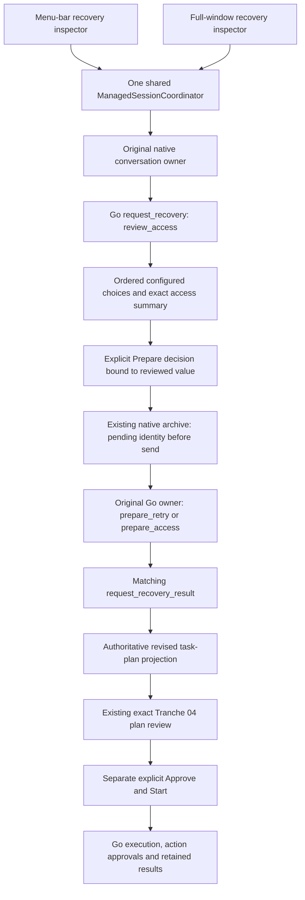

# Tranche 06 — reviewed recovery and account access

Implemented against current local sources, starting from clean HEAD `ce3f65273`. Source changes are confined to `macos/`. Existing Go application code, JS host, terminal behavior, stores, README files and dependencies are unchanged. No commit commands were issued by this agent. External repository activity incorporated parts of the work during this session; this inventory describes the entire tranche rather than only the final uncommitted diff. The separately paused backend goal was not resumed. Tranche 07 is not implemented.

## Working recovery flow

The contextual Tranche 05 inspector now supports an explicit Go-owned recovery-preparation journey:

1. Inspect the original retained failure, task, provider/model, repair guidance, partial outputs and action receipts.
2. For an eligible failed request without account requirements, explicitly choose **Prepare Recovery Plan**.
3. For retained account requirements, choose **Review Configured Account Access**, then select only configured Go-projected choices, in original requirement order. Missing/denied/read-only issues remain visible. The unavailable original account does not become ready merely because replacements exist.
4. A selection change immediately invalidates the old actionable access token. A matching fresh Go review supplies the resulting scope summary and local-configuration readiness. The complete permission/operation summary is expanded before **Prepare Plan With Reviewed Access**.
5. Preparation may consume model usage, but does not execute the original task or approve a plan. A matching operation result establishes immediate admission, not completion. The real revised task-plan projection establishes a new proposal.
6. **Inspect Recovery Plan** reuses the existing exact Tranche 04 inspector. Current owner/task/revision/digest, effects, inputs, access changes, remaining budget and prior attempts are reviewed again. **Approve & Start** remains a separate explicit action.
7. Execution and completion continue to come from the existing Go-owned plan/task lifecycle. Preparation never inherits an old action token or plan approval.

The client does not turn `retry_safe` into general retry permission. Ineligible or superseded records, missing/changed recovery identities, wrong owners, unavailable models, unready/stale access and capacity conflicts have disabled preparation controls and explanations. Interrupted work without a Go recovery projection remains inspection-only. Go-projected pending-access recovery is honored where its handler explicitly allows it; the client does not infer such authority from an interrupted queue/plan row.

Account setup guidance names the existing terminal `/connections`, `/permissions` and `/models` surfaces. Native recovery does not run these commands, create connectors, change global source selections or permissions, install secrets, sign in or replace credentials. Readiness is explicitly local configuration, not a tested provider connection.

## Contracts and ownership

Only these existing `request_recovery.action` values are implemented:

| Action | Exact fields and result |
| --- | --- |
| `review_access` | Original `conversation_id`, `task_id`, retained `token`, fresh `request_id`; optional positional `connections`. No `access_token`. Matching result must carry a valid `access_review` for the same ordered requirements and selections. |
| `prepare_access` | Same original identity plus the exact reviewed positional `connections` and `access_token`; fresh explicit request ID. Go rechecks the retained request, access token, processing/scope, leases and budgets. |
| `prepare_retry` | Same original identity and fresh explicit request ID. No account-selection or access-token fields. Original provider/model and frozen Go inputs remain authoritative. |

`discard` is not implemented. Native views cannot construct bridge frames. A finite native action API delegates to the original owner's existing NDJSON transport and managed coordinator. No new scheduler, process manager, database, networking layer or agent loop was introduced.

A preparation decision captures the exact reviewed account value at button activation. The coordinator checks it again after queued transitions; the owner checks it after persistence. A delayed click for account summary A cannot authorize subsequently reviewed summary B. Changing a selection invalidates both the active value and previously captured copies. Original recovery token, generation and projected scope must still match. Go independently rejects a changed request or account scope.



The coordinator serializes preparation with admissions and transitions and enforces three-working/four-cached owner limits. Pending or uncertain preparation reserves its original owner's capacity. Other owners remain independent. No work is stopped or evicted to make preparation possible. Go's idle/foreground checks and execution leases remain authoritative.

## Admission, persistence and uncertainty

Native phases distinguish submitted, transport-acknowledged, Go-admitted, preparing, actual plan-ready, rejected, failed, not-submitted, uncertain and canonical-state reconciliation. `action_applied` is never admission. Request results require the original owner/generation/conversation and matching request ID. Late results cannot affect another task or chat.

The existing native draft archive is now version 6, with owner-scoped preparation metadata: original owner generation, conversation/task, recovery token, action, reviewed positional selections/access token, request ID/nonce, previous plan revision, result/admission confirmation and uncertainty. It stores no credentials, credential pins, OAuth pins or full access-review private data. Older archive versions remain readable; earlier app bundles reject version 6 rather than ignoring pending identities. Use separate profiles when comparing earlier bundles. Terminal drafts and Go schemas are untouched.

Pending preparation is persisted before sending. A storage failure or failed final identity/capacity gate records **not submitted**. A send failure, timeout, owner loss or interrupted admitted preparation is retained as uncertain and is never replayed. Admission confirmation survives restart: the UI distinguishes an admitted preparation with an uncertain proposal outcome from an unconfirmed admission.

A replacement owner may reconcile uncertainty only from an actual newer proposal for the same retained task. This is labeled canonical inspection, not proof that the earlier native request succeeded. It never resubmits that request. Where the retained state cannot establish a new proposal, duplicate preparation remains blocked. No native operator-reset/discard mechanism is added.

## Files

| Path under `macos/` | Responsibility |
| --- | --- |
| `Sources/GatorCore/NativeRecoveryPreparation.swift` | Typed retained recovery, ordered access review, finite actions, pending identity and truthful stage labels. |
| `Sources/GatorCore/BridgeProtocol.swift` | Internal request-recovery frame serialization. |
| `Sources/GatorCore/GatorApplicationState.swift` | Freshness/eligibility, immediate selection invalidation, matching results, preparation stages, post-persistence guards, reconciliation and no-replay handling. |
| `Sources/GatorCore/ManagedSessionCoordinator.swift` | Original-owner routing, captured-decision validation, serialized preparation, capacity reservation and safe eviction. |
| `Sources/GatorCore/NativeDraftStore.swift` | Version 6 per-context merging, bounded completed receipts, retention of unconfirmed preparation. |
| `Sources/GatorCore/NativeRecovery.swift` | Current recovery explanation; existing evidence/receipt privacy and identity rules retained. |
| `Sources/GatorMac/RecoveryPreparationView.swift` | Full access summary, eligible account selection, app-local Tab/arrow navigation, guarded explicit preparation, canonical setup guidance. |
| `Sources/GatorMac/RecoveryInspectorContent.swift` | Embeds preparation in existing contextual inspection; displays admission/uncertainty and opens existing plan review. |
| `Tests/GatorCoreTests/RecoveryPreparationTests.swift` | Eligibility, ordered selections, stale copies, wrong results, ACK/admission distinction, duplicate input, persistence, late-owner isolation, final capacity gate and three-working-owner rejection. |
| `Tests/GatorCoreTests/RecoveryPreparationIntegrationTests.swift` | Actual Go retry/access/stale-scope/wrong-identity/interruption workflows and separate execution approval. |
| `Tests/GatorCoreTests/Fixtures/recovery-provider.mjs` | Controlled loopback provider/source, 401 failure, repair marker, held plan preparation and request trace. |
| `TRANCHE06-VERIFICATION.md` | This evidence ledger. |

Existing transport, scenes, plan-authorization implementation, exact action approval, receipt checker and terminal code were preserved. No unrelated test assertion or production timeout was changed.

## Build and regression evidence

From repository root unless noted:

```sh
go build -o /tmp/gator-native-runtime ./cmd/gator
go test ./cmd/gator ./internal/workapp -count=1
swift build --package-path macos --scratch-path /tmp/gator-native-build
swift test --package-path macos --scratch-path /tmp/gator-native-build --no-parallel
node --test app-host/tests/backend.test.mjs app-host/tests/sessions.test.mjs \
  app-host/tests/drafts.test.mjs app-host/tests/uploads.test.mjs \
  app-host/tests/policy.test.mjs app-host/tests/native.test.mjs
GATOR_TEST_BINARY=/tmp/gator-native-runtime bun test \
  app-host/tests/task-access.test.ts app-host/tests/access-rereview.test.ts \
  app-host/tests/preparation-recovery.test.ts
```

| Check | Observed result |
| --- | --- |
| Go build | PASS. |
| Go bridge/workapp regressions | PASS: `cmd/gator` 173.692 s; `internal/workapp` 42.314 s. Includes recovery, access, scope, leases, plans, dialogue and receipt boundaries. |
| Swift build | PASS; final explicit incremental build 0.38 s. macOS 15.0 target, installed Swift 6.1.2. |
| Swift explicit sequential suite | **96 passed**, zero failed; 45.602 s. All 82 earlier cases retained, plus fourteen new test functions including four real-Go preparation workflows. Parameterized variations are reported within those functions. Log `/tmp/gator-native-t06-swift-final96.log`. |
| Host existing JS files | **72 passed**, no failed/skipped; final valid-file command 5.359 s. |
| Host access/preparation integrations | **21 passed**, 561 assertions, three files, 56.66 s. These independently cover retained input/scope/access rereview and prepared recovery. |
| Native package | PASS: native executable, bundled Go runtime and valid Info.plist. Earlier verified bundles preserved. |

Two earlier concurrent Swift runs hit the unchanged blocked-stdin shutdown test's strict seven-second bound at 7.030 s and 7.084 s. This was not a recovery admission failure. Explicit `--no-parallel` is honored by the installed SwiftPM/Swift Testing runner: the complete suite, including that same shutdown assertion, then passed (95 before the captured-review regression was added; final 96 after it). No check was skipped, assertion relaxed or transport shutdown algorithm changed. The concurrent timing failure remains part of this record.

From `ui/`:

```sh
GATOR_TEST_BINARY=/tmp/gator-native-runtime bun test --preload ./scripts/preload.ts \
  tests/plan-corrections.test.tsx \
  -t 'initial correction failure and retry retains original task through restart at 80×24'
GATOR_TEST_BINARY=/tmp/gator-native-runtime bun test --preload ./scripts/preload.ts \
  tests/plan-corrections.test.tsx
GATOR_TEST_BINARY=/tmp/gator-native-runtime bun test --preload ./scripts/preload.ts \
  tests/request-recovery.test.ts tests/request-recovery-controls.test.tsx \
  tests/receipts.test.tsx tests/approvals.test.tsx tests/approval-review.test.tsx \
  tests/conversation-during-work.test.tsx tests/recovery.test.tsx \
  tests/running-plan-correction.test.ts tests/repeated-plan-owners.test.ts
GATOR_TEST_BINARY=/tmp/gator-native-runtime bun test --preload ./scripts/preload.ts \
  tests/interaction-recovery.test.tsx
```

- Prior-timeout exact-case reproduction: **1 passed**, 23 filtered, 13 assertions, 5.61 s. This is intentionally a targeted reproduction, not claimed as a complete file run.
- Complete affected file: **24 passed**, zero failed, 437 assertions, 64.02 s. Includes the exact case and all four terminal dimensions.
- Other targeted nine TUI files: **31 passed**, zero failed, 833 assertions, 99.63 s.
- Interaction recovery file: **1 passed**, zero failed, 13 assertions, 17.95 s. Together with the complete correction file and nine-file run, 56 distinct TUI tests passed across 11 files; the one-test timeout reproduction is counted separately, not added again.

### Previous TUI timeout investigation

The original Tranche 05 evidence is preserved in `/tmp/gator-native-t05-tui-tests.log`: 55 passed and one timeout, `initial correction failure and retry retains original task through restart at 80×24`. Its configured limit was 30,000 ms but reported elapsed time was **1,797,557.96 ms** (almost thirty minutes); that log spans 13:25:36–14:00:21 on 14 November. The Tranche 05 complete-file rerun passed 24/24 in 102.40 s. This tranche's isolated case and complete-file rerun both pass without changes to the TUI, Go application, affected test or its assertions.

Conclusion: **not reproduced; evidence favors an environment/scheduling stall** rather than a demonstrated Tranche 05 product regression. The large elapsed/timeout discrepancy is evidence of a stall, not proof of its cause. No sleep/power history was used to assert a specific cause, and this is not labeled a known flaky test or a proven absence of every race.

### Previous host-count investigation

Tranche 04 ran backend/session/**draft/upload**/policy files and reported 63 tests. Tranche 05 omitted draft/upload and reported 47, plus nine native helper tests. Its command also named **`app-host/tests/application.test.mjs`, which does not exist**. The installed Node runner did not run a test file for that argument. It was a reporting error to imply application-file coverage. This tranche first reproduced the copied command, then corrected it to the six existing files listed above, which pass **72 tests**. The 21 Bun access/preparation integrations are counted separately. No equality of coverage is inferred merely from a test count.

## Controlled Go integration

- **Unchanged-scope retry:** actual original HTTP 401 produces Go recovery metadata. A file repairs only the local provider behavior, keeping original configuration/scope fixed. Explicit preparation is admitted while model planning is held. No execution is recorded. Releasing planning produces the same task's actual revised plan. Fresh exact inspection plus separate Approve & Start produces exactly one successful execution; the unrelated draft remains intact.
- **Reviewed access:** an official Go setup process retains an inspect-mode source selection. The test removes that original connector using the supported CLI, then native submission retains a real pre-execution missing-source failure. Go reviews configured replacements. Selection changes invalidate the old review and preserve positional IDs. Changing the replacement's configured destination makes Go reject its old access token. Restoring setup and explicitly reviewing again permits preparation. The resulting plan exposes actual access changes; no connector read, external write or task execution happens merely because preparation was accepted.
- **Wrong identity/processing:** direct test-only bridge commands independently prove Go rejects wrong conversation, task and recovery token. A changed original provider configuration/scope is rejected before planning/execution. Native guards are not the only boundary.
- **Interruption:** the exact disposable Go PID is killed while admitted preparation is held. Restart retains original conversation/task, request identity, confirmed admission and uncertain proposal outcome. No second preparation or execution is recorded. Draft retained.

Fixtures use disposable HOME/config/state/workspace/native archive directories, whitelisted environment variables, unauthenticated loopback-only sources and controlled providers. They contain no production account, Gmail token or real external effect. Model POSTs are intentional preparation/execution fixture calls; they are not external action sends. Source endpoints reject non-GET operations. Existing prior-tranche actual-Go tests retain exact action approvals, read-only receipt checks, plan restoration/start, corrections and conversation during work.

## Native launched-app evidence

The actual packaged application and its bundled Go runtime were exercised through `/tmp/gator-native-tranche06-journeys.py`. The AX helper `/tmp/gator-native-t06-ax` targets the launched app PID. It uses actual Tab/arrow/Return/Space events, direct status-item presentation and targeted accessibility actions. Fixture repair and configuration changes occur only in disposable test setup, not through recovery controls.

- **A, retry:** `/var/folders/pq/lllswlg16q396qgx147zv_mm0000gn/T/gator-native-tranche06-ui-bq7tfid6`. Real failure → explicit keyboard preparation → held admitted planning → actual proposal → remaining-budget/exact review → separate approval → exactly one successful execution. Draft, another conversation and original task survive navigation; all owners reaped on Quit.
- **B/C/E, configured access plus stale access:** `/var/folders/pq/lllswlg16q396qgx147zv_mm0000gn/T/gator-native-tranche06-ui-odnt0ehl`. The unavailable original account is unready. Actual Tab reaches the named picker with Full Keyboard Access false; arrows select Alpha then Beta and Go returns fresh reviews. Compact/full views show the same account selection and ready summary. A changed destination makes Go reject the old token with zero preparations/executions. Fresh review retains Beta; explicit Space preparation yields a real new proposal with `selected_source_ids: ["beta"]` and no source read/execution. Navigation preserves drafts and ownership. Every Go owner reaped.
- **D, admitted preparation interruption:** `/var/folders/pq/lllswlg16q396qgx147zv_mm0000gn/T/gator-native-tranche06-ui-53_8rkd1`. SIGKILL of original owner, guarded Quit/restart, same original request ID and admitted-but-uncertain preparation, one preparation total, zero execution, inspectable interruption, retained draft and usable unrelated owner. All owners reaped.

Each root contains `journey.json`, native logs, actual Go request journals, provider request traces and AX/screenshot evidence. The access-review screenshot was visually inspected: full selected destination/permission, task-only scope, local-readiness limitation and explicit preparation control are readable within a scrollable inspector; no critical permission summary is collapsed or line-limited. The final retry journey was rerun on the delivery bundle after the keyboard repairs, rather than relying only on an earlier candidate.

Earlier driver attempts are excluded from acceptance: one captured the initial empty conversation ID before the first durable admission; another expected “Execution budget” where the reused inspector correctly displayed “Remaining execution budget”; an old coordinate-based helper could not safely select a scrolled-out picker; another attempt targeted menu entries unreliably. The final account journey uses actual focused Tab/arrow selection, not offscreen coordinate clicks. Diagnostic fixture profiles were retained; test applications/providers were explicitly closed.

## Accessibility and limitations

Implemented: semantic native fonts/colors, meaningful named review/prepare/select controls, text/symbol status, selectable full literal evidence, scrollable permissions, reduced-motion-compatible existing presentation, shared draft/focus restoration and non-default authorization controls. Return never prepares or approves. Space/explicit click/AX press remains intentional activation.

The native pass found Tab skipped the picker with system Full Keyboard Access off. App-local focus now exposes the picker; Up/Down choose only backend-projected issue-free accounts and trigger a fresh access review. Return is consumed. An in-progress review retains picker focus while the operation guard prevents competing selection changes. This does not change OS keyboard settings. The native journey verified Back → Review → Picker → Prepare traversal, selection, ready/stale states, Return safety, explicit Space and return to the composer.

Read-only environment inspection: AX trusted true; Full Keyboard Access false; Reduce Motion false; Increase Contrast false; preferred body font 13 pt. VoiceOver was not running. No persistent setting/input source was changed.

**NOT TESTED:** spoken VoiceOver/VO navigation, physical IME composition, changed Reduce Motion/text-size/high-contrast preferences, live accounts or production providers. AX inspection is not speech acceptance.

Operator checklist:

1. With your VoiceOver setup, read original failure → ordered requirements → selected account/destination/permission → full task-only scope. Distinguish Review, Prepare and Approve & Start.
2. Tab/Shift-Tab and arrows through the picker; wait for fresh readiness. Confirm Return cannot prepare/approve, Space is explicit and Escape/Command-L restores the same draft. Repeat in compact/full views.
3. With your existing IME, verify unfinished marked text never submits; check Enter and Shift-Enter. No input source was changed here.
4. If you choose to change accessibility preferences, inspect the longest summary/remaining-budget review at larger text/contrast and Reduce Motion. Scroll and select its final line.

## Acceptance and remaining boundaries

| Status | Scope |
| --- | --- |
| PASS | Original task/token binding; ordered configured account selection; immediate stale-token invalidation; captured review-bound decisions; explicit retry/access preparation; Go rejection of wrong/stale identities and changed processing; admission distinct from model proposal; fresh exact plan approval and one execution; no account/permission mutation by native controls; interruption persistence/no replay; multi-owner/draft/capacity/quit safety; listed regressions and native journeys. |
| PARTIAL | Accessibility acceptance: automated native keyboard/AX and visual inspection passed; physical speech/input/preferences remain operator work. |
| FAIL | Earlier concurrent Swift timing runs and driver attempts are recorded above; no known failing product assertion remains in final sequential/native verification. |
| NOT TESTED | Physical VoiceOver/IME and preference variants, production accounts/model connectivity, exhaustive every-provider and every malformed legacy record. |
| DEFERRED | OAuth/login, credential setup, permission/source configuration, destructive discard, automatic recovery/replay, generic resend, attachments, voice, Following, broad queue/manual plan editing and other excluded scope. |

An interrupted preparation without authoritative newer proposal stays blocked and reserves its owner; there is no generic Retry or native reset that erases uncertainty. A retained newer proposal can be inspected/reconciled without claiming an old request's outcome or replaying it. Preparation history and the current Go plan/execution state remain separate. Missing backend recovery evidence cannot create authority. Version 6 archives require isolated profiles for earlier bundles. Forced parallel native instances on one profile remain unsupported.

Recommended Tranche 07: native configuration/account repair using existing Go controls, together with operator-led VoiceOver and IME acceptance. No Tranche 07 work is included.

## Package and launch

Packaging used fresh destinations to preserve earlier builds and avoid overwriting running processes:

```sh
GATOR_NATIVE_APP_PATH=/tmp/Gator-Native-Tranche06-AccessKeys.app \
  bash macos/scripts/build-dev-app.sh
mv /tmp/Gator-Native-Tranche06-Ready.app /tmp/Gator-Native-Tranche06-PreAccessKeys.app
mv /tmp/Gator-Native-Tranche06-AccessKeys.app /tmp/Gator-Native-Tranche06-Ready.app
open /tmp/Gator-Native-Tranche06-Ready.app --args --open-window
```

The app contains `Contents/MacOS/GatorMac` and `Contents/Resources/gator-runtime`; minimum macOS 15.0. No runtime repository path, JS runtime, webview or new server is required. Earlier Tranche 01–05 bundles are preserved. Quit older Gator builds first; omit `--args --open-window` for menu-bar-first launch. Open original recovery with Command-I, review configured account access if needed, explicitly prepare, inspect the resulting plan and separately authorize execution.

SHA-256 of final packaged executables:

- Native: `41f41f38a57011f3cbf1ecfcd30edea28ea1efee613f25e49760df5503cfe825`
- Go: `58bf3597e14b99abe3a6919107ed9d648e81d77f340a2fcc2d82f1019a2b170e`

All acceptance accounts are controlled fixtures. Distribution signing/notarization is outside scope.

## Requested scenario ledger

| Cases | Evidence |
| --- | --- |
| 1–5: eligibility, interruption, missing/changed token and supersession | Parameterized native rejection tests, generation/current-record checks, real interruption and original-task completion tests. No controls are derived from an arbitrary interrupted queue row. |
| 6–14: task-bound access, ordering, configured choices, readiness and stale tokens | Native ordered/duplicate positional selection test, invented-choice rejection, immediate old-copy invalidation, reordered-result rejection, scope invalidation, actual Go access/stale-scope tests and native keyboard/account journey. Host access suites cover denied operations, read-only mode and retained requirements. |
| 15–25: exact preparation, owner/model/scope guards, matching admission, duplicate input and no pre-approval work | Native pending/captured-review/final-admission tests, actual Go wrong owner/task/token/processing rejection, held-preparer acceptance test, explicit plan approval test and interrupted-no-replay test. |
| 26–32: revised plan, current tuple, separate authorization and retained evidence | Actual Go and native retry journey through fresh plan inspection and one execution, stale-plan invalidation at preparation, existing restored-approved Start and prior action/plan correction integrations. Host recovery integration independently exercises original retained input/budget/scope accounting. |
| 33–37: multi-owner, generation, failures, focus and Quit | Native late-result A/B draft isolation, generation/restart retention, three-working limit test, existing managed-session regression cases, launched account/navigation and interrupted-owner journeys. |
| 38–44: earlier tranches | All 82 prior Swift tests retained in the 96-test sequential run, including real-Go interruption, immutable read-only receipt checks, exact approvals/plans, correction/revision, dialogue, archive and owner lifecycle; listed Go/host/TUI suites. |

Final native retry evidence was rerun after all account-keyboard and captured-review repairs on the delivered bundle. Its `journey.json` reports passed; original task and separate explicit authorization are retained with one successful execution. Actual native account B/C/E and interruption D also report passed. These are controlled-provider/native-app results, not production-account or spoken-accessibility acceptance.

The final process check found no remaining native test application, controlled recovery provider or owned Go bridge process. No publication, deployment, push or commit command was issued. Verification stops at this tranche.
