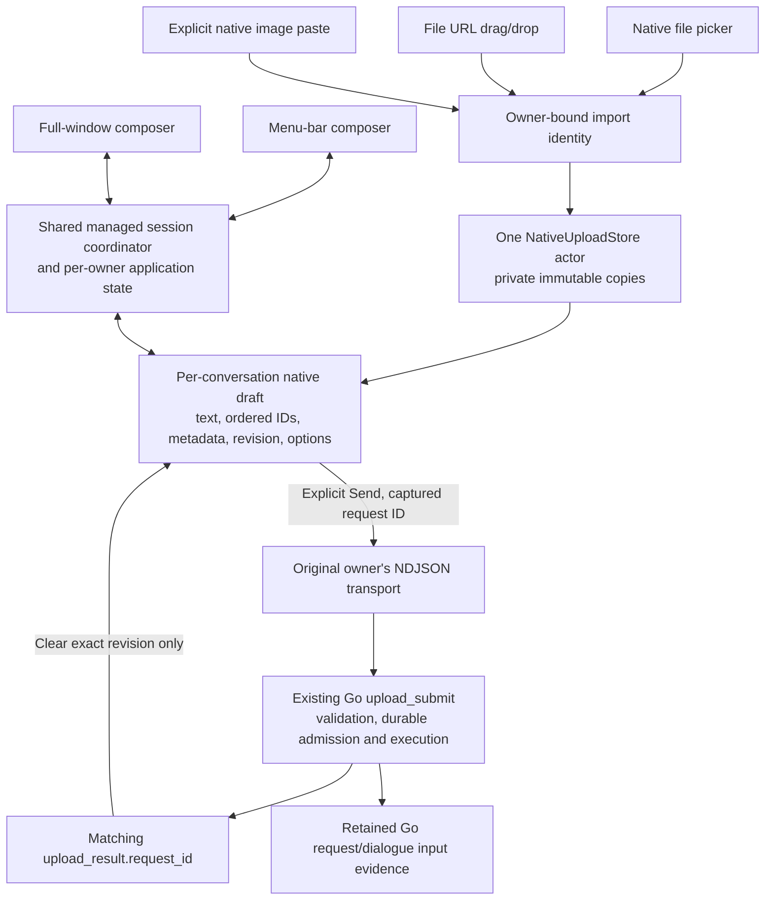

# Tranche 07 — Native attachments and rich composer

Implementation is confined to `macos/`. No README, Go/JS application code, terminal workflow or paused backend goal was changed. No commit, push or dependency installation was performed. The worktree was revalidated at HEAD `08726774096118a1f063fd55388372cbcd1f3561` after externally introduced commits; existing work was preserved.

## Architecture and attachment lifecycle



Native staging lives at `<GATOR_STATE_DIR-or-XDG_STATE_HOME-or-HOME/.local/state>/gator/native-uploads/<32 lowercase hexadecimal characters>/<filename>`. The resolved absolute root is passed as `GATOR_DESKTOP_UPLOAD_DIR` to **every** managed Go owner and replacement transport. No original source path is sent in a bridge frame or persisted as attachment authority.

This deliberately uses a native-only root. The existing JS upload janitor scans Go retention plus its own draft namespace, not native drafts; sharing its root could prune an old unsent native attachment. Native staging uses the existing Go upload layout and loader, with no second processing engine. No native pruning is implemented. Removing a chip only removes its current draft reference. Copies potentially owned by pending, queued, running, interrupted, recovery or retained dialogue work remain on disk.

Native and terminal upload roots are isolated. Cross-host replay of historical upload IDs is not provided: the other host's staged bytes are not automatically copied. Existing history, retained results, CLI/TUI behavior and backend validation remain unchanged. Never move old bundles onto this native draft profile merely to test rollback.

## Changed files

| File | Responsibility |
| --- | --- |
| `Sources/GatorCore/NativeUploadStore.swift` | Random opaque IDs, strict extension/name/count/size rules, descriptor-relative private storage, bounded immutable copies, digest validation, image normalization and thumbnails. |
| `Sources/GatorCore/NativeDraftAttachments.swift` | Context/generation-bound import identity and deterministic explicit clipboard policy. |
| `Sources/GatorCore/NativeDraftStore.swift` | Optional staged metadata/reply/owner fields, version 7 archive, old-version reads, pinned attachment drafts and exact pending identities. |
| `Sources/GatorCore/GatorApplicationState.swift` | Import/remove/availability services; immutable submission capture; actual Go result handling; workspace-to-durable conversation draft promotion and uncertain first-admission restoration. |
| `Sources/GatorCore/ManagedSessionCoordinator.swift` | One shared upload actor, safe initial workspace ownership, durable selection after Go assigns identity, imports excluded from owner eviction. |
| `Sources/GatorCore/GoBridgeConnection.swift` | Host-owned upload environment propagated to each real subprocess. |
| `Sources/GatorCore/BridgeProtocol.swift` | Ordered opaque file IDs and optional reply in typed `upload_submit`; public dialogue input labels; timestamp ordering by actual instants. Raw approval message indexes remain unchanged. |
| `Sources/GatorMac/NativeAttachmentActions.swift` | Multi-file NSOpenPanel, security-scoped imports through the store, file URL item providers, explicit NSPasteboard image access and focus restoration. |
| `Sources/GatorMac/AttachmentSelectionView.swift` | Bounded scrollable selection, staged thumbnails, literal wrapping filenames, sizes and accessible remove controls. |
| `Sources/GatorMac/ComposerView.swift` | Functional picker/image controls, native paste responder, text-view and surrounding drop targets, import/error feedback. Existing multiline/marked-text send safeguards remain. |
| `Sources/GatorMac/ConversationView.swift` | Retained public input labels and captured request attachment/admission details. |
| `Tests/GatorCoreTests/NativeUploadStoreTests.swift` | Security, immutable bytes, permissions, limits, atomicity, invalid images and paste policy. |
| `Tests/GatorCoreTests/NativeAttachmentDraftTests.swift` | Per-owner drafts, shared surfaces, restarts, late results, missing bytes, first-conversation promotion, corrupt archives and timezone regression. |
| `Tests/GatorCoreTests/NativeAttachmentIntegrationTests.swift` | Real Go document/image delivery, files-only canonical behavior and dialogue/delegated input retention during held work, including restart. |
| `Tests/GatorCoreTests/NativeAttachmentDisconnectTests.swift` | Real Go admission with deliberately withheld upload result; process interruption and restart preserve exact request/files without replay. |
| `Tests/GatorCoreTests/Fixtures/attachment-provider.mjs` | Disposable loopback Chat Completions provider, recorded input bodies, held work, reply/task routing. No connector credentials or external effect endpoint. |
| `Tests/GatorCoreTests/ManagedSessionTests.swift` | Existing submission enum pattern updated for optional attachment/reply fields; assertions retained. |
| `TRANCHE07-VERIFICATION.md` | This evidence ledger. |

## Protocol and security

- Confirmed shared limits: **12 files**, **8 MiB/document**, **4 MiB/image**, **16 MiB/message**, text **128 KiB**. Extension allowlist matches current Go/host constants: `png jpg jpeg webp pdf docx odt xlsx pptx txt md markdown rst csv tsv json jsonl yaml yml toml xml html htm log ini cfg conf js jsx ts tsx py go rs java c h cpp hpp css scss sh bash zsh sql rb swift kt vue svelte tex r`.
- File picker/drop batches are atomic from the draft's perspective. One invalid item rejects the entire batch and removes only new partial copies. Existing files/drafts survive. Duplicate filenames receive different random directories.
- Source files are opened read-only, regular/nonempty and no-follow; copied in 64 KiB chunks; size/mtime are checked across copying. Native storage root and ID directory/file opens use `O_NOFOLLOW`/`openat`, exclusive creation and containment-validated IDs. Root/ID directories are 0700, copies 0600. `/var` parent system aliases are canonicalized; the private root/children themselves cannot be symlinks.
- SHA-256, filename and byte count persist with draft references. Submission rechecks the captured private copy; changing/removing a selected original cannot change the admitted bytes. Go independently validates actual upload IDs and contents.
- Image input is decoded only on explicit paste/import. PNG/JPEG/WebP are supported where ImageIO supplies the decoder; clipboard TIFF is normalized to PNG. Images are bounded to 16 megapixels, dimensions at most 16,384 and final staged PNG at most 4 MiB. Thumbnails are at most 160 px. Document preflight reads are bounded to 8 MiB; image data/normalization allocations are bounded. NSPasteboard materializes its selected encoded representation before the size check; no background clipboard polling occurs.
- Ordinary Paste prefers plain text when text and pixels coexist. Explicit Paste Image requests pixels. Clipboard file URLs never become pixel imports; untrusted HTML is not rendered/interpreted. Explicit file selection/drop is required for file URLs.
- `upload_submit.upload`: captured `request_id`, original `context`, exact text (empty for files-only), ordered opaque `files`, optional `plan_first` and `reply_to_update_id`. No local paths, credential material or implicit `queue_only`. Go supplies its canonical files-only prompt. Existing reply metadata is preserved; no new reply workflow is invented.
- Nonce `action_applied` is not admission. Only matching `upload_result.request_id` confirms the immediate result. Newer text, attachments and options survive late acceptance. Rejections retain the selection. Uncertain admissions retain the same request and input identities, with no automatic replay.
- A first workspace admission may gain a durable Go conversation identity after sending. The native archive preserves the original request context and separately binds its uncertainty to the Go-confirmed durable owner. Restart restores that pending identity rather than offering an unrelated new submission.
- Imports capture original context/generation before picker/provider work. Navigation to B cannot attach A's completed import to B. A replaced/disconnected generation cannot silently receive old import output. No chip removal deletes retained bytes.

## Archive compatibility

Existing native archive versions 1–6 remain readable. New optional fields preserve prior correction, plan, receipt, recovery, draft and pending-operation state. Version 7 is written when attachment/reply metadata or a promoted uncertain owner binding requires it. Older bundles reject version 7 rather than silently ignore these identities. No terminal draft migration or write occurs.

Attachment-bearing drafts and pending contexts are not aged out after seven days; at most 128 pinned draft contexts are retained, otherwise persistence fails without replacing the original archive. Other draft retention remains bounded. Corrupt, unsupported and invalid attachment archives fail closed and are preserved. Atomic saves retain the existing private-file convention. Rollback testing requires a separate profile or a pre-upgrade backup; no automatic backward rewrite is attempted.

## Commands and regression evidence

Executed from repository root unless noted:

```sh
go build -o /tmp/gator-native-runtime ./cmd/gator
go test ./cmd/gator ./internal/workapp ./internal/attachment -count=1
swift build --package-path macos --scratch-path /tmp/gator-native-build
swift test --package-path macos --scratch-path /tmp/gator-native-build --no-parallel
node --test app-host/tests/backend.test.mjs app-host/tests/sessions.test.mjs \
  app-host/tests/drafts.test.mjs app-host/tests/uploads.test.mjs \
  app-host/tests/policy.test.mjs app-host/tests/native.test.mjs
GATOR_TEST_BINARY=/tmp/gator-native-runtime bun test \
  app-host/tests/task-access.test.ts app-host/tests/access-rereview.test.ts \
  app-host/tests/preparation-recovery.test.ts
# From ui/:
GATOR_TEST_BINARY=/tmp/gator-native-runtime bun test --preload ./scripts/preload.ts \
  tests/attachments.test.tsx tests/draft-synchronization.test.tsx \
  tests/conversation-during-work.test.tsx tests/approvals.test.tsx \
  tests/recovery.test.tsx tests/receipts.test.tsx
```

| Check | Result / log |
| --- | --- |
| Go build | PASS. Actual executable used by native integration fixtures. |
| Go bridge/workapp/attachments | PASS: cmd/gator 202.942 s, workapp 64.395 s, attachment 4.479 s. `/tmp/gator-native-t07-go-final.log`. |
| Host regressions | 72 PASS, 0 failed/skipped, 9.942 s. `/tmp/gator-native-t07-host.log`. Includes retention and host immutable uploads/drafts. |
| Host access/preparation integration | 21 PASS, 561 assertions, 0 failures, 116.03 s. `/tmp/gator-native-t07-host-integration.log`. |
| Selected TUI regressions | 11 PASS, 1 SKIP, 0 failed, 313 assertions, 94.51 s. `/tmp/gator-native-t07-tui.log`. The existing Linux-only attachment test is intentionally skipped on macOS; not counted as native acceptance. |
| Swift focused import suite | 5 test functions PASS, including seven parameterized rejection cases. `/tmp/gator-native-t07-upload-unit.log`. |
| Swift full suite before final uncertainty test | 110 PASS, 62.184 s. `/tmp/gator-native-t07-swift-delivery.log`. |
| Focused first-admission/lost-result regressions | 3 PASS, 2.593 s; includes unchanged older managed pending-state assertions. `/tmp/gator-native-t07-loss.log`. |
| Final Swift full suite | **112 PASS**, 0 failed, 55.805 s. `/tmp/gator-native-t07-swift-final112.log`. All 96 earlier tests retained; 16 new test functions plus parameterized variants. |
| Package | Development app contains native executable and real Go executable; Info.plist lint passes. Final packaging command/result recorded below. |

Swift tests use explicit sequential execution. No parallel run was attempted in this tranche; the prior concurrent shutdown timing issue is not erased or claimed fixed. No timeout assertion was relaxed. Initial local Swift call-site/macro compilation errors were repaired before passing checks. SwiftPM occasionally waited for its scratch-path lock during packaging; the final build/test/package steps are serialized.

## Controlled real-Go evidence

The provider fixture binds only `127.0.0.1`, requires a disposable control directory, reads no real accounts/secrets and records supplied model bodies. It has no external action endpoint. Temporary profiles contain only a configured custom local provider. Production keys and services were not used.

1. A native-staged Markdown document was changed/deleted at its original location. The actual Go provider body still contained `Original jade heron`, never the modified content. The Go request journal retained the original opaque upload ID.
2. A native-normalized PNG submitted with empty text produced a real Chat Completions `image_url` data URI and Go's canonical files-only request. Its opaque ID was retained in the actual request journal. Admission cleared only the matching draft.
3. Held original work continued while attachment-bearing dialogue received its independent response with no implicit queue. The public dialogue retained exact `input_ids`. Another routed attachment task used its own Go owner and received the immutable document. This passed again after restoring a durable conversation.
4. The lost-result fixture forwards actual Go snapshots/acks but deliberately withholds only the matching upload-result field. Go durably admitted the staged file and the local provider observed it. SIGKILL then interrupted that owner. Native restart retained original request/context/files and no new provider invocation occurred. This is controlled transport fault injection, not proof of a physical network failure or a GUI button journey.

## Launched native application evidence and limitations

Actual app instances were launched with bundled runtime, disposable config/state/user-data/workspace and the same loopback fixture. The final repeat used `/var/folders/pq/lllswlg16q396qgx147zv_mm0000gn/T/gator-native-tranche07-ui-ak8ly9ao`. Evidence root:

`/var/folders/pq/lllswlg16q396qgx147zv_mm0000gn/T/gator-native-tranche07-ui-8r0sbmws`

AX/CGEvent automation, archive inspection, provider trace and owned-window screenshots were used. These are actual native app tests; they are separate from the Swift test suite and from physical user acceptance.

| Journey | Observed evidence |
| --- | --- |
| A: document picker and immutable submission | PASS: real NSOpenPanel, selection chip, private file/archive, unsent restart before first durable conversation, delete/modify original, explicit native Send, original bytes at actual Go provider and retained request input. `selected.png`, `document-delivered.png`, picker AX records, provider trace and request journal. |
| B: clipboard image | PASS for explicit native Paste Image control, staged preview, no provider call before Send, image persistence across restart and actual files-only native Send delivering a PNG data URI. `image-selected.png` / `image-delivered.png` where captured and native-final log. Command-V automation initially inserted stray text rather than producing a preview; it is not claimed as physical keyboard acceptance. The native text responder now handles explicit Command-V without depending on an active accessory-app Edit menu. A final synthetic Command-V attempt still did not establish image staging; shortcut acceptance remains NOT VERIFIED. Explicit Paste Image and actual files-only delivery passed on the final bundle. |
| C: owner/presentation/restart | PASS for independent A/B selections, return to original staged image, one shared selection in compact/full views and restart retention. Native archive and actual process counts corroborated this. |
| D: conversation during work | Real Go/coordinator integration PASS. Launched app produced and retained the attachment-bearing reply while original work was held. Initial native assertion failed because UTC/local-offset lexical sorting placed the new reply earlier in history. Timestamp comparison is now by actual instants, with regression coverage; rebuilt app visibly showed the retained attachment reply. Earlier native-menu driver attempts timed out. The final bundle then passed a fresh complete native image/work journey: image-bearing reply visible during held work, switch to another owner, full-window dismissal with all Go owners alive, actual menu-bar opening, Expand retaining draft/selection, background completion without focus theft and return to original result. See final evidence below. |
| E: uncertain native admission | PASS both controlled real-Go lost-result integration and actual native button-driven fault journey: fourth owner, selected PNG and explicit Send; a watcher interrupted only its newly created Go process at the persisted-pending boundary. Matching original ID/files survived explicit Reconnect, other owners stayed alive, no new provider request occurred, and guarded Quit cancellation/confirmation retained pending state and reaped all owners. No replay claim relies solely on mock state. |
| Drag/drop | Native file URL handlers are implemented on the NSTextView and surrounding composer. Core import/context safety is tested. Controlled cross-process drag automation did not establish a selected chip; its hit target was not reliably established. Actual Finder/drop acceptance remains NOT VERIFIED. Source operation reports alone are not treated as import proof. |

Driver attempts and repaired issues are not omitted: an early picker matcher recognized only AXWindow while the later actual picker correctly used AXSheet; a launch raced unfinished packaging; a reused failed-task conversation routed a repeated objective as dialogue, so the held-work fixture was moved to a fresh conversation; menu/keyboard automation had timeouts/stray text. These do not establish product success. The UTC/local-offset ordering issue and initial workspace-draft persistence defect were reproduced, fixed and regression tested.

## Accessibility and native interaction

Implemented: literal selectable names/errors, wrapping filenames, scroll-bounded attachment list in 440×620 compact view, named keyboard-focusable picker/remove controls, image/declaration labels, count/size/import/admission/error text, no color-only status, native security-scoped picker handling, native text/IME send guards and no new motion. Full/compact observe the same store/coordinator. No persistent accessibility setting or input source was changed.

Automated native AX inspection verifies control names and selected attachment metadata; screenshots were inspected. AX metadata is not VoiceOver speech acceptance. Physical VoiceOver, marked-text IME composition, preference variants and comprehensive keyboard traversal remain NOT TESTED.

Operator checklist:

1. Quit older native bundles. Open this app; Tab to Attach Files, select multiple documents, cancel and retry. Confirm cancellation preserves text/files and the compact panel survives its picker.
2. Paste a screenshot with Command-V; paste plain text; with mixed representations use Image attachment options → Paste Image. Confirm nothing sends before explicit Send. With your existing IME, finish/cancel marked text before Return; verify Shift-Return inserts a newline.
3. Drop one/multiple supported files onto the text area and surrounding composer. Check the drop label, unsupported-type error, original conversation binding and no automatic send.
4. Navigate/remove attachments with keyboard and VoiceOver; read long filenames/errors, scroll all selected files in compact/full views, expand and return without changing owner/draft.
5. Start controlled work, send an independent attachment-bearing message, read its latest reply, switch chats and dismiss both views. Return to the original owner and inspect completion. Do not infer delivery from admission.
6. With preferences you choose to use, inspect larger text/contrast/Reduce Motion. No preference was modified by verification.

## Acceptance and remaining boundaries

| Status | Scope |
| --- | --- |
| PASS | Secure immutable staging, exact supported types/limits, atomic imports, descriptor containment/no-follow checks, staged-byte validation, ordered opaque upload contract, text/files-only Go delivery, authoritative admission, late-edit preservation, isolated persistent drafts, initial workspace promotion, uncertain first-admission restoration, no automatic replay, actual managed attachment dialogue/delegation, prior tranche regressions. |
| PARTIAL | Accessibility/native input acceptance: real picker, explicit clipboard image, delivery/restart/shared surfaces, full held-work navigation/dismissal, native disconnect/reconnect and guarded shutdown passed. Physical speech/input/preferences and successful Command-V/drop acceptance have the narrower boundaries recorded below. |
| NOT TESTED / NOT VERIFIED | Successful physical or complete automated drag/drop, comprehensive native keyboard/IME/VoiceOver/preference acceptance, production-provider/model image support and real API/account behavior. |
| DEFERRED | Safe disk pruning, cross-host staged-file migration, general file/document editing, OAuth/provider setup, voice, Following, queue editing, manual plan editing and Tranche 08 UI/UX audit. |

At the user's request about headless testing, repeated headful attempts were stopped. Future routine checks should use the headless Swift/real-Go suites; picker/paste/drop/window and physical accessibility checks are reserved for affected native changes or release acceptance.

Copies are conservatively retained and can accumulate. Missing/tampered copies produce a repairable remove-and-reattach error. Inspecting/chip removal never purges potentially admitted data. Native-only user-data archives do not support concurrent native application instances writing the same profile. No external effect was issued by these controlled fixtures.

Tranche 08 preparation: use this build and these exact operator gaps for the reserved native UI/UX audit. Focus on picker/drop/paste keyboard acceptance, compact attachment layout/focus, transcript follow/reading position and physical accessibility. Do not replace the Go-owned admission or shared session architecture. No Tranche 08 implementation was started here.

## Final artifact and launch

```sh
GATOR_NATIVE_APP_PATH=/tmp/Gator-Native-Tranche07-Ready.app \
  bash macos/scripts/build-dev-app.sh
open /tmp/Gator-Native-Tranche07-Ready.app --args --open-window
```

The packager refuses an existing destination. Earlier T01–06 bundles remain intact; intermediate T07 bundles were moved to distinct `PreWorkspaceDrafts`/`PreTimestampOrder` paths before rebuilding. Final package evidence and executable hashes are appended below.


### Final recorded results

- Explicit final Swift build: PASS, 10.69 s; `/tmp/gator-native-t07-build-final.log`.
- Final full sequential Swift suite: **112 passed**, 0 failed, 55.805 s; `/tmp/gator-native-t07-swift-final112.log`. All 96 earlier tests plus 16 attachment/first-admission/ordering/lost-result cases remain. No parallel run or timeout relaxation was used.
- Final packaging: PASS; `/tmp/gator-native-t07-package-final-ready.log`. Native minimum target macOS 15.0; `Contents/MacOS/GatorMac` and `Contents/Resources/gator-runtime` are executable, Info.plist valid. Final native executable SHA-256 `1502332e9da4753edfedd4a9f43d809e70d45cadd512457f3dcc4bacbdd70638`; bundled Go SHA-256 `20b2b29e1af913a7d92f72489aa3df6745110f4fce7f4c2311d1adef8a657442`.
- Final native image/work journey PASS: `/tmp/gator-native-t07-native-final-journey.log`, final fixture root `final-native-journey.json`, `native-attachment-during-work.png`, `native-task-return.png`. The actual menu-bar/full-window, draft, ownership, dismissal and independent-completion checks passed.
- Actual native uncertain admission/reconnect/guarded shutdown PASS: `/tmp/gator-native-t07-native-E.log`, final fixture `native-E.json` and `native-disconnect.ax.txt`. Only the fresh fourth owner's Go PID was interrupted. Other owners remained alive; explicit reconnect retained the same request/files with no new provider invocation; cancellation and confirmation of Quit were both exercised. A later native restart restored those same uncertain attachments without replay (`/tmp/gator-native-t07-native-drag.log`).
- Read-only input environment: ABC input source, secure event input false, AX trusted true, event-post and screen-capture preflights true. This did not establish successful synthetic Command-V/drag acceptance and is not physical IME/VoiceOver testing.
- Earlier T01–06 bundles preserved. The preceding T07 artifact was also preserved as `/tmp/Gator-Native-Tranche07-PreAdmissionBinding.app` before the final rebuild.

The remaining acceptance gap is native keyboard/drag and physical accessibility verification, not Go attachment delivery, durable ownership, admission or disconnect semantics. No live API keys, accounts, credential writes or real external effects were used. A configured production model can be tested next through explicit Send; model-specific image capabilities and actual usage must be verified separately.

Cleanup confirmed no remaining final native test app or owned Go subprocess; both controlled attachment providers and the drag source were stopped. Final Info.plist lint and `git diff --check` passed. HEAD remained `08726774096118a1f063fd55388372cbcd1f3561`; no README edits or commits were made. The final native image/work/disconnect results supersede earlier incomplete driver attempts, while unsuccessful Command-V/drag attempts remain explicitly unverified. No further headful acceptance runs were performed after the user's request to prefer headless verification; remaining UI activity was cleanup only.
