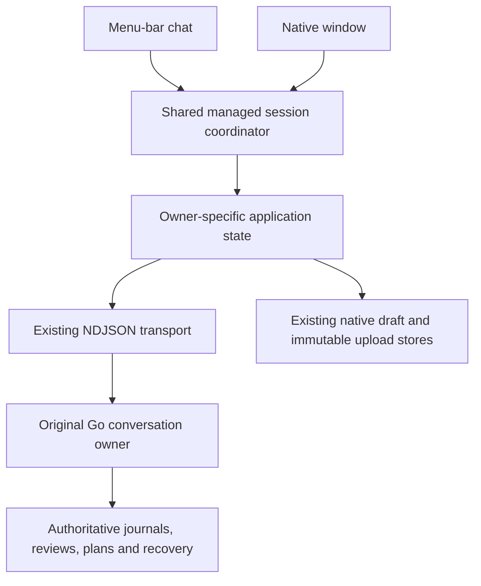

# Tranche 08 — native remediation and acceptance evidence

Date: 2026-11-16. Verdict: **PARTIAL final acceptance**. This is implemented remediation, not an audit-only deliverable. The native app is materially more coherent, but incomplete desktop/accessibility evidence and a blocked real-provider inference prevent unconditional eight-tranche acceptance.

## Scope, worktree and architecture

Inspected the current native sources, tests, packaging/resources and all seven existing verification reports; Go bridge/task/recovery/upload authority and host contracts remain unchanged. Initial HEAD was `08726774096118a1f063fd55388372cbcd1f3561`. External commits advanced HEAD through `c8f3b76d3fb89068c73ad9b02e1ef77ea448f445` to `5897fe52b6e5280266b180b6f72fc44bc5eeac73` during this work and captured part of the native edits/evidence. It was preserved. **This agent created no commits**, installed no dependencies, changed no README, and did not resume the paused backend goal.

One existing application state/session coordinator remains above both scenes. Views still use typed methods; no new agent/runtime/network/store was introduced. Only presentation/window references, native input adapters and test fixtures were added. SwiftUI owns its scene/window identifiers. Weak window references are presentation metadata, not an execution coordinator.



## Changed-file inventory

This inventory includes Tranche08 edits already captured by the external commit, not merely the final uncommitted diff. Existing Tranche07 files/work were preserved.

| File under `macos/` | Responsibility/change |
| --- | --- |
| `Sources/GatorCore/GoBridgeConnection.swift` | Removes a sampled Foundation synchronous exit-wait hang; asynchronously confirms termination after existing escalation. |
| `Sources/GatorCore/BridgeProtocol.swift` | Fast transcript projection; preserves raw indexes/UTC-offset ordering and complete snapshots. |
| `Sources/GatorCore/GatorApplicationState.swift` | Reuses decoded messages; fresh managed profile requests existing Go `new` boot mode before editing; legacy drafts/uncertainty restore unchanged. |
| `Sources/GatorCore/NativeMessageContent.swift` | Bounded native Markdown blocks; no executable authority or structured-review parsing. |
| `Sources/GatorCore/NativeUploadStore.swift` | Distinct backend-compatible names for repeated pasted images; existing private immutable copies and validation preserved. |
| `Sources/GatorMac/ConversationView.swift` | Native toolbar/subtitle, welcome, readable messages, grouped menus, bounded notices, full errors and concise public activity. |
| `Sources/GatorMac/ComposerView.swift` | Restrained semantic editor surface, balanced dimensions; editor lifetime keyed by conversation/generation. |
| `Sources/GatorMac/NativeComposer.swift` | Extracted AppKit editor; native paste, bounded plain text, Tab traversal, composition guards, compact Escape and focus lifetime. Opt-in DEBUG tracing records only fixed input metadata. |
| `Sources/GatorMac/NativeDropInput.swift` | Typed file URL/legacy file-list extraction; rejects textual paths/web URLs. |
| `Sources/GatorMac/NativeAttachmentActions.swift` | Existing picker/staging pipeline uses typed clipboard file detection and safe diagnostic metadata. |
| `Sources/GatorMac/AttachmentSelectionView.swift` | Count-bounded scrolling attachment region. |
| `Sources/GatorMac/NativeMessageBody.swift` | Selectable native prose/headings/lists/fenced code. Exact reviews and user commands stay literal. |
| `Sources/GatorMac/NativeErrorDisclosure.swift` | Summary plus complete selectable error. |
| `Sources/GatorMac/NativeWindowConfiguration.swift` | Adaptive accent, weak presentation references, preserves SwiftUI scene identity; process-only DEBUG appearance is idempotent. |
| `Sources/GatorMac/GatorApp.swift`, `AppDelegate.swift` | Standard full-window toolbar/edit commands, activation policy and existing guarded lifecycle integration. |
| `Sources/GatorMac/TaskInspectorView.swift`, `ApprovalReviewView.swift` | Flatter semantic review sections, less repetition, compact explicit decision layout; authority checks unchanged. |
| `Resources/Info.plist`, `scripts/build-dev-app.sh`, `scripts/make-app-icon.swift` | Native ICNS generation and bundle metadata; bundled Go runtime and existing terminal packaging preserved. |
| `Package.swift` | Native AppKit component test target without launching the application. |
| `Tests/GatorCoreTests/NativeMessageContentTests.swift`, `NativePerformanceTests.swift` | Markdown fidelity, JSON/transcript/startup/idle-owner/thumbnail measurements. |
| `Tests/GatorCoreTests/NativeAttachmentIntegrationTests.swift`, `NativeUploadStoreTests.swift`, `GoIntegrationTests.swift` | Actual Go fresh idle identity and multi-image admission; unique pasted input names. |
| `Tests/GatorMacTests/NativeInputTests.swift` | Native shortcut/text paste, marked text, file pasteboard types, keyboard loop, contrast, editor ownership and window identity. |
| `Tests/GatorCoreTests/Fixtures/audit-provider.mjs`, `Fixtures/native-history/main.go` | Loopback-only visual fixture and bounded synthetic retained history via the existing Go store API. No credentials/external service. |
| `TRANCHE08-UIUX-AUDIT.md`, this report, `Evidence/Tranche08/` | Before/after findings, reproducible logs, actual screenshots and explicit acceptance limits. |

## Protocol and security preservation

No Go/JS application protocol changed. Existing `upload_submit`/matching `upload_result`, managed dialogue dispatch/control, `focus_session`, exact approval tokens, task/revision/digest-bound `task_plan`, request recovery/access tokens and exact receipt contracts remain authoritative. `action_applied` still only acknowledges transport handling. No replay, implicit approval, automatic recovery, provider fallback or upload pruning was added.

Pasted images keep distinct opaque IDs and immutable copied bytes; only colliding generated display names are disambiguated. Originals and existing retained uploads are untouched. Source/config selection, permission enforcement, execution leases and request IDs remain Go-owned. Fresh idle chat creation invokes no model/task/tool.

## Headless commands and results

All routine regressions ran headlessly. Swift uses `--no-parallel`; no timeout assertion was weakened and no parallel run was substituted.

```sh
go build -o /tmp/gator-native-runtime ./cmd/gator
go test ./cmd/gator ./internal/workapp ./internal/attachment -count=1
swift build --package-path macos --scratch-path /tmp/gator-native-build
swift test --package-path macos --scratch-path /tmp/gator-native-build --no-parallel
node --test app-host/tests/backend.test.mjs app-host/tests/sessions.test.mjs \
  app-host/tests/drafts.test.mjs app-host/tests/uploads.test.mjs \
  app-host/tests/policy.test.mjs app-host/tests/native.test.mjs
GATOR_TEST_BINARY=/tmp/gator-native-runtime bun test \
  app-host/tests/task-access.test.ts app-host/tests/access-rereview.test.ts \
  app-host/tests/preparation-recovery.test.ts
# From ui/:
GATOR_TEST_BINARY=/tmp/gator-native-runtime bun test --preload ./scripts/preload.ts \
  tests/attachments.test.tsx tests/draft-synchronization.test.tsx \
  tests/conversation-during-work.test.tsx tests/approvals.test.tsx \
  tests/recovery.test.tsx tests/receipts.test.tsx
GATOR_TEST_BINARY=/tmp/gator-native-runtime bun test --preload ./scripts/preload.ts \
  tests/plan-corrections.test.tsx tests/request-recovery-controls.test.tsx \
  tests/approval-review.test.tsx
```

| Suite | Result and evidence |
| --- | --- |
| Go build | PASS; actual executable used by controlled native integration. |
| Go packages | 3 PASS: cmd/gator 165.906s, workapp 45.374s, attachment 0.566s. `headless/go.log`. |
| Host Node regressions | 72 PASS, zero failures/skips, 8.626s. `headless/host.log`. |
| Host access/preparation integration | 21 PASS, 561 assertions, 68.52s. `headless/host-integration.log`. |
| Selected TUI baseline | 11 PASS, one existing Linux-only platform SKIP, 313 assertions, 63.91s. `headless/tui.log`. |
| Additional TUI review/recovery/plan cases | 29 PASS, 502 assertions, 78.04s. `headless/tui-reviews.log`. |
| Swift intermediate full runs | 122 PASS/61.478s; 124 PASS/204.689s under severe load; 125 PASS/94.159s; 126 PASS/89.370s. No functional test removed. |
| Final Swift | **128 PASS /60.960s**, complete post-shutdown-fix run, zero failures. `headless/swift-final-128.log`. Earlier127-test failure, focused rerun,127-test success and subsequent sampled shutdown hang are recorded separately below. |
| Real Go repeated image admission | PASS, 1 focused integration test/1.985s; full final suite repeats it. `headless/multi-image-go.log`. |
| Native component fixture failures | Initial zero-size/nonfocusable button and released-on-close test window were corrected; same keyboard assertions pass. A weak-window-deallocation assertion was invalid because AppKit retains windows; replaced with scene identity/mapping assertions. Initial failure logs retained; no production safety assertion weakened. |
| Existing native regressions | Full suite includes managed dialogue, correction, plan revision/approval/start/restart, reviewed recovery, exact read-only receipts, attachment admission, uncertain IDs, capacity/eviction, independent owners and guarded shutdown. |

## Targeted desktop checks and fixture boundaries

Desktop interaction was limited to visual/native-input sessions, not used for ordinary protocol/state regressions. Baseline T07 and T08 candidate captures are separate from final-candidate captures. All GUI data uses disposable profiles and a loopback custom provider with fake `.invalid` destinations. No production screenshot account was connected.

Observed:

- Full window and actual MenuBarExtra open with the same draft/attachment state.
- Hardware-style CG Command-V reached `ComposerTextView.paste`, staged a PNG and left it unsent. The earlier `postToPid` Unicode shortcut produced no responder trace; that failed automation attempt is retained rather than called a product success/failure.
- Plain text paste and AppKit marked-text behavior pass component tests. Actual Tab moved from composer to Attach Files.
- Native picker staged `brief.md`; editing the source afterwards did not modify the private copy. Actual Go admitted text+PNG+document and returned native rendered prose.
- A duplicate pasted filename was truthfully rejected by Go and preserved the draft. The native naming fix then passes real Go multi-image files-only admission.
- Plan-first produced a real proposed plan. Native inspection showed objective, ordered steps, effects and budget; explicit Approve & Start caused the held task to run under its original owner.
- The subsequent AX chat-navigation operation timed out; this desktop conversation-during-work continuation is **PARTIAL**, while real Go coordinator integration passes headlessly.
- A controlled exact-action GUI fixture initially remained in inspect/forbid scope and produced no external effect/review. Attempting native mode-menu selection then timed out. This is **not** counted as GUI approval acceptance. Real Go exact approval/correction workflows remain covered by the unchanged integration suite.
- Initial unbundled drag injection did not establish a visible source/destination. A bundled AppKit drag-source fixture then produced actual native document and PNG drops: two accepted destination callbacks and both unsent chips were observed. No submission was triggered. The intermediate source-missing attempt is retained as automation history, not counted as a separate pass.
- Some AX menu/window operations lost their target or timed out. A sampled main thread was in the idle AppKit event loop; this does not establish a product deadlock. Window configuration now avoids overriding SwiftUI's own scene identifier. Full menu/window restoration needs operator verification.
- Interrupted controlled fixture processes were terminated only within their disposable profile after held work was released. This is not presented as successful manual guarded-Quit acceptance; that behavior is covered by core integration tests.

No real email/write was executed. The audit provider's external-effect trace remains empty. Normal model fixture calls and synthetic history are not real-provider validation.

## Bounded real-provider smoke

**FAIL for inference; successful real-provider acceptance NOT TESTED.** The already configured model was `gemini/gemini-3.5-flash`. No defaults or credentials were changed.

An initial isolated-state attempt could not find the existing authentication store and stopped before inference. The one authoritative bounded call then used the existing Go credential store, an empty disposable source, inspect mode, external actions forbidden, one model request, one step, 1,024-token limit and 45-second timeout:

```sh
/tmp/gator-native-runtime work --source <empty-disposable-directory> \
  --mode inspect --actions forbid --max-steps 1 --max-model-requests 1 \
  --max-tokens 1024 --timeout-seconds 45 --json \
  'Reply with one short sentence confirming this test message was received. Do not call tools or perform any other action.'
```

Gemini returned **HTTP 401: API key not valid**. No successful inference, external action or secret logging occurred. No further provider attempts were made. Sanitized evidence: `headless/real-provider-authoritative.json`. Repair must occur through the supported provider configuration path outside this tranche; do not put a secret in this report or test artifacts.

## Performance methodology and measurements

Intel i5-8279U 2.40GHz, 8GiB RAM, macOS15.7.7, Swift6.1.2/macOS15.5SDK, debug build. Seven samples per complete JSON fixture; medians. The benchmark separates JSON decode from transcript projection. It preserves access to all older messages; no history truncation shortcut was introduced.

| Messages / JSON bytes | Before decode / projection ms | Early after decode / projection ms |
| --- | --- | --- |
| 50 / 24,084 | 1.569 / 5.506 | 1.178 / 0.068 |
| 500 / 240,934 | 13.357 / 48.399 | 12.849 / 0.608 |
| 2,000 / 964,934 | 51.545 / 191.568 | 51.330 / 2.621 |

Peak benchmark RSS: before14,860,288B; early after14,970,880B. This is a projection improvement, **not a claim of 73× faster UI scrolling**. Rendering/scroll latency needs actual native observation.

Loaded repetitions varied materially: a 124-test run took204.689s; unchanged JSON decode at2,000 rows reached1,219.688ms and projection21.983ms. Host load averages included45.55 and181.93 with substantial swap/independent concurrent activity. No unrelated process was killed. This confounds strict before/after timing; no arbitrary performance threshold was invented.

Actual Go owner cold/warm-like sequential startup samples were297.45,230.89,257.33,250.30ms to connected in the early run. A later run measured242.61,255.84,229.47,191.39ms. Four settled idle Go owners occupied approximately24–26MiB RSS each, each0.0%CPU in the sampled `ps`. These are owner startup samples, not filesystem-cache-controlled native app cold-start benchmarks.

Twelve512×512 controlled PNGs:11,116,140 staged bytes;930,144 thumbnail bytes;160px bounded previews. Loaded conversion samples1,034.577–1,539.137ms. Full UI attachment residency was not isolated from other app memory.

Actual native process samples: an earlier session reached~54%CPU; after idempotent appearance configuration, idle samples were0.0%CPU and~53MiB RSS. Sampling also showed an idle AppKit main loop during an AX timeout; causation is not assigned solely from CPU snapshots. Menu opening, Spaces, display changes and long-history scroll benchmarks remain partial/unmeasured. No unexplained measured regression is hidden as PASS.

## Screenshot index

Actual application PNGs, not code screenshots. `before/` is T07; `after/` is an earlier T08 candidate; `final/` contains packaged T08 session captures. Some later nonvisual/lifetime fixes were applied after the initial final-session captures; exact final-binary recaptures are named below when available.

- Before: `full-idle.png`, `full-conversation.png`, `task-inspection.png`, `plan-review.png`, accompanying AX text.
- Candidate dark: `after/full-idle-dark.png`, `compact-idle-dark.png`, `full-attachments-dark.png`, `compact-attachments-dark.png`.
- Final-session light: `final/full-idle-light.png`, `compact-idle-light.png`, `full-attachments-light.png`, `compact-attachments-light.png`, `full-conversation-light.png`, `plan-review-light.png`, `plan-review-bottom-light.png`, `task-working-light.png`.
- Final-binary dark: `full-history-dark.png`, `full-history-narrow-dark.png` (200 controlled retained revisions), `full-drop-document-dark.png`/`full-native-drops-dark.png`; initial startup frame was recaptured after connection. Exact final-binary captures after the shutdown fix: `final-full-history-dark.png`, `final-full-attachments-dark.png`. Compact history/attachments recapture remained incomplete.

Missing final evidence is not inferred from compilation: compact streaming, exact action review, recovery, some background/long-history/resized/preference states were not all conclusively captured. See final matrix.

## Accessibility

Implemented/testable: semantic labels, native roles/controls, system type/colors, color-independent status text, selectable wrapped review/error content, scrolling, explicit approval buttons without default Return, AppKit composition guards, conversation-bound editor lifetime, native Tab loop and Reduce Motion transaction. Adaptive accent contrast is tested in both process appearances.

Actual verified interaction: composer focus, Tab to attachment control, menu-bar/full-window shared input, native picker and Command-V image staging. These do not establish complete keyboard-only task/recovery navigation.

**NOT TESTED:** physical VoiceOver speech/navigation, physical CJK IME, Full Keyboard Access/Increase Contrast/larger-text preference variants, multiple displays/Spaces. No persistent OS accessibility setting/input source was changed. AX metadata is not spoken VoiceOver acceptance.

Operator checklist:

1. Open compact chat; Tab/Shift-Tab through composer, Attach, images, plan-first, Send and task controls. Escape dismisses the compact view without stopping work.
2. In the full window, use Cmd-L/Cmd-I and return from task/recovery review without losing the draft; test long exact content selection and scroll.
3. With VoiceOver already enabled by the operator, navigate headings, plan steps, account requirements, errors and distinct Approve & Start/Start/Decline. Verify no accidental Return approval.
4. With a chosen IME, start marked composition, press Return to commit, then separately Send; test Shift-Return, conversation switches and preserved drafts.
5. In light/dark and operator-selected accessibility variants, inspect contrast, wrapping, long addresses and narrow540×480 layout.
6. Drag one Markdown document and one PNG from Finder into the composer; observe chips, switch conversations, explicitly Send, and verify original ownership.

## Packaging and lifecycle

Packaging command:

```sh
GATOR_NATIVE_APP_PATH=/tmp/Gator-Native-Tranche08-ReleaseCheck.app \
  bash macos/scripts/build-dev-app.sh
# Preserve the earlier T08 iteration, then place the newly packaged app at:
# /tmp/Gator-Native-Tranche08-Final.app
```

The script builds Swift, generates native ICNS, builds Go with `-trimpath`, validates Info.plist, and refuses to overwrite an existing destination. T01–T07 bundles remain intact. Final bundle inventory is exactly native executable, Go executable, ICNS and Info.plist; no auth/config/credential file is copied. `otool -L` reports system frameworks/Swift libraries, no repository absolute dependency. Metadata declares Gator/dev.gator.native/productivity/macOS15.0. Signing/notarization is deferred. Final packaging PASS; `headless/package-release-check.log`. Native executable SHA256 `1b56751ef4f2939a9ffbaae1821cfb938f297fe8f00b5fc500b51eb0a6fd76fd`; Go runtime SHA256 `01ec6d5ed8f6124b55fb0fc4e8d5c0d2dd66fc692bbe5dbee45398b2742b2278`. The packaged native binary matches the final Swift build. Actual final-binary launch/connection, restored dropped files and two distinct Command-V image selections were observed. Idle native Quit was separately confirmed; active-work manual Quit remains bounded by core integration evidence.

Launch:

```sh
open /tmp/Gator-Native-Tranche08-Final.app --args --open-window
```

The menu-bar remains available; full window and compact chat share the coordinator. Closing a presentation is not an execution cancellation. Guarded Quit, draft persistence and subprocess cleanup are integration-tested; complete manual multi-owner shutdown remains partially verified. This is an unsigned local development bundle, not a signed/notarized distribution.

## Final acceptance matrix

| ID | Surface / behavior | Result | Evidence / limit |
| --- | --- | --- | --- |
| A | Native foundation | PASS | Actual SwiftUI/AppKit package + real bundled Go. |
| B | Menu-bar interaction | PARTIAL | Opens, shared drafts/attachments observed; full dismissal/focus/Spaces matrix incomplete. |
| C | Full window | PARTIAL | Native toolbar and real conversation/plan observed; menu/restoration AX gaps remain. |
| D | Shared state / managed sessions | PASS | Actual Go coordinator integration; one app-wide owner manager. |
| E | Conversation rendering | PASS | Native Markdown, literal structured decisions, screenshot and fidelity tests. |
| F | Streaming / responsiveness | PARTIAL | Real bridge streaming tests pass; full native timing/streaming screenshot incomplete. |
| G | Composer / keyboard | PARTIAL | Command-V, Tab and AppKit composition/lifetime pass; physical IME/full traversal unverified. |
| H | File picker | PASS | Actual native selection/private immutable copy and Go admission. |
| I | Clipboard image paste | PASS | Actual Command-V staging; explicit Paste Image; real Go pixels and repeated-paste admission. |
| J | Drag-and-drop | PASS | Actual document +PNG callbacks and unsent chips; typed containment/staging and real Go integration. |
| K | Attachment persistence | PASS | Restart/owner isolation/immutable input integration. |
| L | Exact action review | PARTIAL | Real Go safety/correction integration passes; final native exact-review capture incomplete. |
| M | Task corrections | PASS | Real Go managed action-correction journey remains green. |
| N | Plan review / execution | PASS | Actual native plan inspection/explicit start; Go exact/stale/recovery tests. |
| O | Recovery / uncertainty | PASS | Real Go recovery/access/receipt/no-replay regressions; final screenshot matrix incomplete. |
| P | Multi-owner navigation / isolation | PARTIAL | Core ownership/capacity/independent dialogue pass; final AX navigation timed out. |
| Q | Light/dark appearance | PARTIAL | Actual screenshots and semantic contrast; preference/full-state matrix incomplete. |
| R | Accessibility | PARTIAL | Component semantics/keyboard plus limited desktop; physical VO/IME/preference testing absent. |
| S | Performance | PARTIAL | Measured projection improvement, startup/RSS/thumbnail samples; load confounds complete native comparison. |
| T | Bundling / lifecycle | PARTIAL | Launchable native+Go bundle; core shutdown guards pass; complete manual lifecycle matrix pending. |
| U | CLI/TUI compatibility | PASS | 3 Go packages,72 host,21 host integration,40 TUI PASS +1 existing platform skip; application backend untouched. |

## Remaining work and migration assessment

- **Release acceptance blockers:** resolve or reproduce the incomplete native menu/session/window interactions on a settled desktop; finish final exact-review/recovery/streaming/resized screenshots and keyboard acceptance. Do not infer PASS from headless tests.
- **External prerequisite:** configured Gemini key is rejected. A successful one-call live inference requires a valid configured key; no secret should be pasted into artifacts.
- **Operator acceptance:** physical VoiceOver/IME and preference/display/Spaces checks above. They remain explicitly NOT TESTED.
- **Optional polish:** richer Markdown/table presentation, measured rendering work only when profiling demonstrates a bottleneck; quieter contextual summaries as real use warrants.
- **Future feature/maintenance:** safe coordinated upload cleanup, distribution signing/notarization. Conservative retained upload storage is intentional.

No known P0 or authorization bypass was found. The reproduced pasted-image defect is fixed and backend-tested. Unresolved desktop acceptance is not disguised as completed parity. **The eight-tranche migration has working implementation coverage, but cannot yet be declared fully accepted under the requested exit criteria.** No Tranche09 was started.

## Shutdown regression investigation and remediation

The activation follow-up full run stalled during real Go interrupted-plan cleanup (stdio buffering left the last visible line earlier in the suite). `sample` of the owned runner showed `realGoInterruptedPlanRestoresOriginalIdentityWithoutReplay → NativePlanFixture.close → ManagedSessionCoordinator.shutdown → GatorApplicationState.shutdown → GoBridgeConnection.shutdown → Process.waitUntilExit`. This is a reproducible native lifecycle defect, not a reason to extend a test timeout. The stalled controlled runner and its two remaining fixture children were stopped; the original partial log/sample are retained.

Removed the redundant synchronous Foundation exit wait, preserving graceful exit/SIGTERM/SIGKILL escalation and asynchronous confirmation. Added an externally killed owner regression. Focused command:

```sh
swift test --package-path macos --scratch-path /tmp/gator-native-build --no-parallel \
  --filter 'shutdownOfExternallyKilledOwner|shutdownEscalatesEvenWhenAFullInputPipeBlocksWrites|realGoInterruptedPlanRestoresOriginalIdentityWithoutReplay'
```

**3 PASS /7.853s**: blocked stdin5.823s (unchanged `<7s` assertion), killed owner0.412s (exit/reaping asserted), real Go interrupted-plan recovery1.616s. No assertion weakened or failing case removed. This fix is under macos only; no Go contract changed. Final complete post-fix result: **128 PASS /60.960s**, zero failures; `headless/swift-final-128.log`.

## Closing measurements and acceptance boundaries

After host contention settled, the final128-test run measured decode/projection medians (ms):50 rows1.282/0.073;500 rows12.545/0.627;2,000 rows50.487/2.570. This reproduces the early projection improvement with unchanged decode cost. Four actual Go owner connection times were191.03,160.77,158.66,158.04ms; settled RSS24–25MiB per owner,0.0%CPU. Twelve bounded PNG thumbnails took171.339ms. Peak test-process RSS33,755,136B includes all preceding tests and is not an isolated thumbnail allocation or directly comparable standalone-app measurement.

The final packaged app was launched and connected on this Mac. Its two dropped files survived restart; native Command-V produced `Pasted image.png` and `Pasted image 2.png` without duplicate display names. Final full-window screenshot shows both removable unsent images. Some later desktop input/selection was outside the automated sequence; this was a shared desktop rather than an exclusive UI-test environment. A retained controlled message containing the dropped files therefore is not claimed as proof that the drop itself submitted anything. Code and tests require explicit Send.

Actual native idle Quit returned successfully and the controlled app exited. Full active-work/background Quit is integration-tested, not newly claimed as complete physical acceptance. The final full-window/compact recapture sequence did not establish every requested state; no missing PNG is counted as present.

No known reproducible P0 remains. The reproduced P1 repeated-paste and shutdown defects have targeted and full regression evidence after fixes. Remaining release acceptance items are desktop/operator verification gaps, not a claim that their untested behavior is broken. The provider401 is an external configuration blocker. The eight-tranche work is **not unconditionally accepted** until the explicit partial items are closed.

Final idle lifecycle check on the exact final binary: native Quit confirmed; owned Go PID3914 was gone afterwards; unsent image draft archive kept. Evidence: `gui-final-quit.json`. Controlled providers/drag source were stopped. Previous verified T01–T07 bundles remain untouched. No credentials/configuration files are present in the four-file final bundle.

Known lower-severity limitation (P2): selecting separate documents with the same basename can still receive Go's duplicate-name rejection. The exact draft/files are retained and the error is inspectable; generated screenshot names are fixed. Automatic renaming of user-selected filenames was not silently introduced. Consider an explicit disambiguation flow as optional follow-up.

## Final acceptance closure supplement — 2026-11-17

Original verification/evidence above is preserved verbatim. See [final closure assessment](TRANCHE08-ACCEPTANCE-CLOSURE.md), [operator checklist](TRANCHE08-OPERATOR-ACCEPTANCE.md) and [screenshot index](Evidence/Tranche08-Closure/continuation/SCREENSHOT-INDEX.md). Original-prefix byte counts and SHA256 values are retained under `Evidence/Tranche08-Closure/continuation/headless/original-prefixes.json`.

Current final checks on Apple M3/macOS26.5.2/Swift6.3.3/Go1.27.3: required Go build PASS;3 Go packages PASS; Swift build PASS; complete final Swift suite **130 PASS /38.350s**; relevant host **16 PASS**; recovery integration **9 PASS**; selected TUI **2 PASS +1 existing platform skip**. The earlier72/21/40 broad totals are historical. Initial current host dependency/runtime setup failures and frozen-lockfile incompatibility are preserved separately from successful reruns; no assertion or lockfile was weakened. Details, commands and logs are in the closure report.

Native additions: actual partial Responses deltas in both surfaces, exact-action long review and explicit keyboard decline, full/compact recovery, minimum-window scroll, background-work/completion with preserved foreground draft, presentation close/reopen, and pending-review Quit warning. Exact final bundle/native/Go launch and child exit are recorded. AX metadata is not physical VoiceOver acceptance. Empty/unsettled or incorrectly named old images are explicitly excluded in the index.

Performance medians:2,000-row decode20.595ms/projection0.853ms (7 samples, M3); streaming framing/state replacement6.748ms/snapshot (5×30 snapshots/500 retained rows); four sequential Go-owner connects median71.282ms;12 bounded PNG thumbnails67.732ms (one batch). One process-cold final-app launch reached an accessible connected window in1,230.597ms including AX polling. Native sampled CPU12.8→0.3→0.0% with138,080KiB RSS; first sample includes recent interaction. These are bounded measurements, not a global rendering speedup, sustained energy test or cache-cold result.

Historical Gemini401 was not retried. Following the user's new authorization, one real OpenAI request used the repo `.env` privately via Gator's existing adapter with a512-output-token HTTP cap,45s timeout and one-request limit. It returned HTTP401; no output/usage, retry, secret logging or credential/default changes. Successful real-provider inference remains blocked. See sanitized `openai-env-smoke.json` and the exact repair paths in the closure report.

Final app: `/tmp/Gator-Native-Tranche08-Acceptance.app`, native arm64 and real bundled Go verified, with new user-requested original alligator PNG/ICNS. The earlier `/tmp/Gator-Native-Tranche08-Final.app` was absent on this host and was not overwritten. Local development bundle PASS; physical accessibility PARTIAL; real inference FAIL/configuration blocker; signing/notarization DEFERRED. No commit or Tranche09.

### Provider and notch continuation — 2026-11-17

Following explicit additional user requests, diagnostics now cover all38 direct provider IDs, custom/managed-local models and host-known Codex/Claude/Pi CLI failures. Pi1.5.2 and OpenCode2.3.0 are installed under fnm Node26.7.0; saved credentials/defaults were not changed. Real Chat Completions output passed via Gator's adapter, standalone Pi, sandboxed Gator Pi and standalone OpenCode. Responses still returned401; no automatic fallback or repeated retry of that route. Full details, original failures and bounded usage are in [PROVIDER-DIAGNOSTICS.md](PROVIDER-DIAGNOSTICS.md).

Final relevant Go regression:15 packages PASS; required Go build PASS. Swift build PASS;132 tests PASS /37.262s after the final native keyboard-focus correction. Custom/local and trace tests additionally passed cmd/gator +telemetry. Host16 PASS; recovery integration9 PASS; selected TUI2 PASS +1 existing platform skip. Real final-binary notch keyboard/hover/draft/window journeys are scoped in [MENUBAR-NOTCH-VERIFICATION.md](MENUBAR-NOTCH-VERIFICATION.md). Exact-action routing through the notch and physical accessibility variants remain unverified. Bundle/native/Go/hash/credential checks passed for `/tmp/Gator-Native-Tranche08-Enhanced-Final.app`; earlier bundles/evidence are preserved. Distribution remains deferred. No Tranche09 or agent-created commit.
