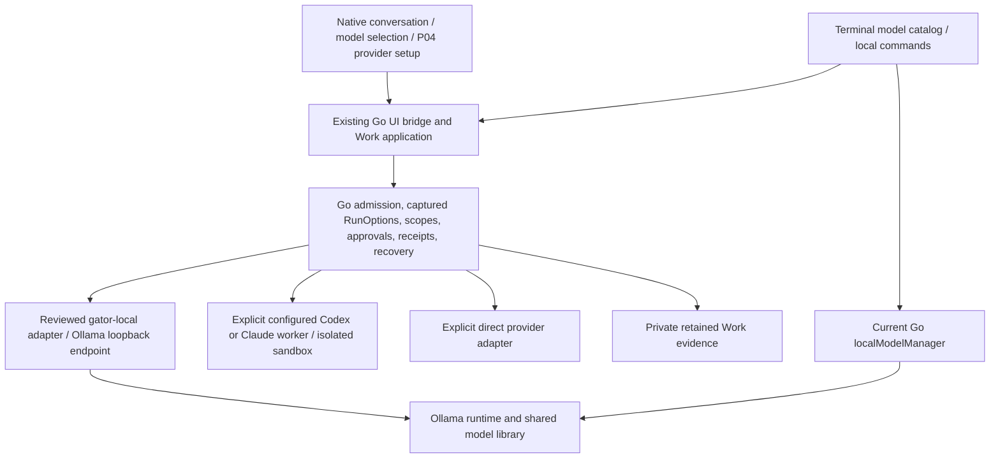
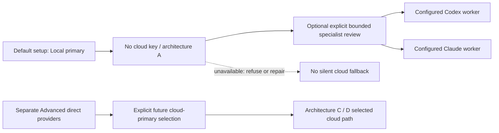

# P04L-1 — Local-first architecture and API evaluation

## Decision and boundary

**L1 architecture/evaluation foundation: complete. Local-first runtime acceptance: NOT TESTED. Local lifecycle mutation expansion: blocked on the findings below.** This is an audit and deterministic evaluation increment, not a default-model migration or native local-model manager.

Recommend **HIDE direct-provider onboarding from the default local-first setup, preserving direct providers as an optional Advanced feature**. This is a proposal; no onboarding, defaults, credentials or provider support changed. Target architecture B, local primary plus explicitly authorized Codex/Claude specialists, should include architecture A as a fully supported zero-cloud-key configuration. D is an explicitly selected advanced cloud primary, never an automatic fallback. No claim is made that a small local model already provides sufficient orchestration quality.

Initial source baseline: `978813b3b5403798c1c8efa6054e1f6a119ad2ca`. HEAD advanced externally to `8052f0c2a50809bf04c9eb070a4c069fec785663`, capturing this increment’s code and earlier evidence. This session made no commits and preserved that external change. Read the P04 provider, lightweight A2 mascot and B2 integration reports, then checked current Go/native sources. Existing P04 provider setup and A2/B2 presentation are retained. [Scope and source hashes](evidence/p04l-1/final-scope.json) identify the tested working sources relative to the initial HEAD and the later external commit. No commits, user configuration edits, real credential reads/removals, downloads or model mutations were performed. Test configuration/credentials and fake endpoints were confined to disposable fixtures.

## Current authority

`gator-local` is an existing managed custom-provider identity, not another agent engine. `provider.go:newCustomExecutorConfiguration` checks a reviewed catalog model, validates the local endpoint and applies eligibility. It wraps the existing Chat Completions backend in `localmodel.TextOnlyModel`, allows an empty API key and preserves the Work executor. It does not download missing models or prove the selected tag is installed at constructor time. The current request serializer does not expose an enforced per-request `num_ctx` or keep-alive policy; a profile's planned 4K context is not proof of actual runtime context.

`work_service.go` captures the primary and optional role configuration. Its external CLI delegates are enabled for foreground Work; background jobs do not inherit them. Internal configured role models can have distinct providers. A local primary alone therefore does not establish that every role, embedding call or connected tool is local. `work_recall.go` already distinguishes local storage, basic matching, optional local embeddings and explicitly opted-in cloud embeddings. That distinction must survive future local-first presentation.

### Capabilities in the current tree

“Implemented” below describes code and fixture-tested paths, not live Ollama acceptance. Native means a current macOS affordance, rather than a feature accessible only by invoking a terminal command. All live Ollama/model operations on this host remain NOT TESTED.

| # | Capability | Existing Go / terminal or TUI | Native macOS exposure and gap |
|---|---|---|---|
| 1 | Ollama discovery | Implemented: PATH lookup, version/tags probes; no exhaustive application search | No dedicated local discovery workflow; selected custom provider can appear |
| 2 | Installation guidance | TUI installation plan; macOS official manual download guidance | Missing local installer/onboarding; P04 deliberately excludes runtime management |
| 3 | Runtime start | `localModelManager.Start`, TUI start/recovery review; bounded readiness wait | Missing native start; ownership incomplete across managers/processes |
| 4 | Runtime stop | `Close` kills/waits for its own child; does not adopt an already reachable runtime | Partial: teardown only, no explicit safe user Stop workflow or shared-use leases |
| 5 | Runtime health | Version and installed-model requests | Configuration/readiness metadata is not an Ollama health panel |
| 6 | Model catalog | 13 reviewed local entries, published size/source/eligibility | Composer can list already configured local models; full local catalog missing |
| 7 | Download | Reviewed TUI pull with streamed bounded progress and cancellation | Missing native download; no persistent operation reconciliation |
| 8 | Select | `Use` verifies installed name, publishes managed provider/future default | Existing native model selection can select a configured local entry; initial setup missing; LF-01 applies to local manager |
| 9 | Version/digest | Runtime version implemented; installed DTO retains name/size only | Exact model digest, quantization and revision inspection missing |
| 10 | Update/re-pull model | Pull can re-pull a tag | Partial: no candidate digest/change review, rollback identity or active-use coordination |
| 11 | Running models | No `/api/ps` integration | Missing; downloaded must not be displayed as loaded in RAM |
| 12 | Unload weights | No exact unload method | Missing; runtime stop is not unload |
| 13 | Delete model | TUI reviewed Remove calls canonical Ollama delete | Native missing; partial-commit and active-use defects make expansion unsafe |
| 14 | Storage | Host disk-capacity check, model-directory source/advice, installed size DTO | No exact shared/reference-aware usage or reclaim preview |
| 15 | Partial-download recovery | Cancellation returns; explicit re-pull delegates reconciliation to Ollama | Partial: no durable operation identity or verified resume/digest result |
| 16 | Cleanup | No reference-aware dry-run/reclaim workflow | Missing; no permission to delete a guessed shared directory |
| 17 | Runtime updates | External Ollama application/manual workflow | No Gator runtime update authority or UI |
| 18 | Runtime uninstall | No Gator uninstall implementation | Official manual guidance required; preserve library by default |
| 19 | Mac resource monitor | Total RAM and disk; current available-memory measurement unimplemented | No pressure, swap, GPU or actual model working-set admission monitor |
| 20 | Native integration | Existing Go provider/owner boundary reusable | Partial: local selection supported after configuration; lifecycle management absent |
| 21 | Direct API providers | 38 built-in direct adapters; canonical secure enrollment/settings | P04 native reviewed save/replace/remove remains implemented and unchanged |
| 22 | Codex / Claude specialists | Explicit executable, key-env, scopes, timeout and sandbox; fake-process security tests | Preconfigured execution is available through existing Work; native enrollment and cost review incomplete; vendor-login import unsupported |
| 23 | Readiness/failure | Existing adapter validation and Work error/recovery paths | Configured/locally ready != live verified; no local live acceptance or global offline enforcement |

The reviewed catalog currently includes Qwen3 4B/8B/30B, Llama 3.1 8B, Mistral Small 3.2 24B, Qwen2.5-Coder 0.5B/1.5B/3B/7B/14B/32B, Devstral 24B and Qwen3-Coder 30B. These are repository catalog entries with mutable tags, not pinned tested weight artifacts. Catalog context maxima are not a sensible default allocation for a 16 GB Mac.

### Separate status facts

1. **Installed runtime:** executable/application found and identified.
2. **Running runtime:** exact endpoint responds with recognized version.
3. **Downloaded model:** exact tag and digest exist in that runtime's installed inventory.
4. **Loaded model:** running inventory confirms residency/context/expiry; not inferred from a file.
5. **Selected model:** Gator's confirmed future configuration points to that identity.
6. **Successfully tested:** a separately authorized bounded local inference completed, with time/version/digest recorded.
7. **Used for a task:** a real admitted Work request completed or failed with retained evidence.

Ollama exposes installed identity in [tags](https://docs.ollama.com/api/tags) and loaded-model identity/residency/context in [ps](https://docs.ollama.com/api/ps). Gator currently does not retain all those fields. Neither endpoint establishes model quality.

## API-key architecture decision

The following quality/maintenance comparisons are **[Inference] design assessments**, not empirical model rankings. Live A/B/C/D quality, paid costs and local throughput are unmeasured.

| Dimension | A: local only | B: local primary + authorized specialists | C: direct cloud primary | D: optional explicit cloud primary |
|---|---|---|---|---|
| UX | Zero inference key; installation/model choice required | Same local start; explicit assignment/destination/cost review | Existing P04 setup; needs credential and network | Local default with clearly separate Advanced switch |
| Orchestration quality | Limited by measured small-model competence; correct refusal allowed | Local must recognize limits and verify specialist evidence | Provider/model dependent, not presumed superior | Depends on selected primary; no automatic rescue |
| Reliability | Runtime/memory failures remain local | Local plus CLI/process/provider failure domains | Network/rate-limit/auth/provider failures | Both paths maintained; selected path failures remain explicit |
| Resources | Unified RAM, context and desktop headroom critical | Local residency plus bounded worker processes | Less local model residency; network dependency | Must manage explicit transition, never alter an in-flight request |
| API cost | No inference API charge; energy/storage not priced here | Paid worker invocations only when authorized; exact charges may be unknown | Usage/cost provider dependent | User-selected cloud calls only |
| Credential surface | No inference key; tool credentials may still exist | Explicit worker key environment boundary | Gator direct credential store and endpoint settings | Retained P04 store, off the default setup path |
| Disclosure | Local model; tool/network policies still necessary | Reviewed assignment/evidence subset crosses provider boundary | Supplied model context leaves computer | Explicit destination/data disclosure review |
| Installation | Ollama + reviewed model | A plus supported CLI executable/key setup | Existing direct adapter setup | A initially; optional existing P04 later |
| Maintenance | Runtime/model lifecycle + hardware acceptance | A plus worker compatibility/security tests | Existing adapters/credential validation | Preserves compatibility at ongoing adapter cost |
| Failure handling | Repair/refuse; no hidden download or cloud use | Bounded failure, incomplete evidence, no automatic replay | Existing explicit errors/recovery | No silent switch to another architecture |
| Offline | Can support offline inference, not yet a global offline guarantee | A when specialists disabled; cloud workers unavailable offline | Cannot infer remotely offline | Local path only when explicitly selected and admitted |
| Code fit | Existing local adapter and supervisor | Existing CLI boundary, missing product policy/budgets | Mature current direct-provider path | Smallest compatible product migration |

**Do not delete P04.** Direct providers support existing configurations and explicit cloud-primary use. Their necessity is a product choice, not disproved by scripted evaluation success. Hide default onboarding only in a separately approved increment; keep current profiles editable and preserve credential store semantics. No provider path is proposed for removal now.

### Proposed local-first default flow

This is a product proposal. It does not change the current selected primary or grant a worker any task authority.

### Five distinct credential categories

| Category | Current authority / limits |
|---|---|
| Direct provider keys stored by Gator | `internal/auth`, P04 reviewed bridge, `saveTUICloudModelConfiguration`; direct precedence is explicit request credential → Gator store → environment |
| Keys explicitly supplied to CLI workers | `cliagent.Config.APIKeyEnv`, read at execution, inserted only in isolated child environment; not the direct-store credential path |
| Vendor CLI-managed login | Not imported by current Gator worker; installing/logging into Codex/Claude independently does not authorize Gator to consume that account |
| Local Ollama inference | Managed local provider supports no key; a local URL alone is not proof the server cannot forward to cloud |
| Connected tool/service credentials | Separate accounts/connectors/embeddings; local inference does not revoke them or make those tools offline |

`cliagent.Config` permits Codex, Claude and the separately existing Pi kind. L1 targets Codex/Claude only and does not expand those protocols. Current worker configuration requires a named `_API_KEY` environment variable even for the native worker lifecycle. Own-vendor subscription/OAuth sign-in is not a supported substitute in this integration. The worker uses a private home, copied/scoped sources, bounded output and an outer OS sandbox; Codex's inner CLI sandbox flags do not remove that outer Gator boundary. Secrets are excluded from argv and fake-secret/patch tests exercise redaction. Its network permission is general `AllowNetwork`, not a provider-domain firewall. Never describe the current worker as technically restricted to one remote inference host.

Configured task/time limits and supervisor tool limits do not equal a hard maximum vendor billing-request count or USD budget inside an external CLI. L3 must expose this uncertainty and constrain delegation invocations/time; do not equate a stored key with spending consent. No CLI was invoked against a real provider in L1.

## Security and concurrency findings

These are existing paths inspected/tested here, not defects introduced or silently repaired by the eval extension. Severity is an engineering assessment. No user-owned model or configuration was mutated.

| Finding | Evidence and consequence | Required next gate |
|---|---|---|
| **LF-01 P1: stale full-settings publication** | `local_manager.go:Use` loads settings, waits on tags, then calls `Store.Save`; Save does not participate in `Update`'s sidecar lock. An independent test process used Update to set Theme=mono and revoke a fake CLI config. Use returned success, reset Theme and restored the revoked config. [Reproduction](evidence/p04l-1/audit-reproductions.log). [Inference] a later task could again see that revoked worker configuration. | Migrate cooperating read/modify/write callers to locked fresh-state updates with reviewed field comparisons. Audit Use/Remove/Rename/recall and other full-document writers; not just native UI. Do not hold a global settings lock across network waits. |
| **LF-02 P1: deletion/config partial commit** | `Remove` does DELETE before publishing settings. Fake endpoint confirms exact tag deleted; forced settings replacement failure returns the existing truthful “removed ... but could not update” error. No persistent operation/reconciliation identity; stale defaults can survive. | Reviewed operation receipt, task-use exclusion, explicit selection transition and post-mutation reconciliation; no destructive retry or automatic re-download. |
| **LF-03 P1: loopback redirect escape** | `localmodel.NewClient` validates only the initial URL and uses `http.DefaultClient`. Fake RoundTripper demonstrates an off-host 302 follow without DNS/sockets. Source confirms shared HTTP use for local API operations. [Inference] inference/embedding transports need the same audit; real exfiltration was not attempted. | Pin literal loopback transport, disable proxy/redirect escape, bound all responses and test each local inference/embedding/lifecycle path. Do not claim localhost validation alone enforces offline operation. |
| **LF-04 P1 risk: no cross-owner model/runtime leases** | Source: mutable tag selection, pull/delete without active-use exclusion; ownership mutex is manager-local. A starts an owned server, B reuses it without adopting it, A Close can kill it while B depends on it. Real shared-runtime race NOT TESTED. | Cross-process cooperating leases and exact runtime/tag/digest evidence. Ollama APIs do not provide a demonstrated conditional tag mutation transaction against arbitrary third-party clients; document that residual race rather than promise universal CAS. |
| **LF-05 P2: capacity is not admission** | Darwin available-memory measurement is explicitly unimplemented; eligibility can pass using total RAM only. Existing 2× download guard and 20% disk margin are repository heuristics. | Pressure/swap/working-set/context-aware admission without loosening the existing guard. |
| **LF-06 P2: incomplete lifecycle evidence** | Installed DTO discards digest/quantization; no loaded inventory/unload; pull progress accepts bounded JSON lines but lacks numeric monotonic/range validation; cancellation and a failed post-save status reread can leave outcome uncertain. Error bodies are bounded but not a complete safe native diagnostic DTO. | Exact identity, validated progress, bounded redacted errors, persistent receipts and read-only reconciliation. |
| **LF-07 P2: owned child environment/destination** | `startRuntime` executes `ollama serve` with inherited environment and no binding to the selected client URL. [Inference] ambient host/proxy/config/credential variables can change child behavior and startup destination. | Minimal reviewed child environment, explicit loopback binding, real process tests; do not change global environment or user-owned runtime settings. |
| **LF-08 product/safety gap: offline is not global** | Distinct role providers, cloud embeddings and connected tools exist; disabling local browser support does not fence all network paths. An Ollama endpoint can also serve cloud-backed models. No current silent-fallback execution was observed. | Explicit inference + delegation + connected-tool network policy, fail closed at each authority boundary. |

`config.Store.Update` uses an in-process mutex plus stable `.settings.lock` to serialize cooperating read/change/save transactions. `Save` alone is a private temporary-file/rename replacement, not a locked transaction; there is no settings file/parent fsync. Do not confuse this settings behavior with the already corrected **native draft archive** transactions, which were untouched.

P04's cloud setup retains its separate setup lock, reviewed credential comparison, `Store.Update` and compare-before-rollback after settings failure. That is not a general cross-file crash journal. Existing auth/config and provider regression tests remain in the final test run.

## Hardware baseline and candidate plan

Read-only [host evidence](evidence/p04l-1/host-and-runtime.json): M3 `Mac15,12`, arm64, 16 GiB physical memory, macOS 26.5.2, Go 1.27.3. Standard endpoint `127.0.0.1:11434` refused version/tags/ps requests. Ollama was not on PATH or in `/Applications` / `~/Applications`; the default model directory was absent. A custom installation elsewhere is **not excluded**. Exact installed tag/digest/quantization and loaded models are UNKNOWN. No inference was attempted.

The sampled system had 1,007.50 MiB swap used out of 2,048 MiB. VM counters and `memory_pressure -Q` are retained, not converted into “available model RAM.” They describe a point in time, not a measured model working set or an OOM diagnosis. Nearest default storage filesystem had 238,873,595,904 free bytes; no model-library contents were traversed.

| Proposed role | Reviewed candidate | Repository published package size | Existing 2× guard | Initial context / concurrency |
|---|---|---:|---:|---|
| Small coding | `qwen2.5-coder:3b` | 1.9 GB decimal | 3.8 GB decimal | Planned 4K / 1 |
| Small coordinator | `qwen3:4b` | 2.5 GB decimal | 5.0 GB decimal | Planned 4K / 1 |
| Larger 16 GB candidate | `qwen3:8b` | 5.2 GB decimal | 10.4 GB decimal | Planned 4K / 1 |

These are comparison candidates, not recommendations proven by live quality. Quantization must be read from the installed digest; do not assume Q4 from a tag. Consider 8K only after 4K quality/resource trials. Upstream [context documentation](https://docs.ollama.com/context-length) describes memory growth and VRAM-dependent defaults; the FAQ also mentions a generic 4096 default. Use an explicit supported per-request context setting and verify observed allocation instead of assuming either default. Gator's current compatibility adapter needs that enforcement before a genuine bounded-context Work benchmark.

For 16 GB admission, preserve the 2× guard and add OS pressure, compression/swap trends, measured model/KV/scratch working sets, Gator/native footprint and ordinary desktop headroom. Initially permit one local inference at a time across cooperating owners; report busy instead of adding a new queue feature. Pressure must block new loads, not stop arbitrary user processes or mutate active RunOptions. Do not estimate free unified memory by total minus summed process RSS. GPU residency can overlap process/driver accounting; measure RSS and physical footprint separately. **8 GB acceptance, local throughput, TTFT, GPU/energy and end-to-end resource headroom are NOT TESTED.**

## Native requirements and independently gated next increments

Future native setup should distinguish **Primary: Local / exact selected model**, **Specialists: explicit Codex / Claude configuration**, **Advanced: direct cloud provider**, and **Offline policy: inference plus separate connected-tool access**. It must support zero keys, local+Codex, local+Claude, local+both and an explicitly selected cloud primary without silently transferring data between them. Local setup must not block chat/history access when the runtime is unavailable. Reuse finite typed Go actions, request-specific completion, current owner rules and P04 secure entry; never grant install/delete permissions through model-generated text.

- **P04L-2 proposal:** fix LF-01/02/03 and ownership/identity/admission gaps first; then native official-install guidance, reviewed download/select/re-pull/unload/remove with explicit uncertainty and safe cancellation. Do not enable destructive controls before their Go contracts pass. Runtime uninstall should remain manual guidance if ownership cannot be established.
- **P04L-3 proposal:** explicit local-first routing, assignment/evidence boundary, worker setup and invocation/time/cost review, no silent fallback, independent offline policy across all tools/roles.
- **P04L-4 proposal:** approved model downloads if needed, curated live development/held-out quality and task trials on 16 GB, resource/context sweeps, separately qualified 8 GB assessment.

User decisions still required: default-onboarding change, any download/model choice and disk/network budget, CLI/provider credentials and paid budgets, explicit direct-cloud selection, destructive lifecycle operations, runtime ownership/update policy and any later 8 GB acceptance target. None is authorized merely by this report. See the [lifecycle contract](P04L-1-MODEL-LIFECYCLE-CONTRACT.md) and [evaluation results/verification](P04L-1-EVAL-RESULTS.md). Stop at L1.
