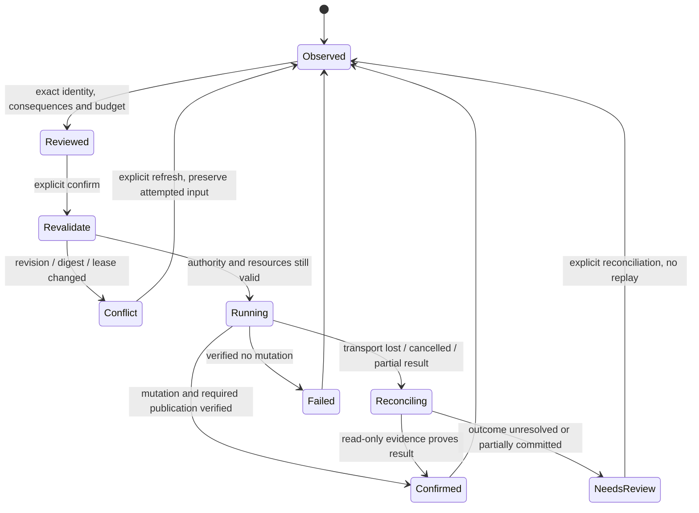

# P04L-1 — Local-model lifecycle contract

**Proposed requirements for P04L-2 onward, not implemented lifecycle controls.** Existing behavior and confirmed gaps are recorded in [the architecture audit](P04L-1-ARCHITECTURE-AND-API-EVALS.md). No installation, pull, update, unload, deletion, uninstall or live delegation was executed in L1.

## Authority, identity and state

Go remains authoritative for admission, captured request/model context, tasks, permission scopes, exact approvals, receipts, retained evidence, cancellation and shutdown. Native controls request finite, reviewed operations. Neither a local model nor a delegate can authorize installation or destruction by emitting text. A transport acknowledgement is not operation success.

Maintain orthogonal facts instead of a single “Ready” flag:

| Fact | Required evidence | Must not imply |
|---|---|---|
| Runtime installed | Verified executable/application identity and version, with observation time | Running, owned or safe to update |
| Runtime reachable | Exact validated endpoint/version and current process/ownership evidence when available | User grants teardown authority |
| Runtime ownership | User-managed / Gator-launched with verified child identity / unknown | A reachable server belongs to Gator |
| Model downloaded | Installed exact tag, digest, size and runtime identity | Loaded in RAM or selected |
| Model loaded | Running inventory, context, residency/expiry, timestamp | Same tag still points to same digest later |
| Future model selected | Confirmed settings revision and exact intended identity | Existing tasks changed their captured model |
| Local inference tested | Explicit bounded test, digest/runtime/context and retained result | General agent quality or tool authority |
| Model used for Work | Real admitted request with retained model identity/outcome | Success if the task is incomplete |

Use a bounded, private operation record: request ID, action, initiating profile, runtime origin/ownership generation, tag, reviewed digest/configuration revision, relevant use leases, reviewed download/network/storage limits, phase and confirmed result. Store no credentials or arbitrary response bodies. Only receipt/storage necessary for recovery is persisted; native draft archives remain separate.

Cancellation stops admission/further work where possible. It does not undo an already completed remote mutation or settings rename. Timeouts become uncertain when the mutation's outcome is unknown. Retrying a request with a new ID is a new explicit decision after reconciliation, not automatic replay.

## Concurrency and publication

1. Capture reviewed fields, runtime and exact installed identity before consent. Recheck them immediately before mutation; reject conflicts, preserve the user's attempted choice and require fresh review.
2. Use the existing stable settings lock with fresh `Store.Update` and field comparisons for cooperating configuration writers. Never replace an old full document after waiting on Ollama. Preserve unrelated defaults, aliases, roles, CLI revocations, credentials and preferences.
3. Do not hold the settings lock during an unbounded network operation. A durable operation receipt bridges mutation and settings publication; it does not pretend these are one filesystem transaction.
4. Preserve active Work RunOptions. Publish only the future selection after authoritative completion. On a settings failure after a model mutation, record exactly what is confirmed and what still needs repair. Do not invent a successful rollback or restore stale settings over a concurrent update.
5. Maintain cooperating **cross-process** model/runtime use leases, including pending review, recovery and live requests whose next turn still depends on the model. Manager-local mutexes are insufficient. Expired/crashed owners require evidence-based reconciliation, not immediate destructive cleanup based only on a timer or a reused PID.
6. A lease coordinates Gator clients, not arbitrary Ollama users. There is no verified conditional pull/delete API here that atomically compares a digest against all external clients. Recheck inventory, detect changes, and refuse operations requiring stronger isolation unless an explicit safe exclusive-use arrangement is established. Do not promise universal same-tag CAS.
7. Preserve private permissions and atomic replacement. Add crash-consistency tests and a reviewed durability policy for settings/operation receipts. Existing native archive locking, late-Quit protection and bounded Go subprocess shutdown are unchanged.

## Install and discover

Probe configured literal loopback endpoint, PATH and conventional application locations without executing an unknown installer. Report “not detected in checked locations” rather than proving absence of every custom installation. Resolve the runtime's model directory from authoritative configuration; respect `OLLAMA_MODELS`, permissions and volume availability.

macOS installation should open the [official Ollama macOS instructions](https://docs.ollama.com/macos) and download page after explicit consent. The supported manual flow is download DMG, inspect/mount it, and drag Ollama to Applications; its own first launch may request CLI-link permission. Explain network access and separately reviewed model storage. Never run arbitrary installer shell scripts, overwrite another application, or change launch services/system environment implicitly. Already installed applications remain user-owned unless Gator launched and can identify a separate owned child.

Installation complete means the verified executable/application is present. Running/reachable and model setup are separate follow-up states. Failed verification does not launch another installer automatically.

## Start, health and stop

- Probe the selected endpoint first. A reachable user-managed Ollama is reused, **not adopted** for Close/Stop/update. Existing code already has a fixture test for non-adoption; cross-manager shared use still needs work.
- Launch only the verified binary with an explicit reviewed loopback bind and minimal child environment. Do not forward unrelated API keys, proxy variables or credential-bearing URLs. Do not mutate the parent or user server environment.
- Establish child identity and endpoint readiness together; another process answering on the same port is not proof this child started successfully. Fail on a mismatched destination rather than silently choosing a different server.
- Bound readiness requests and total wait, retain safe diagnostics, support cancellation and reap the exact owned child asynchronously. Do not kill unrelated processes or stop a user-owned runtime. Shared Gator leases must be considered before owned-runtime shutdown; app Quit must not terminate a server another admitted owner depends on without a safe explicit ownership policy.
- Health checks are read-only and timestamped. Unavailability invalidates readiness, not retained conversation history. Never retry an uncertain inference/task automatically.

A Stop Runtime action is distinct from Unload Model and from disabling Gator integration. A user-owned runtime should get precise manual instructions, not an active Stop button with implied authority.

## Download and interrupted pull

Review model name, exact tag, reviewed publisher/source, published package estimate, runtime destination, model filesystem, known disk capacity and network requirement. Downloading a mutable tag is not a digest-pinned guarantee. Preserve the current 2× package RAM guard and 20% disk headroom; neither substitutes for actual runtime admission or exact transient storage needs. Unknown capacity must be visible and handled conservatively for an unattended operation.

Use canonical Ollama pull, not a shell concatenation. Validate progress frame size, types, nonnegative bytes, completed ≤ total when total is known, sane identity changes and bounded progress retention. Zero/unknown total is an indeterminate state, not a fabricated percentage. Cancellation must terminate owned request/progress work; it need not erase server-managed partial blobs. After success or interruption, re-read installed identity and exact final digest before claiming installation. An HTTP acknowledgement/success string alone is insufficient.

Retry only explicitly after reconciliation. Let Ollama reconcile its partial downloads under its own authority; Gator must not scan guessed blob names and delete them. If server work continues after the client disconnects, display that uncertainty and do not start a competing pull. Persist a bounded receipt for restart recovery.

## Select and inference admission

Require a reachable verified local endpoint, the exact installed tag/digest, reviewed catalog membership and successful current resource admission. Confirm the future settings update and report the canonical selected result. Keep already captured task provider/model/context unchanged. A selection does not start inference, download a model or implicitly contact a cloud provider.

If the selected tag disappears or changes before a task, fail with a repair/review requirement rather than silently pull or change models. A mutable tag cannot be treated as immutable retained evidence. Record the digest actually used where supported and detect changes between turns. If the backend cannot bind a request to the reviewed artifact, retain and disclose the limitation instead of asserting exact identity.

Start with one admitted local inference at a time across cooperating owners, planned 4096 context and a bounded output limit. Do not add queue-management features here: busy can be a refusal. The current compatibility request does not enforce that context; add a supported adapter contract and verify it against running inventory before accepting a 4K/8K claim. Increasing context is a separate resource decision.

## Unload model weights

Unload is not delete, runtime stop or future-model deselection. Require an exact loaded identity and no relevant Gator use lease. Use the supported empty request with `keep_alive: 0`, then verify that exact model is absent from running inventory. See the official [API lifecycle documentation](https://github.com/ollama/ollama/blob/main/docs/api.md). Verify installed tags remain intact and the runtime still responds. Do not unload whenever any unrelated task completes; another owner or external application may still use the server. Expose external-use uncertainty rather than claiming system-wide exclusivity.

If a request disconnects, re-read running state. Do not infer unload success from the absence of new tokens. A user-owned server can independently reload/expire models; report observed state and time rather than permanent guarantees.

## Update model / re-pull

Inspect current tag/digest and use leases. Discover candidate update information only through supported registry/runtime mechanisms; do not label “update available” from a guessed timestamp. Unknown remote digest means “re-pull may change this tag,” not a known version upgrade.

Review the precise known identity change, expected download/storage, effects on future tasks and any current selected alias. Where the API can preserve a prior usable artifact under an explicitly reviewed backup identity, verify that backup before replacement; do not promise rollback if that mechanism is unavailable. Do not delete the last usable weights before obtaining a replacement.

Re-pull only after consent and active-use exclusion. Re-read final tag/digest and reconcile settings without overwriting unrelated changes. A partially completed pull with unknown final digest is **unconfirmed**; do not label the old or new digest as selected/usable until verified. Restart recovery is read-only first. Never silently re-pull a tag during an admitted task.

## Update runtime

Keep application/runtime updates separate from model downloads. Upstream's [FAQ](https://docs.ollama.com/faq) describes macOS application auto-download and a user-chosen “Restart to update,” or installing the official current DMG. Gator must not replace arbitrary PATH binaries, run Linux installation scripts on macOS, or restart a user-owned runtime. Explain that runtime restart interrupts loaded models and potentially other applications. Obtain explicit quiescence/consent and verify version/readiness afterward. No runtime updater is implemented in L1.

## Remove one model

Show exact runtime/tag/digest, selection/alias consequences, active-use blockers and the scope of deletion. Review an explicit future-selection transition or clear state; never automatically choose the first remaining model as a substitute. Keep credentials, provider definitions unrelated to that model, conversations, attachments and evidence intact.

Block while a current owner still depends on the model unless an explicit safe transition has completed. Do not treat lack of streaming as lack of use. Revalidate immediately before deletion, record the admitted operation, invoke canonical delete, confirm installed/running inventory and publish the intended settings change under reviewed comparisons. Shared blobs may remain because another tag references them; do not promise reclaimed bytes equal package size.

If delete succeeds and settings publication fails, retain the partial result, show the stale selection and offer explicit repair. Do not automatically redownload, repeat delete or restore stale settings. The current LF-02 reproduction exercises this failure without touching a real model.

## Inspect and cleanup

Inspect before mutation. Distinguish Gator-owned staging/temporary files from Ollama's shared manifests/blobs, user-specified `OLLAMA_MODELS`, external volumes and third-party data. A cleanup preview must list exact owned candidates and actual reclaim estimates only when reference accounting supports them. Include dry-run and explicit confirmation. Do not recursively delete a shared model directory, remove blobs referenced by other tags, follow untrusted symlinks, or assume package-size sums equal reclaimable physical bytes.

Partial download files are server-managed unless an official supported cleanup operation with established ownership is available. If no safe reference-aware cleanup exists, provide an honest limitation/manual official guidance. Never equate a model's absence from Gator's reviewed catalog with permission to delete it.

## Four separate removal/uninstall workflows

| Workflow | Scope and preservation requirements |
|---|---|
| Remove one model | Exact reviewed tag only; no shared-directory deletion |
| Disable Gator local integration | Stop future local admission, explicitly choose/clear future primary, preserve installed runtime/library and retained conversations |
| Uninstall Ollama runtime/application | Separate user-owned software operation; preserve model library and Gator state by default |
| Erase user-owned Ollama data | Separate destructive consent and ownership/reference inventory; never implied by runtime uninstall |

No automated macOS uninstall is authorized. For runtime-only manual removal: first finish or explicitly cancel dependent work and quit the correct Ollama application; inspect its actual installation path, move that verified application to Trash using Finder, and inspect any CLI symlink before removing **only the link belonging to that application**. Leave `~/.ollama`, a custom `OLLAMA_MODELS` directory and Gator state/config/history untouched. **[Inference]** this is a deliberately data-preserving subset of manual removal, not a claim that upstream offers a separate runtime-only uninstall command.

The official [macOS uninstall page](https://docs.ollama.com/macos) describes **full removal including model/configuration data**. Link it with that warning, not as a one-click default or copied recursive deletion recipe. Its conventional paths are not evidence of the user's actual library location. Optional removal of Ollama's own caches/preferences is a separately inspected choice; never remove other applications' settings.

## Failure/recovery matrix

| Event | Required response |
|---|---|
| Runtime crashes | Release only confirmed dead owned resources; mark requests uncertain where necessary; no task replay; allow explicit restart after reconciliation |
| Interrupted pull | Cancel owned client work, inspect inventory, retain partial-operation status, explicit retry only |
| Permissions / unavailable volume | Preserve previous selection and data; show bounded safe error; do not mkdir a different library or request broad privileges implicitly |
| Low disk | Refuse new pull/update, retain prior usable model; no automatic cleanup |
| Insufficient memory/pressure | Refuse new inference/load; do not kill unrelated processes, silently lower model identity, or use cloud |
| Concurrent settings mutation | Compare reviewed relevant fields; merge unrelated current values under Update; conflict requires refresh/review |
| Model deleted, settings failed | Report both facts; repair future configuration explicitly; no false rollback/success |
| Restart with stale selection | Show selected-but-unavailable; block execution until explicit verified repair/selection |
| Uncertain delete/update outcome | Read-only reconciliation first; never repeat destructive actions automatically |
| Other instance / third-party model mutation | Recheck identity and leases; disclose lack of universal external CAS; fail safely on observed conflict |

## Memory, offline and acceptance requirements

On macOS use real pressure signals, VM/compression/swap trends and measured working-set envelopes rather than total minus process RSS. Keep package-size guards as a first filter. Sampling must be bounded, available-memory uncertainty explicit, and pressure thresholds calibrated in L4; do not invent currently unimplemented thresholds. Track Gator/native, Ollama, model/context/KV and ordinary desktop headroom separately, avoiding double-counted unified-memory residency. GPU/energy and 8 GB hardware acceptance need actual evidence.

Offline means no external inference, no external specialist calls, and independently disclosed/disabled connected-tool/embedding traffic. Enforce policy in Go at adapters, worker admission and tools, including role overrides and retries. A loopback server can itself forward to cloud; permit only verified local installed identities and a reviewed runtime cloud-disable policy where supported. Do not alter a user-owned server's settings automatically. An HTTP URL initially validated as loopback must not escape through redirects/proxy/DNS.

L2 must test these operation states with fake endpoints/processes and cross-process settings writers before native controls. L3 must test public delegation/evidence and offline policies. L4 must separately measure real model quality, load/context resources, repeated tasks, cancellation, swap, desktop responsiveness and recovery. None of these future gates is passed by L1's scripted corpus or installed application detection.
