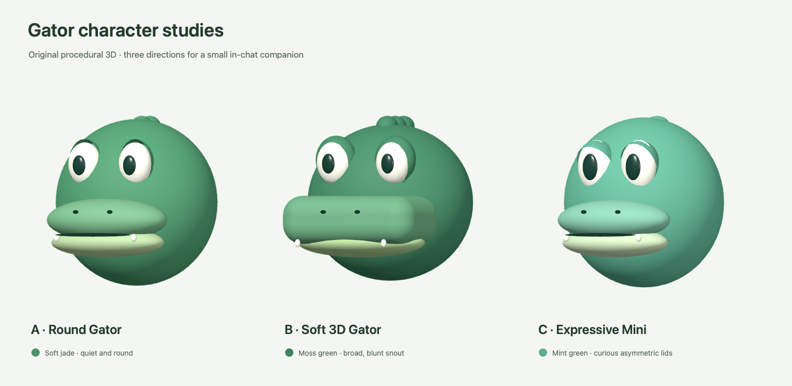
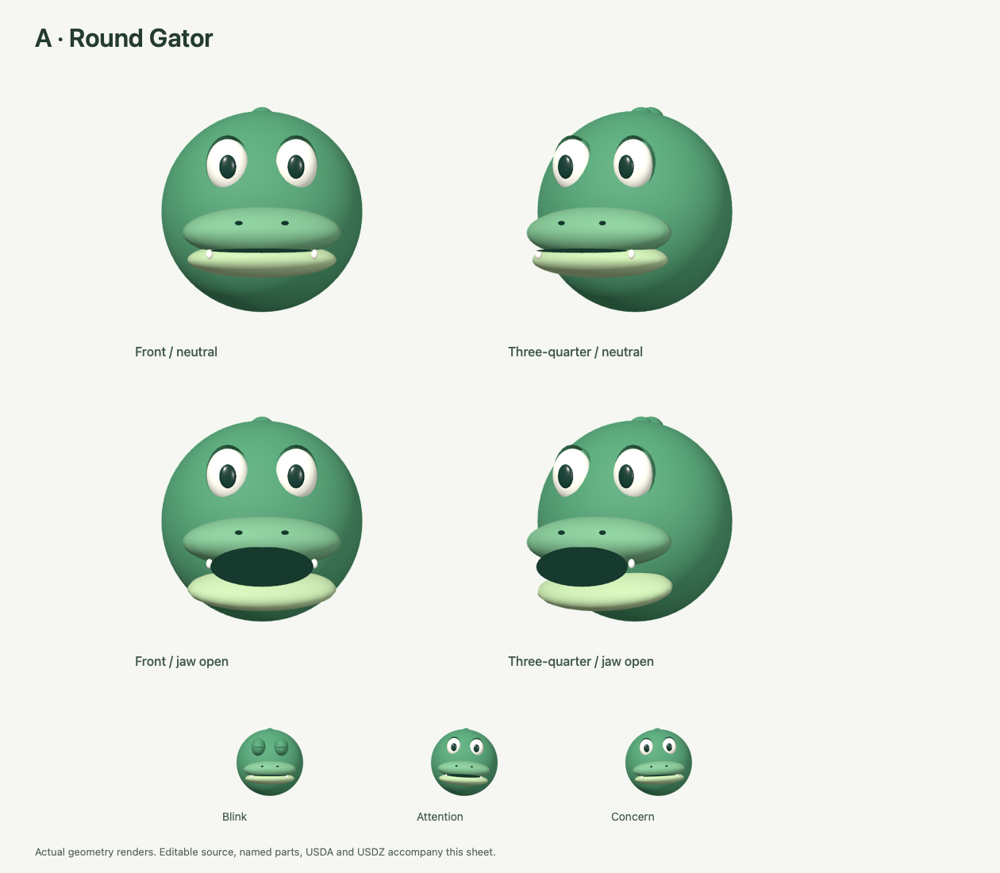
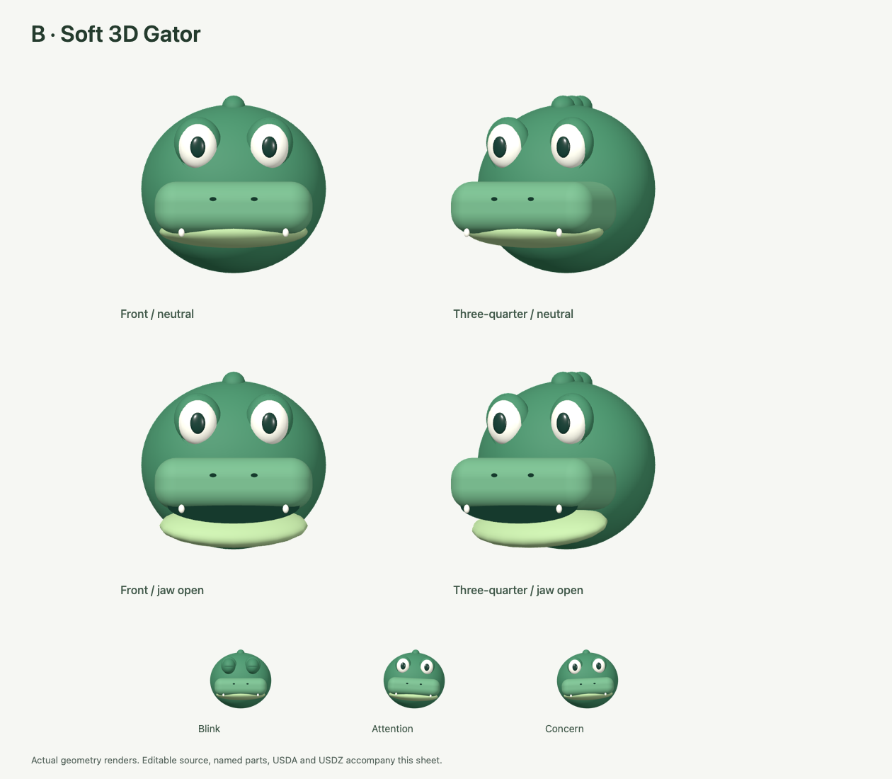
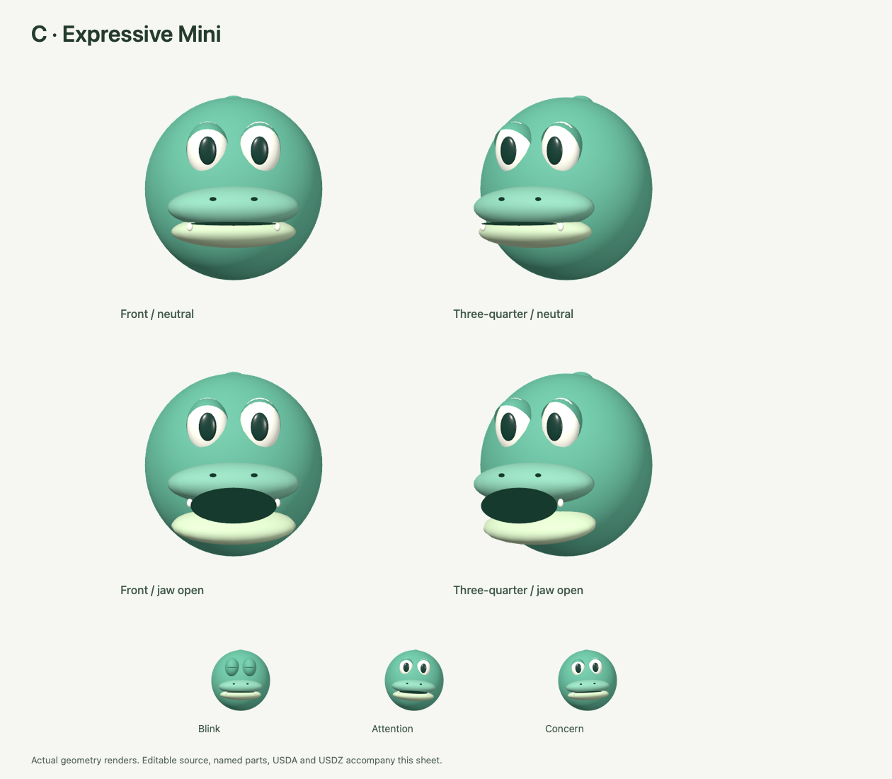
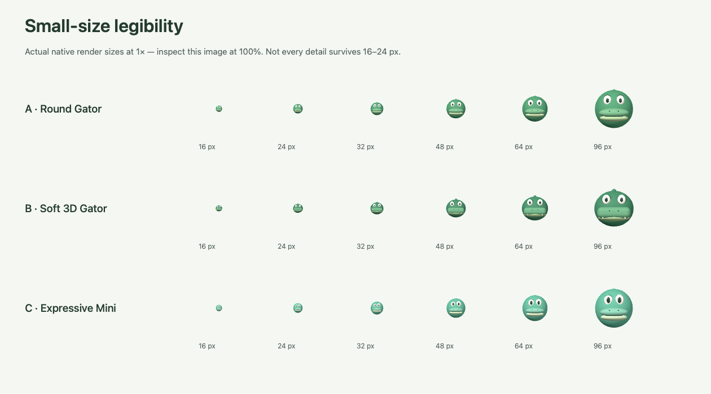
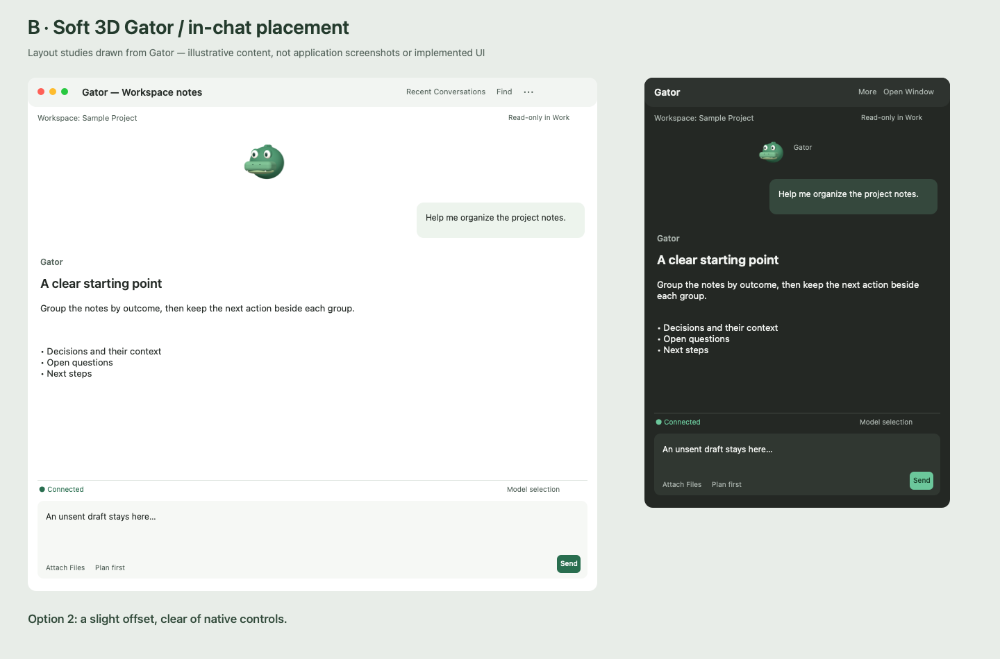

# P04M-A1 — original Gator mascot exploration

**Design checkpoint only. No concept is selected or integrated.** Recommendation: **B, Soft 3D Gator**, with a slightly offset, reserved in-chat header placement. It has the clearest alligator cue: a broad, blunt, short snout. A is the simplest round companion; C favors expressive eyes. These are design judgments, not a blind recognition study.



## What was actually created

All three candidates are **genuine procedural 3D geometry**, authored locally with editable Swift parameters and named independent parts. The deliverables include editable USDA, binary USD/packaged USDZ, SceneKit scene archives, transparent renders, comparison/expression/size boards, in-chat layout studies, and an isolated B animation prototype. The PNGs/GIF/video are previews, **not 3D models**.

No image/model-provider request, mesh download, dependency installation, production integration, icon replacement, signing, notarization, commit, P04M-A2, P04M-B or P05 work occurred. Blender was not found on PATH or in `/Applications`. Xcode's **Reality Composer Pro is installed**, as are native USD tools, Metal, SceneKit, RealityKit, FFmpeg and ImageMagick. No modeling application needed to be installed or opened.

The purple blob reference image is not attached in the current workspace. Its described simplicity informed the brief; no claim of direct visual comparison or copying is made. The actual geometry and design parameters were authored for this task.

## Current application and preservation

Starting HEAD: `12ee4a43b6677f4d01a4ab6882951a35d09ac678`, with the existing P04 implementation/report/evidence changes already present. Read P04's provider-credentials report, UI/UX remediation report and terminal-parity inventory. The older inventory's provider/workspace gaps are historical; current P04/current source take precedence.

| Existing surface | Current source evidence and design consequence |
|---|---|
| Full chat | `ConversationView.swift`: toolbar, workspace context, optional transcript Find, activity, transcript/empty state or exact review, notices, composer. Place the mascot **inside a reserved region below navigation/workspace/Find/activity**, never over those controls. |
| Full-window sizing | `GatorApp.swift` declares 540×480 minimum, 820×740 default. Mascot must collapse rather than consume a fixed large fraction of a small/long-chat window. |
| Compact menu-bar chat | 440×620, compact header/More controls, workspace, messages/status/composer. It has no ordinary window traffic lights. The compact studies preserve that distinction. |
| Inspection/review | Full task inspection remains a sheet; exact approvals, plans and recovery have owner-bound content. Mascot is decorative and shrinks/freezes during review. Existing readable warnings/controls remain authoritative. |
| Reading position | Existing `NativeReadingPositions` and stable transcript identities remain untouched. Future mascot size changes must not reset reading anchors, force following or invoke Jump to Latest. |
| Notch | `NotchQuickAccess.swift` uses a screen/notch-aware AppKit panel, current Gator template mark and existing public activity. No character or interaction is added there now. |
| Branding | Existing alligator `GatorHead.png`, template `GatorMenuBar.png` and generated app icon remain unchanged. A full-body character is unnecessary. |
| Colors/type | Native system surfaces/SF typography; current accent is approximately **#296E4F light / #6BC79C dark**. Character materials complement this palette without recoloring status semantics. |
| Deployment/build | Swift tools 6.1, Swift 6, macOS **15 minimum**, no package dependencies. All prototype executables compile separately with `-target arm64-apple-macosx15.0`; the production Package.swift and build tooling are unchanged. |

Initial/final source hashes cover existing Swift/Go/host source, resources, tests and native scripts. [Preservation evidence](concepts/evidence/integrity-and-tools.json) records unchanged protected files; no pre-existing local changes were reset.

## Three character concepts

### A — Round Gator

A nearly circular jade head, wide-set oval eyes, a short soft muzzle, two tiny rounded teeth and two low crown scutes. Calm, welcoming and deliberately simple. It is the closest to a quiet round companion while retaining reptile cues.



- **Material:** matte soft jade `#4B946A`; lighter muzzle `#75B084`; sage lower jaw `#B4CF9D`; warm ivory eyes/teeth and deep green pupils. No scale texture or glitter.
- **Motion range:** independent blink/lids and pupil look; approximately 0–29° jaw hinge range, with the open study around 24°; restrained 2–4° head tilt. Small idle motion should leave the circular silhouette stable.
- **Advantages:** simplest silhouette; generous white eye/pupil contrast; compact and empty-state friendly; few visual accents.
- **Limitations:** the round muzzle is less specifically alligator-like than B's blunt snout. At 16–24 px, teeth/scutes disappear and the animal category becomes ambiguous. Mouth-corner/smile topology needs final sculpt refinement.
- **Files:** [front neutral](concepts/A/front-neutral.png), [quarter neutral](concepts/A/quarter-neutral.png), [front open](concepts/A/front-open.png), [quarter open](concepts/A/quarter-open.png), [USDZ](concepts/models/Gator-A.usdz), [editable USDA](concepts/models/Gator-A.usda).

### B — Soft 3D Gator — recommended

A compact rounded head with a broad, rounded-rectangle snout, small eye cushions, three low scutes and a pale independently hinged jaw. Two small rounded teeth are visible without becoming a toothy grin. Its slightly wider profile carries more alligator identity than a green sphere alone.



- **Material:** moss green `#3E835F`; muzzle `#67A47B`; jaw `#ADCC94`. Soft matte/vinyl-like finish, with a small controlled gloss on the eyes. No metallic or glass body.
- **Motion range:** independent left/right eye hierarchy and upper/lower lids; pupil look; jaw 0–29°, small mouth-cavity scale/tongue visibility, and a few degrees of head tilt. The current prototype uses rigid parts, not a full skeletal or blendshape face rig.
- **Advantages:** strongest broad U-shaped alligator snout; readable jaw separation; most useful 3/4 view; clear path to an expressive reusable character.
- **Limitations:** more authored mesh parts and silhouette detail than A/C. The primitive snout/jaw intersections need refinement before production; this is not a finished watertight sculpt. At tiny sizes the tooth/scute detail still cannot carry identity alone.
- **Files:** [front neutral](concepts/B/front-neutral.png), [quarter neutral](concepts/B/quarter-neutral.png), [front open](concepts/B/front-open.png), [quarter open](concepts/B/quarter-open.png), [USDZ](concepts/models/Gator-B.usdz), [editable USDA](concepts/models/Gator-B.usda).

### C — Expressive Mini Gator

A mint-green sphere with taller, closer-set eyes, subtly asymmetric upper lids and a smaller soft muzzle. Its face is more curious and playful; the body silhouette remains restrained. One low crown accent avoids a dinosaur crest.



- **Material:** mint `#5EAE92`; muzzle `#83C2A7`; pale jaw `#C8DDB7`. Same material family as A/B, with identity carried by eye proportions and lid pose.
- **Motion range:** independent upper/lower lids make asymmetry/winks possible; pupil look and short jaw opening; very small head rotation. Avoid permanent squinting or a theatrical looping face.
- **Advantages:** largest scope for personality through a few eye controls; simple sphere; slightly fewer authored triangles than A/B.
- **Limitations:** mint/eye styling can drift toward a generic frog if snout/teeth cues are reduced too far. Eye asymmetry becomes difficult to read at 24–32 px. Boundary-overlap placement is more brittle than a reserved slot.
- **Files:** [front neutral](concepts/C/front-neutral.png), [quarter neutral](concepts/C/quarter-neutral.png), [front open](concepts/C/front-open.png), [quarter open](concepts/C/quarter-open.png), [USDZ](concepts/models/Gator-C.usdz), [editable USDA](concepts/models/Gator-C.usda).

### Shared palette and asset rules

All use warm ivory `#FAF9EB`, deep green ink/pupils around `#153B31`–`#173C2F`, and an optional muted mouth interior/tongue. The body uses approximately 0.72 roughness/zero metalness; eyes may use lower roughness. The USD exporter converts sRGB albedo to linear shader values and preserves basic roughness/emission intent. Lighting/tone mapping still differ between SceneKit and RealityKit; matching the final production look requires calibration.

Keep shape/material identity stable across light/dark appearances. Adjust lighting modestly rather than swapping character colors. A subtle dark-mode rim light can be explored later; no halo or glowing status border is proposed. Status meaning must also remain in native text/symbols.

## Small-size evidence



Each candidate has actual 16, 24, 32, 48, 64 and 96 px native renders (`A/size-*.png`, etc.). The board is exactly 1260×700 pixels; inspect at 100% for the stated 1× samples.

**Observation:** 16–24 px communicates a face/color more reliably than species; nostrils, teeth and scutes become indistinct. At 32 px the broad muzzle starts to carry B; 48–64 px gives its face and jaw more room. These are visual observations, not recognition-study results.

Proposed normal chat **canvas** sizes: about 72 points full-window and 44 compact, corresponding to a smaller visible head because the transparent asset includes margin. Collapse to a 28–32-point static canvas when reading long/older content or reviewing. At the smallest setting it is a familiar brand cue, not a claim of unmistakable species recognition. Keep the existing monochrome menu-bar icon for 16–18-point system use.

## Placement exploration

The previews are **offline layout studies drawn from current source**, with synthetic chat text. They are not screenshots of an implemented Gator UI, and do not prove focus/scroll/approval behavior.

| Placement | Preview | Assessment |
|---|---|---|
| 1. Top center | [A full/compact](concepts/placement-A.png) | Balanced for an empty/welcome view. Reserve its own band. Large permanent centering costs transcript space; shrink after the initial short-chat state. |
| 2. Slight offset | [B full/compact](concepts/placement-B.png) | **Recommended.** Center at roughly 42% of chat width, below existing contextual controls; face turned gently into the conversation. No overlay or hit-test interception. |
| 3. Peeking over boundary | [C full/compact](concepts/placement-C.png) | Character crosses **its own reserved divider**, not the workspace, toolbar or message bounds. More distinctive but fragile at minimum sizes; compact/review should revert to a non-overlap presentation. |



For **each** direction, state boards cover long conversation, earlier/scrolled content, background work and pending approval, across light/dark:

- [A conversation states](concepts/states-A.png)
- [B conversation states](concepts/states-B.png)
- [C conversation states](concepts/states-C.png)

Behavior proposed for implementation review:

- Empty/short chat: a modest reserved slot; center the welcome composition and avoid adding a new dashboard. The current toolbar/workspace/Find/activity remain above it.
- Long/scrolled chat: collapse to a small static identity rather than pinning a large floating character over text. Do not resize the slot while the user is actively scrolling; retain existing reading anchors and explicit Jump to Latest.
- Background work in another conversation: retain the current conversation's pose; existing activity text can describe the background owner. Do not make the foreground mascot pretend it owns the other task.
- Approval/plan/recovery: small static attentive pose or omit it if space is tight. No animation over exact review content, no obscured buttons and no implicit approval/success expression.
- Compact: no new window chrome, dashboard or expanding pet panel. Keep the composer/status and More controls readable; collapse earlier.
- Inspection: the existing sheet/compact inspector remains unchanged. The mascot must not recreate or intercept it.

Appearance/QoL proposals **not implemented**: consistent reserved whitespace; center the welcome text with the character; keep the system font/current green accent; gentle header/transcript separation; optional collapse/hide preference considered only in the later approved scope. Do not add new permanent banners or move critical warnings to make room.

## Personality, motion and safe state mapping

No state adapter is connected to Gator in this checkpoint. The prototype uses explicit fixture controls. A future **pure presentation projection** may read existing public state; it is not an execution coordinator.

| State | Proposed expression/motion | Boundaries |
|---|---|---|
| Idle | Sub-percent breathing/settle and one blink roughly every 6–12 seconds while visible; no perpetual rotation. | Timing is a proposal, not a measured battery-safe schedule. No idle high-rate render loop. |
| Thinking/working | One 2–4° tilt or occasional small pupil shift; settle between gestures. | Read the selected owner's public running/status state, not private reasoning. A background owner's work does not re-scope this character. |
| Visible response streaming | A small 2–4° jaw opening/settle at stream start, hold rather than flap, then close at end. | **No syllable-like motion, audible-speaking claim or speech sync.** Future audio synchronization is separate. |
| Completed | Brief relaxed/positive pose, then neutral. | Only a confirmed relevant completion; loading old history, cancelled work or uncertain effects are not success. |
| Needs attention | Eyes open a little wider/face the user once, then hold. | Existing native approval/recovery text is authoritative. No token access, approve action, permission grant or automatic replay. |
| Hover | Coarsely choose left/center/right gaze zones, capped around 4 updates/second; stop on exit. | Do not continuously track every pixel or steal mouse events from controls. |
| Error/disconnected | A small concerned tilt/lid pose, then static. | Keep the actual error/reconnect controls visible; no red flashing face. |
| Reduced Motion | Static appropriate expression or cached neutral poster; no breathing/blinking/tilting loop. | Preserve accessible state elsewhere; decoration may be accessibility-hidden. |

Current `BridgeMessage` exposes stable visible-message identity/text but no typed streaming Boolean. A later implementation must establish a **scoped visible-response delta** if needed; it must not infer streaming from every snapshot or `running` alone. Baseline newly loaded history on owner/generation changes to avoid animating old messages as a new response. No hidden reasoning, raw result JSON, credentials or approval token needs to enter the mascot projection.

The mascot cannot send prompts, submit work, approve, reconnect, replay or mutate anything. Its view should be non-focusable/non-hit-testing; native state labels remain accessible. Cosmetic tasks must cancel on hiding, owner replacement and closing, without participating in durable archives or Go admission.

## Genuine 3D feasibility and recommended architecture

**Genuine native 3D is feasible with existing tools.** All three final USDZs import into RealityKit; both eyes retain separate lids/pupils and the jaw remains independently addressable. B also rendered once through **RealityRenderer** to an RGBA texture with transparent background: [actual RealityKit smoke render](concepts/prototype/realitykit-smoke.png), [import/render log](concepts/evidence/realitykit-import.log).

| Technology | macOS 15 / integration | Recommendation and limits |
|---|---|---|
| RealityKit / RealityView | Deployment-target-15 probe compiles; native SwiftUI content/entity update interface. AppKit can host SwiftUI. | Convenient compatibility path. Its state-update closure is not proof that the engine stops rendering when idle. Actual on-screen idle behavior is not measured here. [Apple RealityView](https://developer.apple.com/documentation/realitykit/realityview/). |
| **RealityKit / RealityRenderer + small MetalKit host** | Local SDK declares macOS 15; the target-15 probe actually renders B. `MTKView` is an AppKit view and can be wrapped in `NSViewRepresentable`. | **Preferred production pilot** for explicit draw-on-demand control. Use system RealityKit, not a custom 3D engine; prove compositing/lifecycle before integrating. [Apple RealityRenderer](https://developer.apple.com/documentation/realitykit/realityrenderer), [MetalKit drawing modes](https://developer.apple.com/documentation/metalkit/mtkview). |
| SceneKit / SCNRenderer / SCNView | Used successfully for this isolated model/animation/rendering lab; target 15 compiles. `rendersContinuously=false` is available. | Authoring/prototype only. Apple now marks SceneKit deprecated and directs new work toward RealityKit. Do not silently adopt it as Gator's new production renderer. [Apple SceneKit](https://developer.apple.com/documentation/scenekit), [on-demand SCNView](https://developer.apple.com/documentation/scenekit/scnview/renderscontinuously). |
| Raw Metal geometry/shaders | Native, but requires maintaining camera/material/lighting/rendering logic. | Unnecessary custom engine work for this character. RealityRenderer can provide the engine. |
| SwiftUI vector animation | Native 2D fallback with a few simple shapes/paths. | Useful if 3D fails the later power/lifecycle gate. It lacks true perspective/lighting and would require its own pose construction; no equal-quality runtime-overhead claim is made without measurement. |
| Cached transparent poster | Ordinary native image produced from the approved geometry. | Best reduced-motion/hidden/inactive fallback and consistent identity. A poster is explicitly 2D, even though its source is 3D. |

**Source/format:** keep the procedural Swift + editable USDA as authoring truth, USDZ as the self-contained portable deployment candidate, and SCN as a reproducible lab archive. Reality Composer Pro is available for later asset/material/animation refinement. There is no `.blend`, professional skin rig, blendshape set, texture atlas or baked USD animation clip in this delivery. Animation is currently code-driven named rigid parts (eyes/lid hemispheres, jaw hinge, mouth interior and small details).

USD Preview Surface material bindings, geometry, transforms, neutral visibility and basic roughness/emission are exported. Render-engine light/tone-map differences still need art direction; the RealityKit smoke is a functional render, not the final lighting standard.

macOS 15 was **not physically run**: current host is macOS 26.5.2 / Swift 6.3.3 on Apple M3 (10 GPU cores). Compilation against a macOS 15 deployment target checks API availability, not every older-system runtime behavior. No Intel/low-end-device/battery acceptance is claimed.

## Isolated prototype and verification

- [B animation GIF](concepts/prototype/B-motion.gif) and [MP4](concepts/prototype/B-motion.mp4): four seconds / 80 frames / 20 fps, demonstrating blink → jaw opening → smooth attention transition → neutral. It is an animation-range demonstration, **not a proposed continuous production loop or silent speech**.
- [Reduced-motion poster](concepts/prototype/reduced-motion.png): the exact cached neutral first frame, static.
- [Procedural model/render source](concepts/source/MascotLab.swift), [standalone native preview](concepts/source/Preview.swift), [RealityKit/macOS-15 probe](concepts/source/RealityKitProbe.swift), [validator](concepts/source/Validate.swift).
- The native preview **compiles but was not launched/operator-tested**. Its fixture buttons drive the same B geometry; it uses no continuous timer, pauses on deactivation/minimizing, reads the current Reduce Motion preference and offers a static-mode checkbox. It is not an always-on-top pet or a Gator window.
- [Asset validation](concepts/evidence/asset-validation.json): 18 exact-size small renders, transparent corners, opaque and fractional-alpha body/edge pixels; 80 distinct preview frames; eye-bright pixels fall from 1,782 neutral to 93 in the closed blink; cached reduced-motion poster equals neutral. Distinct frame hashes alone are not treated as proof of useful animation—the blink/mouth keyframes were also visually inspected.
- USDA → binary USD → USDZ parses and `usdchecker` reports **Success** for A/B/C. The local Apple checker also prints duplicate-connectable-behavior plugin diagnostics; retained in [A](concepts/evidence/usd-A.log), [B](concepts/evidence/usd-B.log), [C](concepts/evidence/usd-C.log). This is not a clean production asset certification.
- A preliminary `usdzip -c` attempt on the text layer terminated with exit 138; the final pipeline uses binary USD packaging plus separate checking and actual RealityKit import/render. No tooling was installed to work around it.
- Visual refinement corrected lid triangle orientation and removed unwanted mouth-seam intersections. Validation also caught that an independently re-rendered neutral poster was not byte-identical to the first frame; the static fallback now deliberately reuses the cached neutral image instead of depending on re-render identity.

Rebuild everything locally, without launching Gator or installing dependencies:

```sh
bash macos/mascot/concepts/source/rebuild.sh
```

[Final rebuild log](concepts/evidence/rebuild.log). It compiles all isolated sources as Swift 6 with a macOS 15 target, writes assets only below `macos/mascot/concepts/`, and puts executables in a task-specific temporary tools directory. The log gives the compiled `ConceptPreview` path for optional manual inspection. It does not open it automatically.

The complete production Swift/Go/host suites were **not rerun for this design-only checkpoint**. Existing production source/resources/tests/build configuration are unchanged by hash; P04's reported regression counts remain historical evidence, not a new test result here.

## Runtime/performance assessment

[Bounded measurements and exact environment](concepts/evidence/performance.json), [measurement source](concepts/source/Measure.swift). One B scene, Metal-backed SCNRenderer, 4× MSAA, three warm-up snapshots, 120 requested frames per size, no PNG encoding in the timed loop:

| Offline snapshots | Batch wall time | Process CPU time | Mean wall time per requested snapshot |
|---|---:|---:|---:|
| 96×96 | 0.09888 s | 0.02716 s | 0.824 ms |
| 256×256 | 0.13410 s | 0.05116 s | 1.118 ms |

A four-second **offline no-render hold** accumulated about **0.000412 seconds process CPU**. It contains no on-screen view/draw loop and is **not evidence that RealityView or Gator idle costs the same**. GPU duration, watts/battery, steady on-screen idle, decoded-memory residency, multiple windows and long-session growth were not measured. The RealityKit smoke/import times include framework/asset warm-up effects and are not an in-app performance benchmark.

Authored geometry, including neutral-hidden details:

| Model | Meshes | Triangles | Vertices |
|---|---:|---:|---:|
| A | 23 | 12,168 | 7,135 |
| B | 26 | 14,164 | 8,609 |
| C | 22 | 11,904 | 6,966 |

These are actual export counts, **not measured draw calls**. Current packed USDZs are approximately 36/57/36 KiB and have no external texture dependency. Production refinement should merge compatible static pieces and consider a compact LOD, while retaining separate moving lids/eyes/jaw; no performance improvement is claimed before measurement.

Proposed power/lifecycle gate before integration:

1. One cached approved model identity; one active renderer for the foreground eligible surface. Other simultaneous full/compact surfaces display cached poses, not another continuously active engine.
2. For a MetalKit host, pause the internal draw loop and request explicit frames only during bounded gestures/state changes. No unconditional display link, TimelineView or 60-fps idle loop. Use a cached poster between bursts if needed.
3. Stop/invalidate animation scheduling on hidden/occluded/minimized/inactive windows, current-owner generation change and closing. Do not queue missed blinks for replay.
4. Load/cache asynchronously once; do not decode a model on every SwiftUI invalidation. Share immutable mesh resources, not a mutable entity with two parents; bound pose-image caches.
5. Read Reduce Motion reactively in the eventual app; static pose, no autonomous blink/breathing and accessible native status.
6. Measure visible idle, finite gestures, hidden idle, renderer handoff, one-hour use, memory stabilization, GPU/energy impact and real macOS 15 behavior. Do not accept the offline numbers as substitutes.

## Reusable character system — plan only

The selected **single identity** should feed full-window, compact, optional future notch, future desktop pet, static art and possible profile/icon artwork. Reuse one palette/proportion/part naming specification and generate poster sizes from the same geometry. No separate redraw per surface and no app-icon replacement now.

A future cosmetic `MascotPose` value can describe mood, gaze zone, lid closure, jaw openness and allowed motion. Derive it from the existing selected owner/public UI state, scoped to context/generation. It must contain no approval token, credential, mutable execution lease or persistent task identity. Render adapters consume it; they do not call admission/navigation/authorization methods. The current native execution coordinator remains the only such coordinator.

Notch and desktop-pet reuse are **future possibilities only**. A head can tilt/roll/peek without a body, but a desktop window, hit testing, dragging, screen boundaries and pet lifecycle would require separately authorized design/implementation.

## Design evaluation

Scores are **subjective 1–5 design assessments**, not user-study or measured runtime ratings. Five is strongest. Runtime is a provisional geometry-complexity proxy (fewer authored parts/triangles), not CPU/GPU/battery acceptance; only B was benchmarked.

| Criterion | A | B | C |
|---|---:|---:|---:|
| Simplicity | 5 | 4 | 5 |
| Alligator recognizability | 3 | 5 | 3 |
| Personality | 4 | 4 | 5 |
| Small-size readability | 4 | 4 | 3 |
| Ease of expressive animation | 5 | 5 | 5 |
| Genuine 3D feasibility | 5 | 5 | 5 |
| Fit with current UI / proposed placement | 5 | 5 | 3 |
| Estimated runtime overhead proxy (higher = simpler) | 4 | 3 | 4 |
| Reuse as a future desktop pet | 4 | 5 | 4 |

**Recommendation: B + placement 2.** Its broad short snout provides the strongest species cue without needing a body or many teeth. A is preferable if maximum roundness/simplicity outweighs species specificity. C is preferable if eye-led personality is the priority, with further recognizability refinement. Animating B for the technical proof does **not** select it on the user's behalf.

## User decision and exact next-stage proposal

Before any implementation, choose:

- **Character:** A / B / C; specify any one feature to borrow from another direction, if desired.
- **Placement:** centered / slightly offset (recommended) / reserved-boundary peek.
- **Scale/collapse:** approve the modest full/compact canvas ranges and small static behavior during long reading/review, or request different sizes.
- **Identity details:** palette, snout squareness, two tiny teeth, ridge count and expression intensity.
- **Technology direction:** true 3D with static cached fallback (recommended), or a simpler 2D fallback; approve a performance-gated native renderer pilot.

**Proposed P04M-A2, only after explicit authorization:** refine the chosen geometry/mouth/lid topology and materials; preserve an editable source and compact asset; build an isolated RealityKit draw-on-demand host with named-part gestures, alpha and Reduce Motion; measure lifecycle/energy behavior and review the chosen in-chat placement. Production integration/QoL changes need that approved scope and a fresh review. No automatic A2, P04M-B, desktop pet or P05 follows this report.
