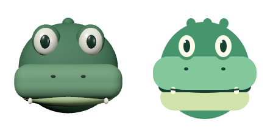
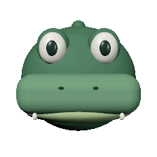

# P04M-A2 — lightweight animated Gator appearances

Date: 19 November 2026. Decision: **PASS for the lightweight playback gate and development integration**, with the operator/platform limits below. This supersedes the proposed live RealityKit *production* approach, not its historical measurements. No live 3D renderer is integrated.

Development candidate: `/tmp/Gator-Native-P04M-2D.app`.

## Outcome and scope

Two selectable appearances are implemented:

- **3D-rendered:** transparent PNG frames authored offline from the approved Concept B USDZ, including its actual jaw, pupil and eyelid articulation. Production displays raster frames; it does not load a 3D model.
- **Classic 2D:** a separately drawn original Core Graphics illustration with a round head, broad muzzle, nostrils, small teeth, cream eyes and lower jaw. It is not a filter of the 3D artwork.

Native Settings provides Show Gator Mascot, Mascot Style and Animate Mascot. The default is visible, animated, 3D-rendered. Reduce Motion takes precedence. The presentation is decorative and cannot admit or authorize work. No desktop pet, queue feature, provider change, icon change or other parity increment is implemented.

| Offline preview | State-specific motion |
| --- | --- |
| 3D-rendered |  |
| Classic 2D |  |

These GIFs are previews, not production playback or recordings of Gator.

## Baseline and preservation

Initial HEAD: `70d096576e6675f8648eb8f1dd1cf552f0d606dc`; initial status was clean. HEAD later advanced externally to `662f5825d81aea1ff4b9f991dbb314746564d31a`. No commit, reset or checkout was performed for this task. New work and external changes were preserved.

The initial [baseline manifest](evidence/p04m-a2-2d/baseline.json) hashes 2,017 existing paths and four prior bundles. The [final integrity manifest](evidence/p04m-a2-2d/final-integrity.json) verifies the preserved bundles and the new bundle's contents. Among those protected source/evidence paths, only ConversationView.swift, GatorApp.swift and build-dev-app.sh changed. GatorCore, original 3D authoring sources, previous renderer experiments and previous evidence remain byte-identical. Go and host application code were not changed.

Preserved bundles include `/tmp/Gator-Native-Parity-P04.app`, Renderer-Lab, Gate2 and Final-Diagnostic. GatorHead.png, GatorMenuBar.png and AppIcon.icns in the new candidate are byte-identical to accepted P04.

## Offline asset pipeline

Authoring sources:

- [AnimationRecipe.swift](2d/source/AnimationRecipe.swift): explicit poses and finite durations.
- [Export.swift](2d/source/Export.swift): original USDZ loading, rig posing, transparent offline output and Classic drawing export.
- [ClassicGator.swift](2d/source/ClassicGator.swift): editable vector geometry, palette and expression drawing.
- [export.sh](2d/source/export.sh): strict Swift 6/macOS 15-targeted authoring executable; exports into a fresh temporary directory for review.
- [previews.py](2d/source/previews.py): regenerates disposable GIF previews using installed ImageMagick.

Canonical input is `macos/mascot/validation/Assets/Gator-B.usdz`, SHA-256 `f85db8a1c80ec5f17d8de8102e77c3b4774357548ee26a582c689be32e4103ca`. Original USDA/USDZ/scene sources are preserved. The authoring exporter loads the original USDZ with its imported PBR materials, verifies all 26 material instances use back-face culling, and applies the existing rig. It avoids the reconstructed native-material path responsible for the earlier back-face/material discrepancy. It does not claim that the rejected reconstructed-material renderer now has exact parity.

Only this authoring tool uses RealityKit/Metal. It renders at 224×224 with the existing transparent offscreen/MSAA authoring engine; production has no dependency on this tool or its 3D frameworks.

Classic palette: skin `#46956C`, muzzle `#83C79B`, lower jaw `#D1E3AA`, ink `#173F32`, cream `#FBFAE8`. Its eyes clip the pupils to the eye shapes; a short mouth curve and tiny teeth remain legible in compact chat.

| Clip, per style | Frames | Duration | Ending static expression |
| --- | ---: | ---: | --- |
| Neutral | 1 | static | Neutral |
| Blink | 8 | 0.30 s | Neutral |
| Working | 12 | 0.80 s | Thinking pose |
| Responding | 9 | 0.55 s | Closed jaw |
| Completed | 11 | 0.65 s | Restrained positive pose |
| Attention | 9 | 0.55 s | Attentive pose |
| Disconnected | 9 | 0.60 s | Concerned pose |

There are **118 PNG frames and one manifest**. Every state has its own sequence; this is not the previous four-second demonstration loop. [Manifest](2d/assets/manifest.json), [rendered state sheet](2d/previews/rendered-states.png), [Classic state sheet](2d/previews/classic-states.png).

[Pixel validation](evidence/p04m-a2-2d/assets.json) checks all 118 images: exactly 224×224, nonempty character, opaque interior, partial-alpha antialiasing and completely transparent borders. No character reaches the image boundary. Validation is reproducible with `python3 macos/mascot/2d/lab/verify-assets.py <output.json>` using the already installed numpy/ImageMagick.

PNG sequences were chosen over APNG/GIF at runtime: exact finite playback/cancellation, transparent edges, one current-clip decode budget and inspectable resources. GIF palette/alpha quantization and looping apply only to previews. No atlas padding, GIF decoder cache or large animation dependency is needed.

## Isolated playback gate — passed before production edits

The gate application is `/tmp/Gator-Mascot-2D-Playback-Gate-Final.app`. The reusable player was moved into GatorMac only after [the timestamped acceptance record](evidence/p04m-a2-2d/playback-gate-acceptance.json) was written. Its two runtime source files remain byte-identical to the [accepted source copies](evidence/p04m-a2-2d/gate-source/):

- NativeMascotPlayback.swift: `22f1660e66f5418830971132c6d0a8168445632a4e945e50653a0fc0964743ea`
- NativeMascotModel.swift: `39c06e215aeb7d03860e52f4af31e75cbd324d834032430fc5a821929a03b4ee`

[Gate revision](evidence/p04m-a2-2d/gate-final-revision.json), [raw samples](evidence/p04m-a2-2d/gate-final/samples.ndjson), [results](evidence/p04m-a2-2d/gate-final/results.json).

Environment: Apple M3, Mac15,12, 16 GiB; macOS 26.5.2 (25F84); Swift 6.3.3. Lab: optimized `-O`, Swift 6, complete concurrency checking and warnings as errors, deployment target macOS 15. Production candidate: existing SwiftPM debug development build. Measurements from those two build configurations are not combined into an incremental estimate.

The final trial lasted **145.66 seconds**, with a bare native text/scroll host baseline, static and active phases for each style, ten creation/hide/destroy cycles, occasional second 56-point presentations, simulated Reduce Motion and a final settled teardown. It passed **26 native assertions**, observed real Core Animation keys for both styles, and finished with **zero retired views alive after releasing the owning task**. Each hidden boundary checked zero animation keys and zero actor-cache bytes. The standalone no-window check passed **63 checks**.

### Resource results

These are process totals and median RSS/physical footprint, measured separately with `TASK_VM_INFO`; CPU is process CPU time / wall time, percent of one core. The test samples once per second and also records the kernel lifetime peak footprint. Sampling/JSON writing is part of the host.

| Final lab phase | Total RSS MiB | Total physical footprint MiB | CPU % of one core |
| --- | ---: | ---: | ---: |
| Bare host | 92.02 | 20.17 | 0.51 |
| Rendered static | 86.92 | 20.05 | 0.10 |
| Rendered responding bursts | 82.23 | 19.63 | 1.62 |
| Rendered idle | 81.62 | 19.63 | 0.06 |
| Classic static | 81.61 | 19.63 | 0.26 |
| Classic responding bursts | 83.92 | 20.44 | 0.53 |
| All presentations released | 84.08 | 20.11 | 0.17 |

Peak total physical footprint was **22.56 MiB**, **2.39 MiB above** the matched host median. The largest later settled footprint was about 0.5 MiB above that median. The highest sampled RSS was 92.06 MiB, already within the host's range. The lower subsequent RSS values reflect residency/warm-up variation; they are **not** evidence of negative memory cost or a zero-allocation renderer.

Decoded frame-cache limit is **3 MiB per presentation**. Largest clip: 2,408,448 bytes / **2.30 MiB**. Static mode decodes one frame, clears the actor cache, and retains that image in the layer. Hidden mode also clears layer contents. Small, bounded simultaneous presentations were exercised; there is no mutable 3D entity or shared render target.

Hidden-phase CPU was approximately 0.09–0.12% after transitions; the first hidden phase included transition work and measured 1.07%. There was no application animation timer or active layer animation in those settled hidden phases. This does not establish zero WindowServer/compositor energy.

[Measured load/dispatch latency](evidence/p04m-a2-2d/load-latency.json): rendered median 5.06 ms, maximum 22.70 ms across 25 observations; Classic median 0.23 ms, maximum 11.23 ms across 23. These include asynchronous scheduling and decoding, not frame-present latency. Decode runs in the frame-store actor, not synchronously in the SwiftUI update method.

Historical rejected live-3D results were about +40.61 MiB settled and +144.69 MiB lifetime peak physical footprint. Those belong to another implementation/trial. The new matched AppKit-host peak increment is comfortably below the preferred +20 MiB steady / +40 MiB activity targets without raising either target. GPU utilization, compositor power and energy are **NOT TESTED**. Installed xctrace templates include Metal System Trace, but no attributable GPU-energy measurement was collected; low app CPU is not an energy measurement.

## Playback architecture and lifecycle

[NativeMascotModel.swift](../Sources/GatorMac/NativeMascotModel.swift) contains finite style/clip specifications, presentation signals and a small reducer. [NativeMascotPlayback.swift](../Sources/GatorMac/NativeMascotPlayback.swift) contains the bounded image actor, finite Core Animation player and native view wrapper.

- Only the current clip for the selected style is decoded. No full-library preload or per-token USDZ/PNG import.
- CAKeyframeAnimation changes layer contents discretely, plays once, and returns to the specified static frame. There is no high-frequency application timer or display link.
- Neutral idle schedules one cancellable blink after 11 seconds. A completed gesture may schedule another idle blink; hidden/static/Reduce Motion modes do not.
- Public-text-driven response gestures are throttled to at most one start per 650 ms. Closing/reopening cannot replay an old response revision as fresh streaming.
- New requests cancel owned load/blink tasks, invalidate old completion tickets and remove the old layer animation. Stale actor loads/clears cannot replace newer content.
- Window occlusion/minimize/close and native view dismantling stop playback. Observers use weak captures and are removed with their owner. Hidden mode releases the layer image and frame cache.
- Missing clips fall back to that style's neutral image. If the style's neutral asset is also missing, decoration is omitted without a retry loop or loss of chat functionality.

Initial test corrections are preserved in evidence: an immediate weak-deallocation assertion still owned its subject through the test task; final lifetime checks occur after task release. A detached headless CALayer lost its animation after transaction flushing, so headless checks validate the actual finite animation descriptor and native gate checks retain the real attached-layer assertion. These were harness corrections, not suppressed application failures. The first new package-test build also caught a labeled BridgeSnapshot initializer and nested `#require` macro error; both test-code errors were corrected before the passing runs.

## Public state mapping and authority

[NativeMascotView.swift](../Sources/GatorMac/NativeMascotView.swift) reads only the selected GatorApplicationState. Its owner key combines context and generation. An owner change resets presentation history and does not celebrate an already-retained completion.

Precedence:

1. Disconnected.
2. A real pending approval, an opened exact review, or a projected plan-review phase.
3. Changed public activity text while work is active: responding.
4. Canonical running/dialogue-busy state: working.
5. A newly observed completed retained activity with a nonempty canonical finished timestamp: brief completed gesture.
6. Neutral idle.

Only public `activity.entries` whose kind is `text` contribute to the streaming revision. Private reasoning, tool arguments, raw internal JSON and approval tokens are not animation inputs. Completed text alone, an acknowledgement or elapsed time cannot establish a completion. Static positive expression may remain after its finite completion gesture; no repeated celebration loop runs.

This is a visual text-stream metaphor, not speech or lip synchronization. Other owners' work does not replace the selected owner's expression or foreground conversation. The component has no message, approval, queue, provider or session-start capability. GatorCore, Go authority, archives, attachments, closing transaction and subprocess shutdown were not modified.

## Native preferences and layout

[NativeMascotPreferences.swift](../Sources/GatorMac/NativeMascotPreferences.swift) uses existing native `@AppStorage`/UserDefaults presentation preferences:

- `gator.mascot.shown`
- `gator.mascot.style`: `rendered` / `classic`
- `gator.mascot.animated`

Unknown style values fall back to 3D-rendered, not rejected live 3D. These settings are not conversation archives, model settings or Go configuration. Conversation → Mascot Appearance…, the More menu and standard Settings expose the form. Disabling Show removes the native presentation; disabling Animate displays the selected style's static expression. The system Reduce Motion environment always overrides Animate.

ConversationView reserves an offset slot outside the transcript ScrollView: full-window character 108 points, compact 56; reading/review sizes 40/28. The full slot is 112 points, compact 60; constrained full-window layouts use a 48-point slot. Shrinking keeps the reserved viewport height stable during reading/review, trading space reclamation for anchor continuity. The disabled preference removes the slot.

The existing near-bottom reading logic is observed without changing its anchor, following or reveal bindings. Separate 80-point return / 160-point leave thresholds reduce oscillation. Programmatic following updates do not create reading mode. Task/exact/recovery inspection also requests collapse. The mascot does not appear in All Conversations, Workspace picker, Models and Providers or Settings forms. Notch behavior is unchanged.

The view rejects hit testing, is not a first responder and is accessibility-hidden as decoration. Canonical text/status/review controls remain the accessible authority. Settings use native labeled controls. Physical VoiceOver/IME and preference variants are not claimed from metadata.

## Targeted desktop observations

The test copy used a unique bundle ID, `dev.gator.mascot.2d.acceptance`, in a private `gator-native-test-mascot-*` temporary directory. Executable/runtime/assets matched the packaged candidate; only Info.plist's bundle identifier differed. HOME, state, config, native data and workspace were disposable. The allowlisted environment used an inert key and a loopback-only Responses fixture. Its code contains no outbound client/effect endpoint. The Go process was the actual bundled runtime behind the existing fixture-only transparent observer.

Actual window recordings, with no desktop or audio capture:

- [Classic 2D live response, 28.86 s](evidence/p04m-a2-2d/live-classic.mp4).
- [3D-rendered live response, about 20.5 s](evidence/p04m-a2-2d/live-rendered-final.mp4).
- [Classic motion crops](evidence/p04m-a2-2d/live-classic-motion.png), [rendered motion crops](evidence/p04m-a2-2d/live-rendered-final-motion.png), [crop analysis](evidence/p04m-a2-2d/recording-motion-analysis.json). The character-only region contains multiple distinct jaw/expression positions while public Go-backed fixture text streams. These are actual native-window captures, not exported GIFs.

| Check | Result and evidence |
| --- | --- |
| Full-window light, both appearances | PASS: [rendered](evidence/p04m-a2-2d/full-rendered-light.png), [Classic](evidence/p04m-a2-2d/full-classic-light.png). Reserved placement does not overlay messages/composer. |
| Dark/static | PASS: [Classic](evidence/p04m-a2-2d/full-classic-dark-static.png); static preference retained its image. |
| Compact, both appearances | PASS: [rendered](evidence/p04m-a2-2d/compact-rendered.png), [Classic dark](evidence/p04m-a2-2d/compact-classic-dark.png). 440×620 panel, composer and controls available. |
| Constrained full window | PASS: [540×532 frame / 480-point content](evidence/p04m-a2-2d/minimum-classic-dark.png); 40-point mascot, visible composer/Send and toolbar overflow. |
| Transcript Find/focus | PASS: actual Command-F focused Find; “Retained note” found 35 matches. Close Find and explicit composer focus worked; mascot accepts no input. An earlier helper expected an obsolete accessibility identifier; checking the real field description corrected the probe. |
| Older reading and style change | PASS for observed case: Find revealed exact retained note 0002-01, mascot shrank, and the selected message remained visible before/after preference editing. [Before](evidence/p04m-a2-2d/reading-collapsed-before.png), [after](evidence/p04m-a2-2d/reading-collapsed-after.png). The immediate after capture can retain the preceding image while asynchronous style loading completes; it is anchor evidence, not proof of the new style's first frame. |
| Jump to Latest | PASS: explicit control returned to latest; it was not invoked by mascot changes. |
| Draft continuity | PASS: “Keep mascot draft intact” survived settings edits, compact/full presentation and Quit/relaunch in the original conversation. |
| Task inspection | PASS: native sheet and Back to Conversation remained usable; [inspection](evidence/p04m-a2-2d/inspection.png). |
| Pending exact approval | PASS: real Go proposed inert web-access review; mascot shrank, exact owner/content/decisions stayed visible. [Approval](evidence/p04m-a2-2d/approval.png), [AX evidence](evidence/p04m-a2-2d/approval.ax.txt). No decision was submitted. |
| Recovery | PASS: guarded Quit retained interrupted work; reopening did not replay it. Recovery inspection displayed “Interrupted · not resumed” and warning evidence. [Recovery](evidence/p04m-a2-2d/recovery-inspection.png), [AX evidence](evidence/p04m-a2-2d/recovery-inspection.ax.txt). |
| Preference persistence | PASS: Classic selection was present after Quit/relaunch; Show/Animate toggles changed the native presentation. [Settings](evidence/p04m-a2-2d/settings.png), [reopened form](evidence/p04m-a2-2d/relaunched-preferences.ax.txt), [hidden mascot](evidence/p04m-a2-2d/disabled-dark.png). |
| Reduce Motion | PASS in controlled renderer request/lab tests; actual OS preference toggle NOT TESTED and not changed. |
| Plan-specific desktop review | NOT REPEATED individually. Shared review-collapse policy and existing headless plan/security regressions passed. |
| Physical VoiceOver, IME, Increased Contrast/larger-text variants | NOT TESTED. |

Focus interference was real: early in the disposable session, inputs “h”, “hi”, “hmmm” not entered by the agent created fixture work. Later the foreground moved between Gator and other applications and some accessibility references temporarily disappeared. The user confirmed a free desktop interval; guarded sequential checks were then completed. Input probes refused to type into an unrelated frontmost application. Immediate capture during occlusion or asynchronous load could show blank/previous content. Those captures/probe failures are not treated as demonstrated application failures. No focus-policy or keyboard-shortcut production rewrite was made.

The first approval fixture incorrectly returned JSON to a streaming request, producing a truthful retained Go failure. The fixture was corrected to emit a terminal SSE response; the subsequent pending-review check passed. This was not a production/provider fix.

Normal guarded Quit succeeded. A background NSRunningApplication termination probe did not itself close the hidden fixture; reopening and invoking the actual Quit menu exposed the existing confirmation. No deadlock was observed in a read-only sample (main thread waiting in the native event loop); no shutdown behavior was changed to accommodate automation.

[Command summaries](evidence/p04m-a2-2d/desktop-command-trace.json) contain no approval decision. [Provider trace](evidence/p04m-a2-2d/provider-trace.jsonl) contains no unexpected endpoint request. No real credential, paid model call or external action was used.

### Integrated resource observation

The isolated gate supplies the controlled incremental comparison. Separate external `proc_pid_rusage` samples of the packaged app are [recorded here](evidence/p04m-a2-2d/integrated-resources.json). After a response, one session showed total RSS 139.73 MiB / physical footprint 59.02 MiB / 0.026% CPU. A later UI session showed about 159.8 MiB RSS / 68.3 MiB physical footprint; explicitly observed hidden state measured about 0.027% CPU. The later process had a recorded whole-app lifetime peak physical footprint of 121.89 MiB. These sessions had different owners, histories, inspectors and auxiliary-window activity; the peak was not attributed to the mascot. Their whole-app totals and lifetime peaks are **not incremental mascot costs**, and the post-response sample is not sustained-stream CPU. Continuous visibility was not independently verified throughout the “idle” sampling window. No full-app GPU or quantitative typing/scroll latency claim is made. Actual typing, Find/reveal and layout remained usable in observed checks.

## Regression verification

Commands ran headlessly except the explicitly described native lab/desktop captures. Existing assertions were not weakened.

| Command | Result |
| --- | --- |
| `swift test --package-path macos --scratch-path /tmp/gator-native-build --no-parallel --filter mascot` | 16 new tests passed after correcting test compilation errors. |
| `swift build --package-path macos --scratch-path /tmp/gator-native-build` | PASS. |
| `GATOR_TEST_BINARY=/tmp/Gator-Native-Parity-P04.app/Contents/Resources/gator-runtime swift test --package-path macos --scratch-path /tmp/gator-native-build --no-parallel` | **243 tests passed**, 141.923 s; baseline 227 + 16 new mascot tests. |
| `swift test --package-path macos --scratch-path /tmp/gator-native-build --no-parallel -Xswiftc -strict-concurrency=complete -Xswiftc -warnings-as-errors --filter mascot` | All package/test sources compiled strictly; 16 mascot tests passed. |
| Strict standalone CheckPlayback compiled from NativeMascotModel/Playback and lab/CheckPlayback.swift; run with 2d/assets root | **63 checks passed**, no windows or backend processes. |
| Final isolated native lab | **26 assertions passed**, two styles actually animated, ten lifecycle cycles, no retired views after task release. |
| `go test ./cmd/gator ./internal/workapp ./internal/worksession ./internal/workspace ./internal/workactivity ./internal/modelcatalog ./internal/auth ./internal/config` | **Eight packages passed**, seven cached and workactivity executed. |
| Node 26.7.0 `--test app-host/tests/{native,sessions,drafts,reading-state,backend}.test.mjs` | **41 passed**. Initial shell Node 20.19.5 run had 40 pass / one PDF dependency failure (`Promise.withResolvers` unavailable); switching to the already installed Node 26 resolved the environment mismatch. No dependency installed or host code changed. |
| `GATOR_NATIVE_APP_PATH=/tmp/Gator-Native-P04M-2D.app bash macos/scripts/build-dev-app.sh` | PASS: Swift app, current Go runtime, resources, plist validation. |

Logs: [full Swift](evidence/p04m-a2-2d/swift-full.log), [strict Swift](evidence/p04m-a2-2d/swift-strict.log), [Go](evidence/p04m-a2-2d/go-regression.log), [host Node 26](evidence/p04m-a2-2d/host-regression-node26.log), [package](evidence/p04m-a2-2d/package.log).

New package coverage includes preference round-trip, finite clip/manifest agreement, state precedence and canonical completion, public/private content selection, owner changes, response suppression after hidden state, cache bound/clear, static/Reduce Motion, cancellation, missing assets, collapse policy and reading identity. A source-boundary check rejects live-3D/WebView and execution calls in mascot components. Existing cross-process archive/stale-write, late-Quit, inherited-pipe shutdown and P01–P04 tests remain in the full passing suite.

The package still targets macOS 15. New Core Animation, ImageIO, AppKit, Settings/AppStorage APIs are compatible with that target; compilation uses it. **Physical macOS 15 runtime is NOT TESTED.** Compiling on macOS 26 is not runtime acceptance on macOS 15.

## Packaging and changed-file inventory

Production changes:

- New `macos/Sources/GatorMac/NativeMascotModel.swift`: styles, finite clips, preferences, public presentation reducer.
- New `NativeMascotPlayback.swift`: bounded async decoder, native player, visibility/teardown.
- New `NativeMascotView.swift`: public projection, reading preference, reserved header and native wrapper.
- New `NativeMascotPreferences.swift`: small native appearance form.
- `ConversationView.swift`: header placement, presentation-only reading observation and settings entry.
- `GatorApp.swift`: Settings scene and menu entry.
- `macos/scripts/build-dev-app.sh`: copies PNG/manifest assets into bundle Resources/Mascot.
- New `macos/Tests/GatorMacTests/NativeMascotTests.swift`: 16 tests.

Authoring/validation additions are under `macos/mascot/2d/{source,assets,previews,lab,acceptance}`; evidence is under `macos/mascot/evidence/p04m-a2-2d/`. The accepted playback files were moved from the isolated 2d/playback staging directory to GatorMac, not maintained as two implementations. The lab build now compiles those same production runtime files. [Complete new-file inventory](evidence/p04m-a2-2d/changed-files.json).

The bundle includes exactly the generated PNGs/manifest and existing app/runtime resources. [Linked-library evidence](evidence/p04m-a2-2d/production-linked-libraries.txt) has no RealityKit, SceneKit or WebKit. No USDZ/USDA/USDC/scene file is bundled. The desktop test copy ran entirely from a temporary installed location; asset loading uses Bundle.main, not source-checkout paths. An unbundled `swift run` does not include these images, so the mascot is omitted; runtime configuration is also required by the existing unbundled workflow. The dev-app script is the supported complete bundle workflow.

No README, Go backend, archive/security source, existing icons or previous evidence was edited. No commit, dependency installation, signing or notarization was performed.

## Remaining limits and decision

No new reproducible P0/P1 defect was found in these checks. Historical owner-retirement P2 limitations remain unchanged. This is a bounded development validation, not a claim to have ruled out every long-session/platform defect.

- GPU/compositor utilization and energy, physical macOS 15 runtime, physical VoiceOver/IME and OS preference variants remain unverified.
- Plan-specific desktop review and every possible compact/minimum-size review combination were not individually exercised; shared collapse logic and prior headless review tests passed.
- Whole-app incremental peak memory and formal scrolling/typing latency were not isolated from other UI activity. Controlled playback resource targets passed; integrated totals are disclosed separately.
- 3D-rendered artwork has baked viewpoint/lighting and finite discrete poses. It is deliberately not a functional 3D model at runtime. Both styles use bounded 224-pixel frames; substantially larger surfaces would need another asset/performance review.
- Shrinking preserves slot height during reading/review to avoid a viewport jump. It does not reclaim all header space until the mascot is disabled or the full window is constrained.

**Acceptance:** the two-style implementation and lightweight playback gate can be accepted as the development increment, with these explicit operator/platform limits. A future P04M-B could reuse the style/state/frame-player identity, but needs separate window, interaction, lifecycle, resolution and resource acceptance. No pet or later parity work has begun.
