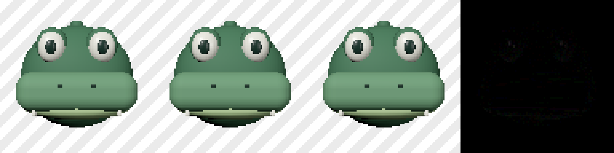

# P04M-A2 — final Gate 2 diagnosis

## Decision

**FAIL / NO-GO for production integration.** This bounded pass identifies the activity-memory charge, distinguishes test-wrapper ownership from a bounded last-output texture, and corrects a real back-face-culling mismatch. It does **not** turn the remaining end-to-end image failure or an unapproved resource budget into a pass.

Production Gator remains unchanged. All work is isolated under `macos/mascot/`. No provider, credential, Go, draft, approval, recovery, icon or production view code is modified. No commits, installs, paid inference, signing or notarization are performed.

The appropriate next technical choice, if the user elects to continue, is the canonical USD/material path with one renderer reused during actual response bursts and released at idle/hidden boundaries. This preserves the approved character and avoids further guessing about reconstructed material shaders. It requires explicit resource-budget review and its own scoped acceptance; it is **not implemented as a replacement in this pass**.

## Baseline and exact experiment identity

Starting HEAD: `2822ba5d5552c290eae0ceedf34fe6048be2d25d`, initially clean. [Baseline](evidence/p04m-a2-final/baseline.json) protects 11,202 existing files and three original bundles. [Inventory](evidence/p04m-a2-final/inventory.json) records all 336 existing files in the requested gate2/validation/prior-evidence trees, including source hashes and parsed evidence schemas.

Host: Apple M3, macOS **26.5.2 (25F84)**, Apple Swift **6.3.3**, arm64, `-O -swift-version 6 -strict-concurrency=complete -warnings-as-errors -target arm64-apple-macosx15.0`. The deployment target remains 15.0; no physical macOS 15 runtime is available for acceptance.

| Asset/source | SHA-256 |
| --- | --- |
| Original Concept B USDZ, 58,290 bytes | `f85db8a1c80ec5f17d8de8102e77c3b4774357548ee26a582c689be32e4103ca` |
| Original authoring USDA | `356d1cabfba9562e34a62a43123eb850b6f389ff2d9efa63cf55e51852334ed3` |
| Exact baked mesh archive, 626,128 bytes | `ca627304250fa060974d1d18e293c9baa85d9755d7086d261cd498eaf0ecc13f` |
| Unchanged Engine.swift | `c4f1a9c9ee846d2861fd9f08f3cebad5decd8aff47a128b38ccb55187cf33718` |
| Unchanged Presentation.swift | `7173b471104441a61717a5a9498b92ad990ca95137b388577fee5482d0126dcb` |
| Corrected NativeMesh.swift | `628d6e545c591c043070f79583a7ed1a7e1204084f86b2707c1f10204fa6b10a` |
| Corrected final lab executable | `2b51a8f7fe8b11ad35c07936dd3627645e27decf317fc3ad749934de42a2ebbb` |

Experiment groups are separate:

1. **Historical v10**: prior report's +35.77 MiB 96px idle RSS, +38.17 MiB final settled footprint, +144.25 MiB highest activity-phase median footprint, 690.835s endurance. Those numbers are not relabeled as this pass's samples.
2. **Attribution v1**: frozen uncorrected loader, unchanged engine/presenter, three fresh-process retained-renderer trials plus poster/offscreen controls. Each fresh process contains three warmed scene lifetimes. Sources/revision are copied into each result. The prototype is preserved at `/tmp/Gator-Mascot-Final-Attribution-v1.app`.
3. **Attribution v2**: corrected culling, same engine/presenter, a matched ABBA policy comparison. Preserved at `/tmp/Gator-Mascot-Final-Attribution-v2.app`.
4. **Corrected final lab**: `/tmp/Gator-Mascot-P04M-A2-Final-Diagnostic.app`, frozen source/asset/executable hashes above, with a new final-configuration endurance trial. The earlier 11m31s trial is historical corroboration, not certification of the material correction.

## Measurement method

- RSS and physical footprint are separately labeled and compared only with the same process's pre-RealityKit baseline. Fresh-process and post-initialization warmed plateaus are distinct. No RSS decrease is called a footprint decrease.
- A 20 Hz read-only sampler records `TASK_VM_INFO`, including resident, internal, compressed and graphics-tag footprint/no-footprint ledgers, plus default-zone malloc and `MTLDevice.currentAllocatedSize`. It writes NDJSON rather than retaining samples in memory. Identical sampling exists during each baseline. `proc_pid_rusage` independently samples the final endurance process from a separate native tool.
- `getrusage` CPU deltas use 100% for one core. The policy comparison uses the same eight 1 Hz gestures, 56 actual frames per block, in reuse/burst/burst/reuse order.
- `footprint` and `vmmap` inspect only controlled fixture PIDs. Their captures are supplemental snapshots; a tool invocation can span a phase boundary, so the phase-tagged kernel-ledger samples are the temporal attribution evidence.
- Metal allocated bytes are neither RSS nor resident GPU memory; counters overlap and are not summed. GPU power/utilization/energy are **NOT TESTED**.
- After a diagnostic releases its Metal device reference, the Metal-allocation counter is unavailable and summarized as `null`, not as zero allocated backing. Other kernel counters remain sampled independently.
- Correctness tests await actual completion/cancellation. Timed waits are confined to resource sampling/settling periods and gesture pacing, not used to claim operation success.

Some headless material controls ran in separate processes during v1 attribution. The reported ledgers are process-specific, but shared-GPU scheduling can affect timing, so those trials are diagnostic rather than isolated GPU-energy benchmarks. The paired v2 comparison and final endurance did not overlap another mascot-rendering experiment. The independent sampler only reads counters.

[Archived runs](evidence/p04m-a2-final/runs/), [summary](evidence/p04m-a2-final/summary.json), and [summarizer](final-diagnostic/summarize.py).

## A — activity-phase memory attribution

The large rise is a **repeatable graphics-ledger charge while rendering and during delayed quiescence**. It is not a 144 MiB RSS increase or 144 MiB of application-owned model geometry. It is also not confined to first shader/model use: warmed second/third scene lifetimes repeat it.

Representative retained-1 phase medians, all **total MiB**, using the same process and native mesh representation:

| Boundary | Physical footprint | Graphics-footprint ledger | Internal bytes | Metal allocated backing |
| --- | ---: | ---: | ---: | ---: |
| Before explicit RealityKit initialization | 16.97 | 0.02 | 16.33 | Not initialized |
| Empty RealityRenderer | 38.72 | 7.59 | 36.36 | 290.59 |
| Mesh template loaded | 43.42 | 6.39 | 42.28 | 288.38 |
| Scene created, before first explicit render | 134.52 | 95.38 | 44.72 | 294.92 |
| After first render, sampled over quiescence | 58.95 | 18.39 | 46.44 | 290.41 |
| After first animation | 59.03 | 18.42 | 46.47 | 290.45 |
| Sustained jaw draws | 153.28 | 110.42 | 46.61 | 290.45 |
| GPU-completed, six-second observation | 56.58 | 15.83 | 46.62 | 290.45 |
| Returned static pose, six-second observation | 56.58 | 15.83 | 46.62 | 290.45 |
| Drawables released | 56.56 | 15.83 | 46.61 | 290.45 |
| Renderer destroyed | 56.30 | 15.69 | 46.39 | 290.27 |

These columns are **not additive**: kernel accounting categories can overlap. During sustained drawing, graphics charges rise roughly 95 MiB while Metal allocated backing and ordinary internal memory remain nearly unchanged. Quiescence moves much of the graphics accounting back out of footprint; the graphics-no-footprint ledger also rises. This establishes the accounting category and its temporal lifetime, not the exact private CoreRE/driver allocation or a claim that the charge is unavoidable.

The appearance of a large charge during scene initialization and repeated warmed animation rejects “only first-use shader compilation.” Its decay after GPU-completed work and removal of all application-owned scenes rejects “all of this is permanently retained scene geometry.” The exact split among private graphics pools, shader/pipeline caches and driver residency policy remains **unverified**; no private release API is used.

### Fresh-process repeatability

| Trial | Host RSS / footprint, total | Maximum sampled incremental footprint | Final warmed incremental footprint |
| --- | ---: | ---: | ---: |
| Retained-1 | 65.27 / 16.97 MiB | 140.31 MiB | 39.95 MiB |
| Retained-2 | 69.06 / 16.69 MiB | 140.28 MiB | 39.62 MiB |
| Retained-3 | 69.05 / 16.91 MiB | 140.34 MiB | 40.52 MiB |
| Add a neutral-poster readback | 69.22 / 17.05 MiB | 140.34 MiB | 39.47 MiB |
| Reuse one headless color target | 69.03 / 16.50 MiB | 141.34 MiB | 40.64 MiB |

The slightly different original +144.25 MiB figure came from a different full/compact host and a phase-median statistic. It is not compared numerically with these minimal-host maxima as an optimization. Both exhibit the same class of activity-associated footprint charge; the corrected full/compact trial is reported separately below.

Returning to the warmed plateau is **not** returning to the cold pre-RealityKit baseline. Approximately 40 MiB of incremental footprint remains after all test-owned strong references are released. This pass does not establish that every retained framework/allocator byte is essential or a leak.

### Decay and frequency

Each sustained trial issued 60 jaw frames, paced at about 30 Hz, with every call awaited through the corresponding command-buffer completion. The graphics charge remains high during repeated work; there is no claim that a long response's peak lasts only one frame. It can remain high for the whole activity interval.

After the final static draw, the direct retained trials usually reached their late warmed plateau plus 2 MiB for at least half a second within **1.10–2.04s**. One warmed trial required **11.40s**. In poster/offscreen controls, several 14-second local observation windows did not establish that plateau; later all-reference-release samples did. Therefore **there is no verified universal short decay timeout**. Poster generation is not claimed harmless, and reference release is not a promise of immediate driver-memory reclamation.

The sampler's `decayAfterFinalStaticDraw` entries retain `null` when the plateau was not observed within the stated window. No timeout was extended to manufacture a pass.

## B — command, drawable and poster lifetimes

`Engine.draw()` retains the acquired drawable across `render()` and presents it only after completion. `render()` creates a CameraOutput scoped to that call, waits on `onComplete`, clears `inFlight` and resumes drain waiters. Apple defines [onComplete](https://developer.apple.com/documentation/realitykit/realityrenderer/updateandrender(deltatime:cameraoutput:whenscheduled:oncomplete:actionsbeforerender:actionsafterrender:)) as the corresponding Metal command-buffer completion handler. No texture is deliberately released before that boundary.

`pause()` invalidates transitions, drains in-flight work, releases the layer/MetalKit surface or headless target, and restores neutral transforms. `close()` drains, removes renderer entities/camera, clears rig/renderer and releases the surface. Finite presentation tasks are canceled/awaited before engine replacement. There are no renderer update subscriptions.

The direct surface bounds its drawable queue to two. The existing MetalKit alternative is paused/manual-draw, no application depth attachment and sample count 1, and calls `releaseDrawables()` before disconnecting its delegate/device. The headless control reuses one appropriately scoped color target. The original older presenter also reused its CameraOutput; prior same-revision comparisons still showed large activity footprint. No evidence identifies repeated CameraOutput construction or small color targets as the main memory cause.

The fresh-process poster and offscreen experiments change one high-level resource choice at a time. Their approximately 140–141 MiB peak increments reject “allocate a different small color target to remove the bulk of the peak.” A cached neutral poster is generated once in the policy test; no per-response poster readback or repeated USDZ import is required. Repeated working-pose posters in the earlier hybrid are still an extra operation and are not assumed free.

No engine rewrite, repeated autorelease-pool workaround, private memory purge, MSAA increase or transport change is introduced.

## C — final ownership audit

The earlier headless test's `identity` local deliberately keeps the first engine wrapper alive through `main()`. That explains `engine: 1`; it does **not** show a live RealityRenderer. Closing already clears that wrapper's target/rig/renderer properties.

The new ownership run records three separate boundaries:

1. Closed wrapper deliberately retained: engine 1, RealityRenderer/scene 0; its original headless target is already gone.
2. Deliberate handle released: engine 0. Presentation tasks are explicitly awaited/canceled, the presentation is released, then fixture/template/poster/device references are released.
3. Owning operation and sampler tasks are cleared and the native run loop returns: engine, presentation, immutable template, renderer, scene, surface and layer **all 0**. A latest headless target can remain observable.

The independent [released-subject test](evidence/p04m-a2-final/released-final.json) runs twelve separate task-scoped lifetimes using **weak probes only**. It checks the target property is cleared after close and clears each task handle before observing. Every preceding target disappears when the next output replaces it; only the latest target remains. After the final output is changed to **16×16**, all eleven earlier 96px targets are gone. **14 assertions pass.** No test subject is retained merely to observe it.

This is evidence of bounded last-output retention beyond application ownership, rather than twelve leaked render targets or a retained wrapper. [Inference] A framework/driver last-output resource cache is consistent with the observation; the exact private retaining object is not identified. The latest target is not falsely declared deallocated. Its tiny color storage also cannot alone explain approximately 95 MiB of changing graphics charges.

## D — strict PNG failure: reproduced and narrowed

The old test compares **two RealityKit renders from the same v10 renderer**: original USDZ import versus the optimized native mesh/material reconstruction, 96×96, same camera, lights, pose, no MSAA and the same PNG writer. It does **not** compare the original A1 SceneKit poster, a different model revision, a screenshot or PNG file bytes.

Reproduction with the unchanged old probe fails for both original images. PNG metadata/encoded color profile match (`sRGB`); alpha is binary and identical, dimensions/orientation agree, silhouette bounds agree, and transparent RGB does not explain the error. Five repeated frames per same input path produce identical decoded samples, so observed GPU nondeterminism is not the cause in these trials.

Additional geometry inspection checks **all position and normal arrays and triangle indices across 26 meshes: exact equality**. USD import includes extra vertex-color buffers, but substituting imported meshes alone does not remove the image mismatch. Substituting imported materials does. This is a controlled material-construction finding, not an encoder hypothesis.

### Real defect corrected

The optimized loader sets `faceCulling = .none`; the canonical USD importer uses `.back` for all 26 materials. The new material-parity test fails on all 26 pairs before the correction and passes after it. `gate2/NativeMesh.swift` now uses `.back`; no original geometry or asset is changed.

Changing **only** culling removes the large neutral outlier:

| Decoded stored sRGB comparison | Maximum channel difference | Mean RGBA difference | Alpha/silhouette mismatch |
| --- | ---: | ---: | ---: |
| Before correction, neutral | 68 / 255 | 0.04397 code levels | 0 pixels |
| After culling correction, neutral | 4 / 255 | 0.03762 code levels | 0 pixels |
| Before correction, jaw-open/blink | 4 / 255 | 0.02612 code levels | 0 pixels |
| After correction, jaw-open/blink | 4 / 255 | 0.02580 code levels | 0 pixels |

The old probe's reported 69.56/5.17 are floating NSColor-converted amplitudes scaled by 255, not integer stored PNG-code differences. That distinction is documented rather than rounding an error into a pass.

### Remaining result is not concealed

Across neutral, jaw, lids, combined articulation and gaze, the corrected end-to-end native material path differs by up to **four stored channel levels** (closed lids: two). Replacing only the material objects with their canonical imported counterparts reduces geometry-path differences to **≤1 stored code**, or zero when both mesh/material representations are canonical. Individual tint/program/emission/specular/roughness substitutions do not remove the remaining material-path difference.

Public material-property inspection isolates the culling difference and tiny tint round trips; imported resource/parameter representation differs from newly constructed PBR resources. The exact private shader/material-default mechanism responsible for the residual four-level difference remains **unverified**. It is not called rendering noise, proven harmless, a camera/gamma error or a successful strict match.

The original strict end-to-end test **remains failing and unchanged**. It correctly exposed the culling defect and still reports real decoded differences. It is not replaced with an arbitrary four-level tolerance.

A separate controlled geometry-fidelity test holds canonical materials constant. It retains exact asset/rig/count checks, exact alpha/dimensions/silhouette, and ≤1 **stored RGBA8 quantization level** in eye/lid, snout and jaw regions. This test passes for all five poses. Actual 3D renders with a missing eye or missing jaw fail the same criteria: **all ten negative controls are rejected**. This validates geometry/articulation independently; it does not turn the end-to-end material failure into a pass.

Evidence: [fidelity results](evidence/p04m-a2-final/fidelity-final.json), [original failure](evidence/p04m-a2-final/strict-reproduction.json), [corrected strict failure](evidence/p04m-a2-final/strict-final-commands.json), [geometry](evidence/p04m-a2-final/geometry.json), [material controls](evidence/p04m-a2-final/fields-analysis.json), [scalar controls](evidence/p04m-a2-final/scalar-fields-analysis.json).

### Actual image comparison

Each strip is **canonical USD reference / original optimized output / corrected optimized output / final absolute RGB difference amplified 8×**. These are actual rendered samples, not generated/repainted mascot art. The amplified difference is diagnostic and is not the normal appearance.




## E — event-driven hybrid policy comparison

Same corrected executable, one model decode, same eight 1 Hz response gestures / 56 frames per block, ABBA order. Cached-poster preparation is warmed before the sequence; its initial prepared-poster checkpoint does not mount the image until the first presenter call. Returned-static phases do display the cached pose with no live engine.

| Policy block | CPU, one core = 100% | First activation | Median activation | Frames |
| --- | ---: | ---: | ---: | ---: |
| Reuse until explicit idle, first | 4.84% | 31.33 ms | 5.27 ms | 56 |
| Release between gestures, first | 9.55% | 24.36 ms | 26.11 ms | 56 |
| Release between gestures, second | 10.73% | 33.53 ms | 29.00 ms | 56 |
| Reuse until explicit idle, second | 6.20% | 22.85 ms | 5.53 ms | 56 |

The complete test creates 19 engines (including the poster preparation) with **one model decode**, then zero renderer/scene/surface/layer owners after teardown. Both policies use actual 3D jaw geometry, a static cached pose at idle and no hidden render loop.

The ABBA host is a resource-comparison fixture: it leaves the cached image underneath its transparent live layer. That composition is matched across both policy cases and is **not accepted as a visual handoff**. The qualified full/compact lab has a separate first-frame reveal that removes its cached cover. Neither the ABBA timings nor the direct-render recording certify subframe hybrid transition quality.

Destroying the renderer after every text gesture is **not adopted as an optimization**: it approximately doubles CPU here and does not remove the peak footprint. Retaining one active scene only during actual response activity is the better measured direction; idle/hidden boundaries still release it. Warm first-frame latency includes awaited GPU work and does not prove a main-thread stall or its absence. Formal production typing/scrolling latency, subframe transition flicker and the maximum 4 Hz throttle rate remain **NOT TESTED**. There is no claim that the integrated app meets those criteria.

## F — corrected final validation

Focused strict builds and headless checks after the culling correction:

| Check | Result |
| --- | --- |
| Strict Swift 6, warnings as errors, target macOS 15 | PASS: corrected prototype and check binaries |
| Existing lifecycle checks | PASS: 33 assertions; jaw-open cancellation, concurrent supersession, pause/resume, neutral restoration, hidden suppression, multiple presentation lifetimes |
| Existing rig stress | PASS: 21 assertions / 1,000 pose cycles, including jaw, pupils, upper/lower lids and no transform accumulation |
| Existing graph/pose/bounds | PASS: 342 comparisons; unchanged mesh counts/depth/rig identities |
| New culling parity | Expected FAIL before fix; PASS afterward, 26 material pairs |
| Released-subject ownership | PASS: 14 assertions / 12 task-scoped lifetimes; only the latest small output remains observable |
| Alpha / silhouette / dimensions, canonical-material path | PASS: five poses, exact alpha/silhouette, meaningful-region checks |
| Negative image controls | PASS: all ten missing-eye/jaw renders rejected |
| Corrected end-to-end strict PNG parity | **FAIL**, retained without threshold relaxation |
| Metal API Validation | Enabled for focused final headless runs; no validation error reported |
| Production Swift / Go / host suites | NOT RERUN, production files unchanged as requested |

### Final endurance and native recording

The exact corrected executable completed **701.347 seconds (11m41s)**. [Full report](evidence/p04m-a2-final/corrected-endurance/results.json), [phase/raw samples](evidence/p04m-a2-final/corrected-endurance/samples.ndjson), [independent external samples](evidence/p04m-a2-final/external-endurance-samples.ndjson).

| Final corrected checkpoint | Total RSS | Total physical footprint | Incremental RSS / footprint versus this host baseline |
| --- | ---: | ---: | ---: |
| Pre-RealityKit host | 69.53 MiB | 18.99 MiB | — |
| Initialized/static | 107.08 MiB | 59.33 MiB | 37.55 / 40.34 MiB |
| Final settled idle | 91.61 MiB | 59.61 MiB | 22.08 / 40.63 MiB |
| All presentation/template references released | 91.59 MiB | 59.59 MiB | 22.06 / 40.61 MiB |

- **589 explicit renders**, **one asset decode**, **82 renderer lifetimes**, ten full/compact cycles and five controlled full-window closes/reopens. The duration assertion passes. No crash or unhandled renderer error is recorded.
- Final live counts: engine 0, immutable template 0, RealityRenderer 0, scene root 0, surface 0, layer 0; one bounded last poster texture remains observable. Its qualified ownership is discussed above.
- Ten all-hidden phases issue **zero frames**; static-idle sampling also issues zero frames. Final pending-work flags are false. No renderer-owned high-frequency idle subscription exists.
- Weighted one-core CPU: static idle **0.128%**, responding **6.344%**, hidden **0.229%**. Final settled idle **0.063%**, final teardown **0.068%**. Response-rate and host differences mean this is not labeled an improvement over the prior 7.39% trial.
- Highest phase-median incremental footprint: **142.87 MiB**. Peak RSS: **107.77 MiB total**. An external 120-second / 2,400-sample observation captured **159.64 MiB total** footprint; the independently reported lifetime peak is **163.67 MiB total**, or **144.69 MiB above this host's baseline**. It corroborates the high physical-memory charge despite much lower RSS.
- Final `currentAllocatedSize` remains about **290.11 MiB**. It is not added to footprint or described as an RSS allocation. Driver/framework backing remains beyond application-owned scene lifetime.

The lower final RSS is not evidence of an equivalent footprint reduction; pages can become nonresident/compressed. The approximately 40.6 MiB remaining footprint is reported directly. A successful endurance trial does not clear the separate end-to-end strict image failure or approve a revised resource budget.

The corrected final executable also completed a separate native96 visual replay **after endurance**, excluded from resource-budget measurements. The [actual window-only recording](evidence/p04m-a2-final/corrected-live-3d.mp4) is **29.865s**, 1360×1204 H.264, 874 capture frames. [Actual-frame contact sheet](evidence/p04m-a2-final/corrected-motion-contact.png), [full-window frame](evidence/p04m-a2-final/corrected-live-still.png), [capture metadata](evidence/p04m-a2-final/recording-metadata.json). The jaw opens and closes and the eyelids close independently while the head remains recognizable. No model request, input submission or external action exists in this fixture. Capture frames are not renderer draw counts; the recorder samples the window independently.

An initial legacy capture filter returned `LabWindowNotFound`. The first PID/path-guarded attempt then rejected the legitimate fixture because macOS reports its bundle under `/private/tmp`, while the tool compared the literal `/tmp` path. Diagnostic inspection identified that harness error. The final helper resolves symlinks, verifies the exact owned PID/canonical bundle path and selects its unique visible main window. Capture then succeeds. Failed logs remain alongside the successful log; these failures are not classified as an application focus or renderer defect. No production code or system privacy/focus preference was changed to obtain the recording.

This replay verifies actual native articulation and presentation at 96px. It does not certify production composer/scroll/focus behavior, a minimum-size Gator layout, physical VoiceOver or subframe hybrid flicker. Those remain outside this isolated resource diagnosis.

## Acceptance budget and complete-application impact

The existing approximately **40 MiB additional steady-memory goal is unchanged**. Fresh/warmed evidence is close to that goal but not consistently below it. Repeated activity incurs approximately **140–145 MiB additional physical footprint**, not just a large RSS number. Graphics charges can linger after commands complete; no guaranteed reclamation deadline is established.

For explicit user review only, an engineering envelope of **45 MiB additional settled footprint and 160 MiB additional footprint during animation/its quiescence tail** would cover the currently observed class with some margin. It is **not approved**, not a guaranteed cap, and not certified for sustained 4 Hz gestures or simultaneous Gator work. The old 40 MiB budget is not silently changed.

That envelope describes the current optimized prototype. The previous canonical USD path measured about **45.28 MiB additional idle footprint** in its matched host. Keeping canonical imported material identity may reintroduce loading-path residency; the proposed alternative is not promised to fit a 45 MiB settled envelope without its own measurement. A larger budget is a user decision, not a workaround adopted here.

Complete Gator impact is **NOT TESTED** because there is no production integration. [Inference] These graphics charges would compete with backend, transcript and attachment memory during real work; independent-process numbers cannot simply be added to claim an integrated app total. Energy/battery impact cannot be inferred from CPU or memory counters.

Even approval of a larger budget alone would not clear the remaining end-to-end material mismatch. The recommendation is to retain canonical imported material identity, avoid per-token scene recreation, and validate that specific candidate only if the user authorizes continued work. No alternative renderer, GIF, spritesheet, desktop pet or production rollout is started.

## Reproduction commands

The build scripts require a fresh destination and refuse overwriting a preserved app.

```sh
# original frozen attribution artifact; same process contains three warm cycles
python3 macos/mascot/final-diagnostic/run.py \
  --app /tmp/Gator-Mascot-Final-Attribution-v1.app \
  --root /tmp/gator-final-diag-r1 \
  ownership retained-1 retained-2 retained-3 poster-1 offscreen-1

# corrected, matched ABBA comparison
GATOR_DIAGNOSTIC_APP=/tmp/Gator-Mascot-Final-Attribution-v2.app \
  bash macos/mascot/final-diagnostic/build.sh
python3 macos/mascot/final-diagnostic/run.py \
  --app /tmp/Gator-Mascot-Final-Attribution-v2.app \
  --root /tmp/gator-final-diag-r2 policies-corrected

# corrected frozen full/compact lab and a new final-config endurance run
GATOR_GATE2_APP=/tmp/Gator-Mascot-P04M-A2-Final-Diagnostic.app \
  bash macos/mascot/gate2/build.sh
python3 macos/mascot/gate2/run-experiments.py \
  --app /tmp/Gator-Mascot-P04M-A2-Final-Diagnostic.app \
  --root /tmp/gator-final-corrected-endurance endurance

python3 macos/mascot/final-diagnostic/image_analysis.py \
  macos/mascot/evidence/p04m-a2-final/images-final \
  macos/mascot/evidence/p04m-a2-final/final-image-analysis.json
python3 macos/mascot/final-diagnostic/check_fidelity.py
python3 macos/mascot/final-diagnostic/summarize.py
```

All Swift helpers use `-parse-as-library -swift-version 6 -strict-concurrency=complete -warnings-as-errors -O -target arm64-apple-macosx15.0`. Build logs, before/after failure diagnostics and [exact final executable commands/results](evidence/p04m-a2-final/focused-commands.json) are retained. The independent C sampler builds with `clang -O2 -Wall -Wextra -Werror -mmacosx-version-min=15.0` and reads only its explicitly supplied fixture PID.

## Artifact, preservation, changed files and remaining unknowns

The corrected isolated artifact is **`/tmp/Gator-Mascot-P04M-A2-Final-Diagnostic.app`**. It is a finite renderer lab, with **no production Gator integration**. Its plain launch defaults to the original-USD `direct96` reference comparison. Use `--experiment hybrid` with a fresh `--output` directory to inspect the optimized hybrid, or `--experiment native96` for direct optimized articulation. No mode constitutes resource acceptance or starts a Go owner.

The original `/tmp/Gator-Mascot-P04M-A2-Gate2.app`, `/tmp/Gator-Mascot-P04M-A2-Renderer-Lab.app` and `/tmp/Gator-Native-Parity-P04.app` are preserved. Final hash verification and the precise source delta are recorded in `evidence/p04m-a2-final/preservation.json`.

The final preservation check finds **11,201 of 11,202 protected existing files unchanged**, with only the isolated `gate2/NativeMesh.swift` correction differing. The three protected bundles are byte-identical, and the corrected bundle's runtime-source and asset hashes match the qualified revision. HEAD advanced externally to `3a3b437111daffb24ab15edcf80b2d67aae124f2`; this work issued no commit command and did not reset that history. Acceptance is bound to the executable/source hashes above.

Existing-file change: **`macos/mascot/gate2/NativeMesh.swift`**, one culling assignment plus an explanatory comment. Engine, presenter, metrics, original validation code, A1 geometry and previous reports remain unchanged.

New files under `macos/mascot/final-diagnostic/`: `DiagnosticLab.swift`, `InspectGeometry.swift`, `InspectMaterialDetails.swift`, `RenderImages.swift`, `CheckMaterialParity.swift`, `CheckReleasedSubjects.swift`, `RecordFixture.swift`, `external-sample.c`, `build.sh`, `run.py`, `image_analysis.py`, `check_fidelity.py`, `summarize.py`. New report and evidence are this document and `evidence/p04m-a2-final/`.

Remaining unknowns: private shader reason for the residual material-color difference; exact internal retaining object for the last output; allocation-call-stack subdivision of graphics residency; a universal decay bound; sustained maximum-rate gesture costs; GPU power/energy; production startup/input/scroll impact; subframe hybrid flicker; physical macOS 15 runtime. These omissions are not described as successful acceptance.

**Stop here. No production integration is authorized or performed.**
