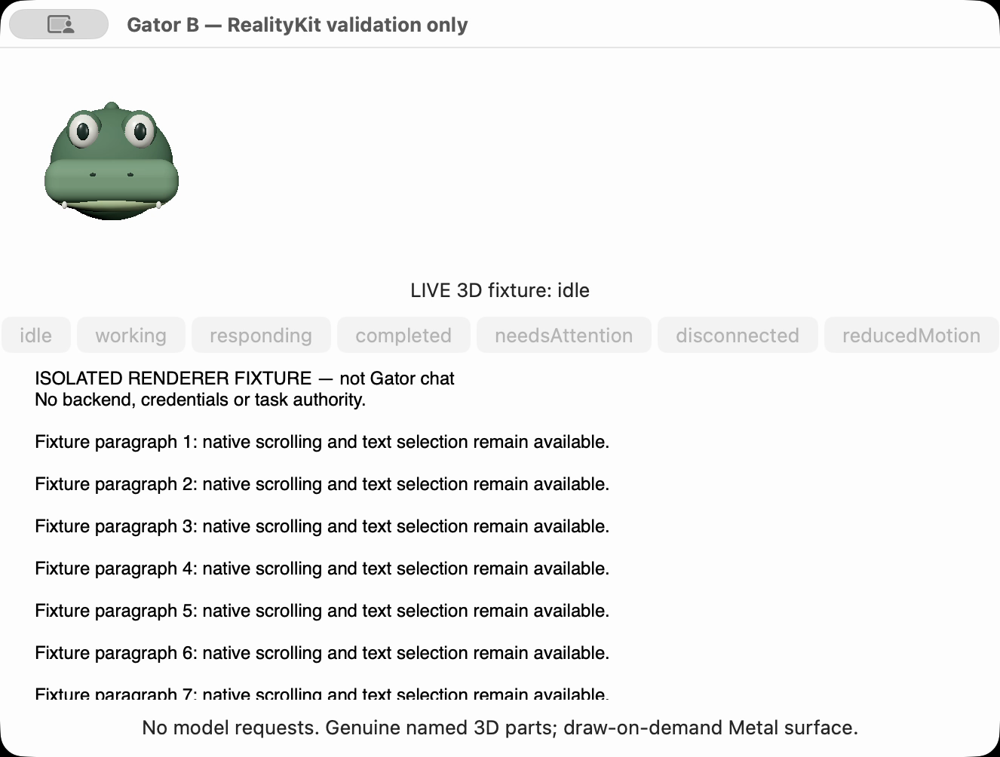

# P04M-A2 — Concept B renderer validation

**Verdict: PARTIAL. Gate 2 is NOT ACCEPTED; production integration has not started.** The approved character loads and animates as genuine RealityKit geometry. The resident-memory budget was not convincingly met across repeated comparisons. The current results do not authorize promoting the pilot into chat, preferences or native packaging.

This is a validation lab, not another application coordinator, a new Go owner or a desktop pet. No production Swift, Go, JavaScript, package manifest, native resource, application icon or build script was changed. The existing dirty P04 worktree is preserved. Starting HEAD: `12ee4a43b6677f4d01a4ab6882951a35d09ac678`.

## Asset and rig — Gate 0

**PASS on the available macOS 26.5.2 runtime.** Original A1 files remain unchanged. [Asset inventory and hashes](evidence/p04m-a2/assets.json), [USD tree](evidence/p04m-a2/usdtree.txt), [USD checker](evidence/p04m-a2/usdchecker.log).

| Property | Verified evidence |
| --- | --- |
| Approved identity | Unmodified Concept B: round green head, broad blunt snout, two eyes, nostrils, small teeth, pale movable lower jaw. No redesign. |
| Deployment model | `validation/Assets/Gator-B.usdz`, 58,290 bytes; one uncompressed, 64-byte-aligned `Gator-B.usdc` member. No external asset references or textures. |
| Geometry | 26 meshes; 14,164 triangles; 8,609 exported vertices. Real depth, normals and USD Preview Surface materials; not image planes. |
| Coordinates | Y up; one authored unit = one meter. Front is +Z. The pilot uses a perspective camera at approximately `(0, .08, 4.7)`, 34° field of view. |
| Root/head | `Gator_B/Head_Pivot`; head tilt independent of jaw rotation. |
| Jaw | `Head_Pivot/Jaw_Pivot/Lower_Jaw`; hinge translation `(0, -.30, .24)`. Local X rotation 0–0.5 radians opens the lower jaw. |
| Eyes | `Head_Pivot/Eye_Left` and `Eye_Right`, each retaining independent `Pupil`, `Upper_Lid`, `Lower_Lid` and `Closed_Eye_Line`. Pupil catchlights remain children. |
| Mouth | `Mouth_Interior` changes scale/position; `Tongue` visibility and position change separately. Neutral invisible parts must be explicitly enabled when posed. |
| Materials/light | Authored matte green/ivory/deep-green colors retained. Two directional lights, transparent background, no downloaded environment. Final pilot disables MSAA and renders at 224×224 before native compositing. |
| Multiple angles | Actual RealityKit front and rotated three-quarter outputs in `evidence/p04m-a2/demo/`; the camera is rendering geometry. |
| Editable source | Original `concepts/source/MascotLab.swift`, USDA and SCN archive preserved. Reproduction emits a **byte-identical** B USDA. Original SCN archive also loads and contains the required parts. |

Reproduction has an important ordering requirement: A1 exports **after its size-study renders**. SceneKit lazily materializes primitive meshes during rendering. Exporting immediately after constructing the primitives produced different tessellation; reproducing A1's rendering sequence recovered exactly the original USDA hash. See [reproduction result](evidence/p04m-a2/asset-reproduction.json), [source](validation/ReproduceAsset.swift) and [log](evidence/p04m-a2/reproduction.log). This is an authoring dependency, not a production SceneKit runtime requirement.

The system USD checker exits successfully and reports `Success!`, while also printing Apple's duplicate USD Connectable-behavior registration diagnostics. Those diagnostics are retained; this is not claimed to be a warning-free asset certification.

## Real-time architecture — Gate 1

**Functional native pilot verified; production lifecycle acceptance is separate.** [Rig](validation/MascotRig.swift), [renderer](validation/RealtimeRenderer.swift), [lab](validation/RendererLab.swift), [build script](validation/build.sh).

- `Entity(contentsOf:)` loads the bundle-local USDZ asynchronously, once per new presentation lifetime. State changes reuse the scene, parts, lights, camera, command queue, texture and camera output. The demo makes one model load for 96 requested render frames.
- A `@MainActor` rig binds the actual named entities. Absolute local transforms restore neutral poses without accumulating deltas. This is a rigid-part rig, not a skeleton or blendshape face.
- `RealityRenderer` draws only on explicit requests. A small AppKit `NSView` backed by `CAMetalLayer` presents the real GPU output. No WebView, timer-based idle render loop, `SceneEvents.Update` subscription or recreated scene per token is used.
- Each short transition interpolates a finite number of poses. Idle blink trials issue short bursts every seven seconds; responding fixtures issue restrained jaw changes. Between requests, the surface retains its last drawable. That retained live-rendered frame is distinct from the separate 2D static poster.
- GPU completion resumes a checked continuation without blocking the main actor. Only the continuation crosses the completion callback; entity and view mutations remain main-actor isolated. Strict Swift 6 compilation passes without `@unchecked Sendable`.
- Cancellation is checked between transition frames. Deterministic cancellation waits for a confirmed first frame, cancels the remainder, then verifies no additional frames and release of the renderer owner. Device loss or a permanently stalled GPU callback is **not** covered.
- Explicit teardown removes entities, releases the presentation's layer/device reference and removes its view. Weak references check retired renderer owners. Independent presentations load separate entity roots; changing one jaw leaves the other unchanged.
- Reduced-motion/static fixtures remove the live renderer and display the transparent cached B poster. Missing-asset failure retains that static UI. Reactive OS preference observation and automatic native-window occlusion handling are not production-implemented in this lab.

The first MetalKit host attempted to use cached drawables outside its delegate drawing lifecycle, producing a clipped character. Actual window captures exposed the error. The pilot now uses a small direct `CAMetalLayer`, checks the full drawable dimensions, and uses `framebufferOnly = false` because its presentation path blits into the drawable. Early measurements and recordings are explicitly separated from the final configuration.

| Fixture state | Actual geometry/presentation change |
| --- | --- |
| IDLE | Neutral head, open lids, closed jaw; separate blink bursts. |
| WORKING | Pupil gaze and slight head tilt. |
| RESPONDING | Small hinged jaw opening, cavity change and gaze. This fixture does not claim audio or word synchronization. |
| COMPLETED | Small positive jaw/tilt pose. A fixture button is **not** a Go-confirmed completion mapping. |
| NEEDS_ATTENTION | Lid expression, gaze and restrained tilt. Grants no authority. |
| DISCONNECTED | Concerned upper-lid angles and tilt. |
| REDUCED_MOTION | Cached static Concept B image; no live render task. |

The deterministic checks include **21 rig assertions**, **1,000 repeated pose cycles** and **six renderer/lifecycle assertions**. They cover independent articulation, neutral restoration, missing resource fallback, cancellation, two independent presentations and renderer-owner release. A separate [headless SDK check](validation/CheckRig.swift) repeats rig verification without a window and also checks independent roots, rejected missing assets and nonzero depth; actual extents are approximately 2.06×1.98×2.159 authored units. [Headless result](evidence/p04m-a2/headless-checks.json), [final native checks](evidence/p04m-a2/checks-final/measurements.json), [Metal API validation](evidence/p04m-a2/metal-validation.log). No Metal validation error was reported in that final check. These counts must not be added to the historical 227-test count.

## Native visual evidence



[Actual final native window recording](evidence/p04m-a2/live-renderer-window.mp4): ScreenCaptureKit captured only the isolated lab window, with no microphone, system audio or desktop. The successful final recording is 19.205 seconds, H.264, 1326×1004, 562 frames. Its readiness marker starts the scripted geometry transitions only after capture starts. It uses the final `Renderer-Lab.app`, including the corrected drawable usage flag. [Successful recording log](evidence/p04m-a2/recording-current.log), [final demo result](evidence/p04m-a2/demo-current/measurements.json). It is **not a recording of an integrated Gator chat**. An earlier successful 18.79-second recording is retained separately.

Compare [neutral](evidence/p04m-a2/live-neutral.png), [articulated lids](evidence/p04m-a2/live-eyelids.png) and [open jaw](evidence/p04m-a2/live-jaw.png), extracted from that recording. Additional transparent geometry renders show [blink](evidence/p04m-a2/demo/blink.png), [responding](evidence/p04m-a2/demo/responding.png) and [three-quarter depth](evidence/p04m-a2/demo/quarter.png). The video and transforms establish real motion; the stills alone do not.

An initial recorder attempt failed to initialize the window server. A second attempt outlived its source window. Neither is used as accepted recording evidence. The final recorder initializes AppKit, synchronizes capture readiness and confirms recording completion. One early benchmark was interrupted with cancellation; its cause was not established, and it is excluded. Benchmark controls are disabled to keep scripted measurements separate from interactive fixture buttons.

## Resource method — Gate 2

Environment: Apple M3, eight CPU cores, ten GPU cores, 16 GiB RAM; macOS 26.5.2; Swift 6.3.3 / SDK 26.5. Optimized standalone macOS-15-target binary. No Go process, provider fixture, network request or Gator profile is needed by this renderer-only lab. Baseline and live measurements use the same native window, static artwork, editable/scrollable fixture text and binary.

Process CPU is delta user+system CPU time from `getrusage`, divided by elapsed wall time: **100% means one fully used CPU core**. RSS comes from `mach_task_basic_info.resident_size`, sampled once per second. Tables distinguish interval medians from final samples; startup/focus/framework paging cause observable variation. These are resident memory measurements, not energy or total system graphics memory.

Warm render latency measures `RealityRenderer.updateAndRender` request through completion. It excludes the subsequent layer present and is **not display frame time, input latency, or production transcript-rendering performance**. A 10 ms main-actor heartbeat runs only during load. Its observed maximum gaps cannot establish absence of all stalls.

Initial runs exercised static, one idle mascot, occasional blinks, responding, two presentations, collapsed 40-point presentation, hidden teardown and reduced/static after teardown. Anti-aliasing was disabled and presentation sizing corrected. The optimized pre-final run measured:

| Mode | CPU, one core | Median RSS | Requested draws |
| --- | ---: | ---: | ---: |
| Static baseline, 12.54 s | 0.445% | 94.19 MiB | 0 |
| One idle, 15 s | 0.106% | 136.05 MiB | 0 |
| One idle with blinks, 15 s | 0.415% | 135.48 MiB | 12 |
| One responding, 14 s | 1.278% | 135.53 MiB | 48 |
| Two idle, 12 s | 0.078% | 142.99 MiB | 0 |
| Two responding, 13 s | 2.822% | 144.12 MiB | 80 |
| Collapsed idle, 12 s | 0.094% | 144.70 MiB | 0 |
| Hidden, renderer removed, 15 s | 0.270% | 144.73 MiB | 0 |
| Static after engine teardown, 12 s | 0.424% | 144.80 MiB | 0 |

Thus one live mascot added **41.86 MiB relative to the median static interval**, or **46.69 MiB relative to the settled final static sample**. After exercising two views, the retained footprint was about **50.6 MiB above the median cold baseline**. The CPU target looks promising; memory is borderline/over the suggested approximately 40 MiB target. Changing MSAA and fixing drawable sizing did not remove the retained overhead. This table predates the final `framebufferOnly` correction and is retained as investigative evidence, not final renderer acceptance. See raw [optimized run](evidence/p04m-a2/quick-optimized/measurements.json) and two earlier repetitions.

GPU utilization, energy, battery drain, Instruments traces, sleep/wake and actual macOS 15 runtime behavior are **NOT TESTED**. A functioning Metal renderer and GPU completion timing are not GPU energy measurements. No alternative renderer is claimed to be cheaper without measurement.

### Final configuration and gate decision

The final configuration sets the drawable's `framebufferOnly` to false for legal blit usage. It compiled strictly, passed the six native lifecycle assertions with Metal API validation enabled, and completed a separate **125.06-second normal, non-validation** resource run. Debug-layer timings are excluded from the following table. [Final raw measurements](evidence/p04m-a2/quick-current/measurements.json), [machine-readable assessment](evidence/p04m-a2/results-summary.json).

| Final mode | CPU, one core | Median RSS | Final RSS | Draw requests |
| --- | ---: | ---: | ---: | ---: |
| Static baseline | 0.453% | 94.61 MiB | 89.17 MiB | 0 |
| One idle | 0.702% | 136.58 MiB | 137.19 MiB | 0 |
| One with blinks | 0.793% | 137.33 MiB | 137.33 MiB | 12 |
| One responding | 1.934% | 137.38 MiB | 137.41 MiB | 48 |
| Two idle | 0.144% | 144.58 MiB | 144.55 MiB | 0 |
| Two responding | 3.385% | 144.63 MiB | 144.66 MiB | 80 |
| Collapsed idle | 0.124% | 145.09 MiB | 145.05 MiB | 0 |
| Hidden, renderer removed | 0.338% | 145.12 MiB | 145.12 MiB | 0 |
| Static after teardown | 0.579% | 145.14 MiB | 145.14 MiB | 0 |

The final one-idle difference is **41.97 MiB versus the median static interval**, or **48.02 MiB versus the settled static sample**. After exercising both presentations, the retained difference is **50.53 MiB versus the median baseline**. The first two investigative runs and the optimized repetition showed the same broad retained-cost pattern. Baseline sampling has noise; it is not appropriate to select only the most favorable startup sample to certify the approximately 40 MiB target.

First asset/scene load was **216.33 ms**, plus **17.09 ms** to first offscreen frame completion. Later presentation loads were **70.87–104.43 ms**. During responding, offscreen request-to-completion p50/p95 was **4.09/7.88 ms**. The largest normal load-time main-actor heartbeat gap was **35.48 ms**, against a nominal 10 ms interval. These values do not establish absence of typing/scrolling stalls or represent full frame-presentation time.

An earlier **642.48-second mixed lifecycle trial** completed ten visible/responding/hidden cycles, alternating 112- and 40-point presentations: ten model loads, 690 requested frames. Visible RSS increased from 139.72 MiB on the first cycle to 142.58 MiB on the last; later cycles stayed around 142–143 MiB rather than growing on each cycle. Hidden CPU was 0.273–0.299%; every hidden interval had zero draws and zero surviving retired renderer owners. [Full earlier lifecycle data](evidence/p04m-a2/lifecycle-before-presenter-flag-fix/measurements.json). A brief independent Metal-check process ran during that earlier trial; it is not an exclusively idle-machine benchmark.

**That ten-minute trial predates the final drawable usage-flag correction.** It is useful resource/ownership evidence, not ten-minute acceptance of the final renderer. The final configuration was not given another ten-minute qualification run because its short comparison already left the resource gate unaccepted. No integrated Gator ten-minute trial occurred.

There is no demonstrated retained **renderer owner** after teardown. Persistent RSS alone is not proof of an actual leak. **[Inference]** engine/framework/driver caches or allocator residency may explain part of the remaining footprint; allocation attribution was not measured. CPU behavior and explicit idle/hidden draw counts are encouraging, but they do not waive the memory target.

| Gate | Decision |
| --- | --- |
| 0 — asset | **PASS**, within the available runtime; original source reproduced exactly and rig/geometry verified. |
| 1 — isolated real-time renderer | **PASS for the functional pilot**: genuine transparent 3D, independent articulation, reusable scene, finite transitions, static/missing-resource fallback, strict build and final Metal API check. Full production lifecycle and OS preference acceptance are not claimed. |
| 2 — resources/lifecycle | **PARTIAL / NOT ACCEPTED**: low idle/hidden CPU and owner release verified; RAM remains borderline/over target across repeats. Final ten-minute qualification, representative typing/scrolling impact and production startup impact remain unverified. |
| Production integration | **STOPPED before any production edit**, as required. |

Recommended correction path: attribute the retained allocations and evaluate a representative **isolated SwiftUI host** against its own static baseline, then test bounded asset reuse and teardown without keeping an active hidden renderer. This AppKit lab is not the same baseline as Gator's existing SwiftUI/Metal stack; no claim is made that the same increment would carry directly into Gator. A budget exception should be an explicit review of these figures, not an implicit acceptance. If a different native 3D renderer is evaluated, measure it independently; SceneKit's deprecation and raw Metal's maintenance burden make neither an automatic better choice. Preserve Concept B and the current accepted app meanwhile.

Only the isolated artifact is delivered: **`/tmp/Gator-Mascot-P04M-A2-Renderer-Lab.app`**. Its model/poster are bundled and loaded through `Bundle.main`, not the source checkout. No `/tmp/Gator-Native-P04M-A2.app` was created.

## Compatibility and official references

The standalone build uses `-swift-version 6 -strict-concurrency=complete -warnings-as-errors -target arm64-apple-macosx15.0`. Mach-O reports minimum 15.0, SDK 26.5. It uses macOS-15 RealityKit loading/RealityRenderer APIs, ordinary Metal/Core Animation and AppKit. The production target is unchanged. **macOS 15 runtime acceptance remains NOT TESTED.**

Reviewed [Apple RealityView](https://developer.apple.com/documentation/realitykit/realityview/), [automatic entity animation](https://developer.apple.com/documentation/realitykit/automatically-animating-realitykit-entities), [RealityRenderer](https://developer.apple.com/documentation/realitykit/realityrenderer) and [CAMetalLayer framebufferOnly](https://developer.apple.com/documentation/quartzcore/cametallayer/framebufferonly). The pilot uses explicit compatible transforms and finite draws rather than relying on the newer implicit-animation examples or assuming that a SwiftUI state-update closure stops rendering.

## Reproduction commands

Run from the repository root; choose fresh destination/output paths:

```sh
P04M_VALIDATION_APP=/tmp/Gator-Mascot-P04M-A2-Renderer-Lab.app \
  bash macos/mascot/validation/build.sh
open -n /tmp/Gator-Mascot-P04M-A2-Renderer-Lab.app \
  --args --mode checks --output /tmp/gator-mascot-a2-checks-final
open -n /tmp/Gator-Mascot-P04M-A2-Renderer-Lab.app \
  --args --mode quick --output /tmp/gator-mascot-a2-quick-current
open -n /tmp/Gator-Mascot-P04M-A2-Renderer-Lab.app \
  --args --mode lifecycle --output /tmp/gator-mascot-a2-lifecycle-current

swiftc -parse-as-library -swift-version 6 -O -D MASCOT_PREVIEW \
  -target arm64-apple-macosx15.0 \
  macos/mascot/concepts/source/MascotLab.swift \
  macos/mascot/validation/ReproduceAsset.swift -o /tmp/gator-a2-reproduce
/tmp/gator-a2-reproduce /tmp/Gator-B-reproduced.usda \
  macos/mascot/concepts/models/Gator-B.scn
cmp /tmp/Gator-B-reproduced.usda macos/mascot/concepts/models/Gator-B.usda
/usr/bin/usdchecker macos/mascot/validation/Assets/Gator-B.usdz

swiftc -parse-as-library -swift-version 6 -strict-concurrency=complete \
  -warnings-as-errors -O -target arm64-apple-macosx15.0 \
  macos/mascot/validation/MascotRig.swift \
  macos/mascot/validation/CheckRig.swift -o /tmp/gator-a2-check-rig
/tmp/gator-a2-check-rig macos/mascot/validation/Assets/Gator-B.usdz

open -n --env MTL_DEBUG_LAYER=1 \
  --stderr /tmp/gator-mascot-a2-metal-validation.log \
  /tmp/Gator-Mascot-P04M-A2-Renderer-Lab.app \
  --args --mode checks --output /tmp/gator-mascot-a2-checks-final
```

The `interactive` mode is a manual, isolated expression lab. `demo` accepts `--record-ready PATH`, which waits for the native recorder's readiness file. [Recorder source](validation/RecordWindow.swift) captures only this bundle's exact lab window. No system-wide preference or privacy setting is changed.
